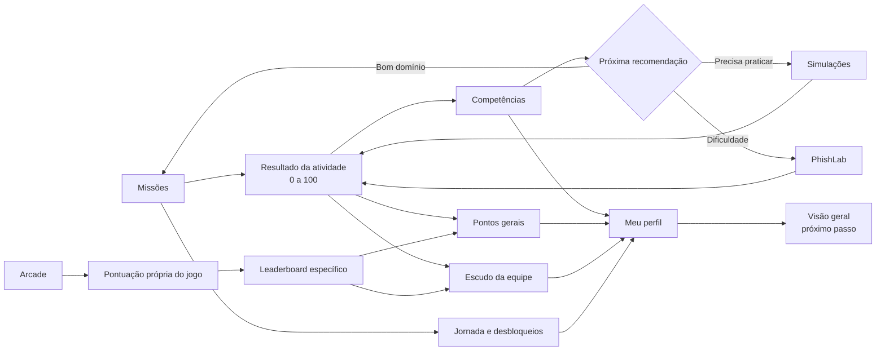
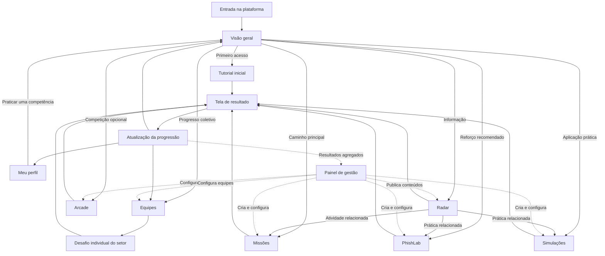

# Fortifica

## 1. Objetivo da plataforma

A **Fortifica** é uma proposta de plataforma interna gamificada para conscientizar e capacitar os funcionários da Leroy Merlin sobre phishing.

O objetivo é desenvolver habilidades práticas para:

- observar sinais de fraude;
- investigar mensagens, links, páginas, anexos e QR Codes;
- verificar solicitações por canais confiáveis;
- tomar decisões seguras;
- reportar situações suspeitas;
- reagir corretamente após um clique ou compartilhamento de informação;
- colaborar com a proteção da equipe.

O projeto apresenta a estrutura e o funcionamento pretendido para a plataforma. Os conteúdos educativos definitivos ainda precisarão ser produzidos e validados pelas áreas responsáveis.

## 2. Decisões atuais do projeto

- A plataforma não será organizada em temporadas.
- Missões formarão uma jornada única e contínua.
- Novas missões poderão ser adicionadas ao final dessa jornada futuramente.
- O resultado individual será privado e usado para feedback e recomendação de conteúdo.
- Velocidade não será o principal critério de pontuação.
- Erros não bloquearão o avanço nem serão exibidos publicamente.
- A aba **Arcade será um catálogo de jogos e minigames desenvolvidos separadamente**, com pontos e leaderboards específicos por jogo.
- Detector Relâmpago possui uma especificação provisória pronta para integração futura; os demais jogos ainda poderão ser reformulados.
- O protótipo visual existente poderá manter elementos antigos até que a próxima versão seja planejada.

## 3. Funcionamento geral

A plataforma oferece um caminho recomendado, mas permite exploração livre. A Visão geral funciona como orientadora e apresenta a atividade mais adequada conforme o progresso e as competências do funcionário.

O ciclo principal será:

1. **Visão geral:** recomenda a próxima atividade.
2. **Missões:** apresenta o contexto e o objetivo.
3. **Simulações:** coloca o funcionário em uma situação prática.
4. **Resultado:** avalia investigação, decisão, justificativa e ação segura.
5. **PhishLab:** reforça uma competência quando uma dificuldade é identificada.
6. **Arcade:** oferece jogos específicos e pontos conforme a posição em cada leaderboard.
7. **Meu perfil:** registra a evolução, os pontos e agenda revisões.
8. **Equipes:** recebe a contribuição para o escudo coletivo.
9. **Visão geral:** recomenda o próximo passo.

O Radar permanece disponível a qualquer momento. O atalho global **Como reportar** foi retirado em 2026-08-16 porque ainda não existe um procedimento corporativo configurado para este protótipo; orientações fictícias necessárias permanecem dentro de cada atividade. O Painel de gestão é restrito aos responsáveis pelo programa e não faz parte da jornada comum do funcionário.

## 4. Modelo de progressão

A progressão não dependerá de um único número. O sistema separa aprendizagem, jornada, gamificação, competição e resultado coletivo.

| Indicador | O que representa |
|---|---|
| Pontuação da atividade | Qualidade daquela tentativa específica. |
| Competências | O que o funcionário realmente aprendeu. |
| Jornada | Missões concluídas e desbloqueadas. |
| Pontos gerais | Progressão gamificada do perfil. |
| Pontuação do Arcade | Desempenho e posição em cada jogo. |
| Escudo da equipe | Evolução coletiva. |

O fluxo dos resultados será:



### 4.1 Pontuação da atividade

Cada Missão, Simulação ou PhishLab gera uma nota de 0 a 100.

Essa nota serve para:

- produzir feedback;
- identificar dificuldades;
- atualizar competências;
- calcular um bônus de pontos gerais;
- recomendar a próxima atividade.

Ela não entra em um leaderboard público.

As fórmulas serão:

| Atividade | Critérios |
|---|---|
| Missões | Investigação 30%, decisão 30%, justificativa 20% e ação segura 20%. |
| Simulações | Identificação 30%, ação 30%, evidências 25% e controle de falsos positivos 15%. |
| PhishLab | Evidências 30%, conclusão 25%, uso das ferramentas 20% e segundo caso 25%. |

Velocidade não participa dessas pontuações.

### 4.2 Competências individuais

Os resultados atualizam habilidades específicas:

- observar;
- investigar;
- verificar;
- decidir;
- reportar;
- recuperar;
- orientar.

Cada competência possui os seguintes níveis:

| Nível | Condição aproximada |
|---|---|
| Não avaliada | Nenhuma atividade relacionada concluída. |
| Em desenvolvimento | Concluiu uma atividade guiada. |
| Em prática | Demonstrou a habilidade uma vez sem ajuda. |
| Consolidada | Demonstrou em dois contextos diferentes. |
| Dominada | Demonstrou em três contextos, incluindo uma revisão posterior. |

Um único resultado excelente não domina automaticamente uma competência.

Resultados baixos não reduzem um nível já alcançado. Eles acrescentam o status **Revisão recomendada**.

### 4.3 Progresso da jornada

O progresso da jornada considera as Missões principais.

Regras:

- concluir uma missão desbloqueia a próxima;
- não é necessário obter uma nota mínima;
- um resultado baixo gera uma recomendação de reforço;
- missões secundárias são opcionais;
- o desafio integrador é liberado após as missões principais;
- pontos gerais não bloqueiam a história;
- posição no Arcade não bloqueia conteúdo educativo.

### 4.4 Pontos gerais

Pontos gerais representam participação e progressão gamificada. Eles nunca diminuem.

Valores iniciais:

| Ação | Pontos-base |
|---|---:|
| Missão principal concluída | 100 |
| Missão secundária concluída | 40 |
| Simulação concluída | 70 |
| PhishLab concluído | 60 |
| Desafio individual do setor concluído | 80 |
| Conteúdo do Radar concluído | 5 |
| Arcade | Depende da posição no leaderboard. |

A pontuação da atividade gera um bônus:

- resultado abaixo de 60: sem bônus;
- resultado entre 60 e 74: bônus de 10%;
- resultado entre 75 e 89: bônus de 20%;
- resultado entre 90 e 100: bônus de 30%.

A conclusão sempre gera os pontos-base. Assim, o funcionário não é punido por errar enquanto aprende.

No Radar, concluir significa ler o conteúdo e responder corretamente à pergunta de verificação. Essa recompensa é fixa, não recebe bônus de desempenho e só pode ser obtida uma vez por conteúdo.

Repetir exatamente a mesma atividade não concede novamente os pontos-base. Uma revisão com outro exemplo é considerada uma nova atividade válida.

Os pontos gerais poderão:

- aumentar o nível geral do perfil;
- liberar conquistas;
- personalizar elementos visuais;
- participar de objetivos coletivos;
- demonstrar constância na plataforma.

Eles não representam domínio técnico.

### 4.5 Arcade e leaderboards

Cada jogo possui duas pontuações separadas:

1. **Pontuação do jogo:** calculada pelas regras daquela partida.
2. **Pontos gerais recebidos:** definidos pela posição no leaderboard.

Somente o melhor resultado válido de cada funcionário aparece no leaderboard.

| Melhor faixa alcançada | Recompensa total provisória |
|---|---:|
| 1º lugar | 100 |
| Top 3 | 75 |
| Top 10 | 50 |
| Top 25 | 25 |
| Participação válida | 10 |

Os leaderboards são permanentes e específicos por jogo. Não existem temporadas, rodadas ou reinícios periódicos. Ao alcançar uma faixa superior, o funcionário recebe somente a diferença entre a recompensa já obtida e o novo total. Perder posições posteriormente não remove pontos já confirmados.

Missões secundárias relacionadas ao Arcade concedem uma recompensa própria. Os pontos do leaderboard são entregues separadamente.

### 4.6 Escudo da equipe

O escudo possui uma progressão de 0 a 100.

| Faixa | Nível coletivo |
|---|---|
| 0 a 24 | Em construção |
| 25 a 49 | Reforçado |
| 50 a 74 | Protegido |
| 75 a 100 | Resiliente |

Na primeira versão funcional de Equipes, o escudo acompanha a mesma nota coletiva utilizada no ranking:

- participação do setor, com peso de 40%;
- precisão coletiva, com peso de 40%;
- cobertura de competências, com peso de 20%.

Os três componentes são percentuais normalizados. Pontos gerais e posições individuais do Arcade não entram diretamente nessa nota. Assim, uma equipe maior ou uma pessoa com muitos pontos não cria vantagem automática.

Erros não retiram pontos do escudo. Repetições da mesma atividade também não geram contribuições ilimitadas.

### 4.7 Revisão adaptativa

A plataforma recomenda reforço quando:

- a pontuação fica abaixo de 60;
- uma evidência importante é ignorada;
- existem muitos falsos positivos;
- uma ação insegura é selecionada;
- uma competência precisa ser revisada.

O caminho recomendado será:

1. dificuldade identificada;
2. PhishLab guiado;
3. novo exemplo sem ajuda;
4. Simulação em outro contexto;
5. competência atualizada.

A revisão é recomendada, mas não impede o funcionário de continuar a jornada.

### 4.8 Exemplo de progressão

Um funcionário conclui uma Missão com 72 pontos:

- recebe 100 pontos-base;
- recebe 10 pontos de bônus;
- desbloqueia a próxima Missão;
- acrescenta evidência às competências Investigar e Decidir;
- contribui para o escudo;
- recebe recomendação de PhishLab por ter ignorado o domínio.

Depois, ele joga por meio de uma missão secundária e termina em oitavo lugar:

- conclui a missão secundária e recebe 40 pontos;
- fica no Top 10 do jogo;
- recebe a diferença necessária para totalizar a recompensa de 50 pontos do Top 10;
- o melhor resultado aparece em Meu perfil.

Em resumo: **competências medem aprendizagem; pontos medem progressão; leaderboards medem desempenho nos jogos; e o escudo mede a equipe.**

## 5. Abas da plataforma

### 5.1 Visão geral

#### Função da aba

Visão geral é a página inicial da plataforma e o ponto de entrada da jornada. Sua principal função é responder:

> **O que eu deveria fazer agora?**

Ela não oferece um tipo próprio de treinamento. Reúne informações resumidas das outras abas, apresenta uma ação principal e encaminha o funcionário para o local correto.

#### Cabeçalho pessoal

O topo apresenta somente as informações essenciais:

- nome do funcionário;
- nível geral atual;
- pontos gerais;
- porcentagem da jornada concluída;
- saudação ou mensagem contextual.

Exemplo:

> Olá, Lucas! Você concluiu 42% da sua jornada e está no nível Reforço.

Os detalhes sobre níveis, pontos e evolução permanecem em Meu perfil.

#### Card Seu próximo passo

É o principal elemento da página e apresenta uma única atividade recomendada.

O card informa:

- nome da atividade;
- tipo: Missão, revisão, Simulação ou PhishLab;
- breve explicação;
- motivo da recomendação;
- duração aproximada;
- recompensa disponível;
- botão para iniciar ou continuar.

Exemplo:

> **Próximo passo: Missão 3 — Entrega por QR Code**
>
> Aprenda a identificar QR Codes que levam a páginas falsas.
>
> Duração aproximada: 8 minutos. Recompensa: 100 pontos.

A escolha segue esta ordem:

1. se houver uma atividade incompleta, apresentar Continuar atividade;
2. se uma revisão importante tiver sido gerada, apresentá-la como recomendação principal;
3. caso contrário, apresentar a próxima Missão da jornada;
4. quando a jornada principal estiver concluída, recomendar uma Simulação, conteúdo do Radar, desafio do setor ou outra atividade relevante.

Uma revisão recomendada não bloqueia a próxima Missão. O funcionário pode continuar a jornada normalmente.

#### Primeiro acesso

No primeiro acesso, a página é simplificada para evitar informações vazias ou excesso de opções.

Ela apresenta:

- uma breve introdução à plataforma;
- o tutorial Investigando uma mensagem como próximo passo;
- competências marcadas como Ainda não avaliadas;
- uma explicação curta sobre pontos, Missões e Equipes.

Depois da conclusão do tutorial, os demais componentes do painel passam a ser apresentados.

#### Resumo da jornada

Uma seção compacta mostra:

- última Missão concluída;
- Missão atual;
- próxima Missão;
- quantidade de Missões concluídas;
- barra de progresso da jornada;
- botão Ver jornada completa.

O botão abre Missões, onde está o caminho completo. A Visão geral mostra somente o momento atual da jornada.

#### Recomendações personalizadas

Abaixo da ação principal podem aparecer até três recomendações secundárias, como:

- praticar análise de links no PhishLab;
- realizar uma Simulação para reforçar uma competência;
- ler um conteúdo relacionado no Radar;
- participar de uma Missão secundária vinculada ao Arcade;
- contribuir para um desafio e uma meta do setor.

Cada recomendação explica o motivo pelo qual foi apresentada.

Exemplo:

> Você teve dificuldade para identificar o domínio verdadeiro na última Missão. Pratique no Analisador de Links.

#### Conteúdo em destaque do Radar

A página apresenta somente um conteúdo educativo relevante do Radar, sem indicar que existe uma ameaça ativa na empresa.

O cartão mostra:

- título;
- resumo em uma frase;
- categoria;
- tempo estimado de leitura;
- botão Ver conteúdo.

Exemplo:

> **No Radar: golpes com documentos compartilhados**
>
> Veja por que um arquivo aparentemente normal pode levar a uma página falsa.
>
> Tempo de leitura: 3 minutos.

O conteúdo completo permanece na aba Radar.

#### Resumo da equipe

Um cartão apresenta:

- nome da equipe;
- nível atual do escudo coletivo;
- progresso para o próximo nível;
- meta coletiva ativa;
- indicação resumida da contribuição do funcionário.

O botão Ver equipe abre Equipes, onde ficam ranking, metas, desafios do setor e histórico coletivo.

#### Destaque opcional do Arcade

Arcade não ocupa a ação principal da página, mas pode aparecer quando houver:

- um novo jogo;
- uma Missão secundária relacionada;
- mudança de posição em um leaderboard;
- recompensa de colocação disponível;
- desafio relevante para uma competência.

A Visão geral apresenta apenas o recorde, a posição ou o desafio relevante. O leaderboard completo permanece no Arcade.

#### Atividade recente

Uma área resumida mostra as últimas atualizações, como:

- Missão concluída;
- competência atualizada;
- pontos recebidos;
- conquista desbloqueada;
- contribuição enviada para o escudo da equipe.

O histórico completo permanece em Meu perfil.

#### Atualização depois de uma atividade

Ao concluir uma atividade, a Visão geral atualiza:

- pontos gerais;
- progresso da jornada;
- competência relacionada;
- contribuição para a equipe;
- nova recomendação;
- próxima Missão disponível.

Exemplo:

> Missão concluída! +120 pontos gerais. A competência Análise de links avançou para Praticando. Próxima recomendação: Analisador de Domínios no PhishLab.

#### Funcionamento depois da jornada principal

Quando todas as Missões principais forem concluídas, a página continua útil e passa a recomendar:

- novas Simulações;
- revisões de competências;
- conteúdos do Radar;
- desafios individuais do setor;
- Missões secundárias;
- atividades do Arcade.

Isso mantém a plataforma ativa sem depender de temporadas.

#### Caminho principal do usuário

O fluxo mais comum é:

1. entrar pela Visão geral;
2. visualizar o próximo passo recomendado;
3. realizar uma Missão ou atividade de reforço;
4. receber o resultado;
5. voltar à Visão geral atualizada;
6. continuar a jornada ou escolher uma recomendação secundária;
7. consultar Meu perfil, Radar, Equipes ou Arcade quando desejar.

Assim, existe um caminho orientado sem impedir a exploração livre das outras abas.

#### Diferença para as outras abas

- **Visão geral:** mostra o que fazer agora.
- **Missões:** apresenta o caminho educacional completo.
- **Meu perfil:** detalha evolução, competências e histórico pessoal.
- **Radar:** informa e contextualiza técnicas, tendências e notícias sobre phishing.
- **Equipes:** apresenta metas, escudo e placar coletivo alimentado por desafios individuais.
- **Arcade:** concentra jogos, recordes e leaderboards.
- **PhishLab:** oferece prática investigativa.
- **Simulações:** testa decisões em situações completas.

---

## 6. Missões — definição detalhada

### 6.1 Função da aba

Missões será a jornada narrativa e o principal caminho de progressão da plataforma.

Cada missão apresenta uma situação de phishing com contexto, personagens, decisões e consequências. Ela pode utilizar componentes das Simulações para representar e-mails, mensagens, QR Codes, páginas ou outros canais.

Missões responde principalmente à pergunta:

> **O que o funcionário faria diante dessa situação?**

### 6.2 Estrutura da página inicial

A página de Missões deverá conter:

#### Próxima missão recomendada

- principal destaque da página;
- título e resumo do caso;
- duração aproximada;
- dificuldade;
- competências trabalhadas;
- botão Continuar jornada.

#### Trilha de missões

Sequência visual mostrando toda a jornada disponível.

Cada missão pode apresentar um dos seguintes estados:

- bloqueada;
- disponível;
- em andamento;
- concluída;
- revisão recomendada.

#### Progresso geral

- percentual da trilha concluída;
- competências desenvolvidas;
- pontos de contribuição coletiva;
- próxima conquista significativa.

#### Revisões adaptativas

Atividades recomendadas quando uma habilidade precisa ser reforçada. As revisões não bloqueiam obrigatoriamente a próxima missão.

### 6.3 Tipos de missão

| Tipo | Obrigatória | Função |
|---|---:|---|
| Tutorial | Apenas no primeiro acesso | Ensinar a utilizar as ferramentas da plataforma. |
| Principal | Sim | Avançar a jornada e apresentar uma nova situação. |
| Adaptativa | Recomendada | Reforçar uma dificuldade detectada. |
| Secundária | Não | Oferecer uma variação ou encaminhar o funcionário para um jogo específico do Arcade. |
| Integradora | Sim | Combinar várias técnicas e competências no encerramento da trilha inicial. |

### 6.4 Trilha inicial sugerida

1. **Tutorial: Investigando uma mensagem** — ensina a utilizar as ferramentas.
2. **O aviso de bloqueio** — e-mail, remetente, domínio e urgência.
3. **A entrega reagendada** — QR Code e página falsa.
4. **O pedido do gestor** — falsificação de identidade e verificação por outro canal.
5. **O documento inesperado** — links e anexos suspeitos.
6. **Cliquei; e agora?** — reporte, contenção e recuperação.
7. **Desafio integrador** — caso multicanal reunindo várias competências.

### 6.5 Fluxo interno de uma missão

#### 1. Briefing

Apresenta:

- situação;
- personagem;
- canal utilizado;
- objetivo do funcionário;
- competências avaliadas;
- duração aproximada.

O briefing deve ser curto e não pode revelar previamente quais elementos são suspeitos.

#### 2. Cena prática

A missão utiliza uma interface de simulação para apresentar o caso. Pode haver entre uma e três cenas.

Exemplos de interface:

- caixa de e-mail;
- conversa de chat;
- mensagem de celular;
- QR Code;
- página de login fictícia;
- anexo inerte;
- ligação ou áudio simulado.

#### 3. Investigação

O funcionário pode consultar:

- endereço completo do remetente;
- destino de links;
- histórico da conversa;
- informações do anexo;
- contexto da solicitação;
- canal alternativo de verificação.

#### 4. Decisão

As opções dependem do caso e podem incluir:

- reportar;
- verificar por outro canal;
- excluir;
- bloquear;
- solicitar uma segunda análise;
- liberar;
- responder;
- abrir um elemento fictício;
- iniciar recuperação.

Depois de decidir, o funcionário seleciona as evidências que justificam sua escolha.

#### 5. Consequência

A decisão produz uma consequência dentro da narrativa.

Exemplos:

- ao reportar, outras pessoas são alertadas;
- ao verificar, o funcionário descobre que o pedido não era verdadeiro;
- ao apenas excluir, protege a própria conta, mas não alerta a equipe;
- ao abrir o link, entra em uma sequência educativa de contenção e recuperação.

As ramificações podem se separar por uma ou duas cenas e depois retornar ao mesmo objetivo pedagógico. Isso reduz a quantidade de conteúdo necessário sem eliminar a sensação de consequência.

#### 6. Debrief

Ao final, a missão mostra:

- sinais importantes;
- pistas enganosas;
- consequência da decisão;
- competências demonstradas;
- pontuação;
- próximo passo recomendado.

### 6.6 Pontuação das missões

Uma distribuição possível é:

- 30 pontos pela investigação;
- 30 pontos pela decisão;
- 20 pontos pela justificativa;
- 20 pontos pela ação segura ou reporte.

Velocidade não deve conceder pontos nas Missões. O resultado é individual e privado.

### 6.7 Regras de progressão

- A primeira missão funciona como tutorial.
- A próxima missão é liberada quando a anterior é concluída.
- Um resultado baixo não impede o avanço.
- Dificuldades geram recomendações de PhishLab ou revisão adaptativa.
- Algumas missões secundárias podem solicitar a participação em um jogo específico do Arcade.
- Missões podem ser refeitas com variações.
- A primeira tentativa tem maior valor para a progressão.
- Revisões reaparecem posteriormente em outro contexto.
- Novas missões podem ser acrescentadas ao final da trilha sem reiniciar o progresso.

### 6.8 Como evitar repetição

Cada missão pode ter variações de:

- remetente;
- assunto;
- domínio;
- canal;
- técnica de persuasão;
- quantidade de pistas;
- ordem das cenas;
- contexto profissional;
- nível de dificuldade.

A recomendação inicial é utilizar aproximadamente 70% de situações gerais e 30% de contextos relacionados às áreas de loja, logística, matriz ou tecnologia.

---

## 7. Simulações — definição detalhada

### 7.1 Função da aba

Simulações será o ambiente de prática realista e repetível.

Diferentemente das Missões, não precisa de uma narrativa longa. Diferentemente do PhishLab, não analisa apenas um elemento isolado. O funcionário recebe um conjunto de mensagens e precisa tratar corretamente todo o ambiente.

Simulações responde principalmente à pergunta:

> **O funcionário consegue aplicar o conhecimento durante a rotina?**

### 7.2 Decisão sobre a quantidade de caixas

Não haverá apenas uma mensagem nem várias caixas abertas simultaneamente.

A estrutura será:

- a página apresenta diferentes pacotes de simulação;
- cada pacote abre um único ambiente;
- dentro desse ambiente aparecem várias mensagens;
- mensagens legítimas, fraudulentas e duvidosas aparecem misturadas.

Simulações avançadas poderão utilizar abas para representar canais diferentes dentro do mesmo caso.

### 7.3 Estrutura da página inicial

A página deverá apresentar:

#### Simulação recomendada

- escolhida com base nas competências do funcionário;
- canal utilizado;
- dificuldade;
- duração;
- habilidade principal.

#### Pacotes disponíveis

- caixa de e-mail;
- central de mensagens;
- ataque multicanal.

#### Histórico individual

- simulações concluídas;
- taxa de identificação;
- reportes corretos;
- falsos positivos;
- competências que precisam de revisão.

#### Níveis de dificuldade

- guiada;
- intermediária;
- avançada.

### 7.4 Pacotes iniciais

#### 1. Caixa de entrada do expediente

Uma caixa com aproximadamente seis e-mails, incluindo:

- mensagens legítimas;
- phishing evidente;
- phishing elaborado;
- mensagem legítima que precisa de verificação;
- tentativa com link;
- tentativa com anexo.

O objetivo é tratar toda a caixa de entrada, não apenas localizar uma mensagem falsa.

#### 2. Central de mensagens

Apresenta quatro ou cinco conversas:

- pedido urgente de um gestor;
- mensagem de um colega;
- suposto suporte técnico;
- solicitação de código;
- comunicação legítima.

Trabalha falsificação de identidade, pressão e verificação por outro canal.

#### 3. Ataque multicanal

Apresenta uma sequência conectada:

1. e-mail inicial;
2. mensagem reforçando o pedido;
3. QR Code ou página de confirmação;
4. decisão sobre o conjunto do incidente.

É o pacote mais difícil e pode ser recomendado após as simulações básicas.

### 7.5 Composição das mensagens

Uma caixa pode utilizar aproximadamente:

- 50% de mensagens legítimas;
- 30% de phishing;
- 20% de mensagens legítimas que exigem verificação.

Essa mistura evita que o funcionário considere tudo seguro ou reporte tudo indiscriminadamente.

### 7.6 Fluxo de uma simulação

1. Escolher ou receber uma simulação recomendada.
2. Abrir o ambiente simulado.
3. Ler e inspecionar cada mensagem.
4. Escolher uma ação para cada item.
5. Concluir a triagem.
6. Receber o relatório final.
7. Atualizar as competências.
8. Receber uma recomendação de Missão, PhishLab, Arcade ou nova Simulação.

### 7.7 Ações disponíveis

Para cada mensagem, o funcionário poderá:

- marcar como legítima;
- verificar por outro canal;
- reportar;
- excluir;
- bloquear;
- solicitar uma segunda análise;
- abrir links ou anexos fictícios;
- iniciar recuperação após uma interação simulada.

Não basta classificar como phishing ou legítima. A ação escolhida também será avaliada.

### 7.8 Ferramentas de investigação

- endereço completo do remetente;
- destino do link;
- histórico da conversa;
- informações do anexo;
- contexto da solicitação;
- alertas relacionados;
- canal alternativo de verificação.

Quando for necessária uma análise aprofundada, a Simulação pode encaminhar o funcionário para uma estação do PhishLab.

### 7.9 Feedback

#### Simulação guiada

Utilizada no tutorial. O feedback aparece depois de cada decisão.

#### Simulação normal

O resultado aparece após toda a caixa ser tratada. Isso impede que o funcionário utilize uma resposta anterior para acertar automaticamente as seguintes.

O relatório final mostra:

- mensagens tratadas corretamente;
- phishing não identificado;
- mensagens legítimas reportadas;
- ações seguras utilizadas;
- evidências ignoradas;
- competências desenvolvidas.

### 7.10 Pontuação

Uma distribuição possível é:

- 30 pontos pela identificação;
- 30 pontos pela ação escolhida;
- 25 pontos pelas evidências utilizadas;
- 15 pontos pelo equilíbrio entre detecção e falsos positivos.

Velocidade não precisa conceder pontos.

### 7.11 Variações e repetição

Cada pacote terá um banco de variações:

- remetentes diferentes;
- assuntos diferentes;
- domínios alterados;
- mensagens em outra ordem;
- técnicas de persuasão diferentes;
- versões legítimas e fraudulentas do mesmo contexto.

A primeira tentativa conta integralmente para a progressão. Repetições permanecem disponíveis para prática, mas oferecem menor contribuição ao progresso.

---

## 8. PhishLab — definição detalhada

### 8.1 Função da aba

PhishLab será o laboratório de investigação digital. Ele oferece ferramentas e exercícios guiados para compreender como encontrar evidências.

Não terá uma caixa de entrada completa nem uma narrativa longa. Cada atividade apresenta um artefato específico para análise cuidadosa.

PhishLab responde principalmente à pergunta:

> **Como o funcionário chegou à conclusão de que algo é suspeito?**

### 8.2 Formas de acesso

O PhishLab poderá ser acessado:

- livremente pela navegação;
- por recomendação após uma Missão;
- por recomendação após uma Simulação;
- por uma revisão agendada no Meu perfil.

O exemplo utilizado no laboratório deve ser diferente do caso que identificou a dificuldade. Isso verifica se o funcionário aprendeu a habilidade e não apenas memorizou a resposta.

### 8.3 Estrutura da página inicial

A página deverá apresentar:

#### Laboratório recomendado

- selecionado conforme a dificuldade encontrada;
- mostra habilidade, duração e nível;
- permite continuar diretamente.

#### Estações de investigação

Catálogo com os laboratórios disponíveis.

#### Níveis de domínio

- guiado;
- assistido;
- independente.

#### Histórico

- laboratórios concluídos;
- competências desenvolvidas;
- nível alcançado em cada estação;
- próxima revisão recomendada.

### 8.4 Estações iniciais

Para o escopo atual, é preferível construir três estações completas.

#### 1. Analisador de links e domínios

O funcionário recebe um endereço fictício. A ferramenta separa visualmente:

- protocolo;
- subdomínio;
- domínio principal;
- extensão;
- caminho;
- parâmetros;
- caracteres visualmente semelhantes.

O usuário deve identificar o domínio real, marcar inconsistências e explicar se confiaria no endereço.

O protótipo não deve aceitar URLs reais inseridas livremente. Os exemplos devem ser curados, fictícios e seguros.

#### 2. Página Espelho

Apresenta uma página legítima fictícia e uma imitação.

O funcionário compara:

- endereço;
- campos solicitados;
- textos;
- comportamento dos botões;
- elementos visuais;
- sinais criados para transmitir confiança.

O objetivo é mostrar que logotipo, cores e aparência profissional não comprovam legitimidade.

#### 3. Linha do Incidente

Apresenta eventos desorganizados, como:

- mensagem recebida;
- link aberto;
- senha inserida;
- alerta percebido;
- conta desconectada;
- reporte realizado.

O funcionário deve:

1. organizar os acontecimentos;
2. identificar o que pode ter sido exposto;
3. escolher a ordem das ações de recuperação;
4. definir quem deve ser comunicado.

### 8.5 Fluxo de um laboratório

1. Apresentar o artefato.
2. Permitir a escolha de ferramentas de inspeção.
3. Revelar informações técnicas conforme a investigação.
4. Solicitar que o funcionário marque as evidências.
5. Pedir uma conclusão e justificativa.
6. Explicar o raciocínio correto.
7. Apresentar um segundo exemplo de verificação.
8. Atualizar a competência no Meu perfil.

### 8.6 Níveis de dificuldade

#### Guiado

- informa qual ferramenta utilizar;
- indica onde observar;
- explica cada elemento.

#### Assistido

- oferece todas as ferramentas;
- não informa qual deve ser usada;
- disponibiliza uma dica opcional.

#### Independente

- apresenta somente o artefato;
- deixa a investigação por conta do funcionário;
- verifica se a habilidade pode ser aplicada sem ajuda.

### 8.7 Pontuação e progressão

A pontuação considera:

- ferramentas utilizadas;
- evidências encontradas;
- conclusão;
- justificativa;
- desempenho no segundo exemplo.

Velocidade não concede pontos. O resultado atualiza o domínio da competência e permanece privado.

Depois do laboratório:

- o funcionário pode retornar à Missão;
- pode receber uma nova Simulação;
- pode receber a recomendação de um jogo específico do Arcade;
- pode ter uma revisão agendada;
- o Meu perfil registra a evolução.

---

## 9. Arcade — definição funcional atual

### 9.1 Função da aba

Arcade será o catálogo competitivo da plataforma. Os jogos e minigames serão desenvolvidos separadamente e integrados por um contrato comum quando estiverem organizados para publicação.

Cada jogo possui:

- regras próprias;
- sistema próprio de pontuação;
- leaderboard específico;
- melhor resultado pessoal;
- posição atual;
- quantidade de pontos gerais que aquela colocação pode gerar.

Detector Relâmpago possui uma definição provisória. Os nomes, conteúdos e regras dos demais jogos continuam independentes e poderão ser reformulados sem alterar a estrutura do Arcade.

### 9.2 Estrutura da página inicial

A página do Arcade deverá apresentar:

#### Jogo recomendado

- sugerido conforme as competências ou missões do funcionário;
- mostra objetivo, duração e habilidade trabalhada;
- permite iniciar diretamente.

#### Catálogo de jogos

Cada cartão de jogo mostra:

- nome;
- resumo da mecânica;
- competência relacionada;
- dificuldade;
- estado **Em desenvolvimento**, **Pronto para integração** ou **Disponível**;
- melhor pontuação pessoal;
- posição atual no leaderboard;
- ação **Ver detalhes** ou **Jogar**, conforme o estado de integração.

#### Missões secundárias relacionadas

Mostra missões opcionais que solicitam a participação em um jogo específico.

Exemplos:

- concluir uma partida;
- alcançar uma pontuação mínima;
- melhorar o próprio resultado;
- terminar uma partida sem utilizar dicas.

#### Resumo competitivo

- pontos gerais recebidos pelo Arcade;
- melhores posições;
- jogos disputados;
- missões secundárias concluídas.

### 9.3 Fluxo de um jogo

1. O funcionário escolhe o jogo ou acessa por uma missão secundária.
2. A tela apresenta regras e critérios de pontuação.
3. O funcionário conclui uma partida.
4. O sistema calcula o resultado do jogo.
5. O melhor resultado válido é enviado ao leaderboard daquele jogo.
6. A posição e a faixa de recompensa são atualizadas.
7. O funcionário pode retornar à missão, jogar novamente ou consultar o ranking.

### 9.4 Leaderboard específico por jogo

Não existirá leaderboard geral do Arcade. Cada jogo terá um leaderboard independente, porque possui mecânica, escala e fórmula de pontuação próprias. Mesmo que todos produzam uma pontuação numérica, resultados brutos de jogos diferentes nunca serão comparados.

O leaderboard poderá mostrar:

- posição;
- nome ou identificação permitida pelo funcionário;
- melhor pontuação válida;
- equipe ou área;
- faixa de pontos gerais correspondente.

Apenas o melhor resultado válido de cada participante deve aparecer. Jogar repetidamente não cria várias entradas no ranking.

### 9.5 Conversão da posição em pontos

A colocação final é convertida em pontos gerais da plataforma por faixas.

As faixas provisórias aprovadas são:

| Melhor faixa alcançada | Recompensa total provisória |
|---|---:|
| 1º lugar | 100 |
| Top 3 | 75 |
| Top 10 | 50 |
| Top 25 | 25 |
| Participação válida | 10 |

As faixas representam o total máximo recebido naquele jogo, e não recompensas que são somadas integralmente. Ao melhorar de Top 25 para Top 3, por exemplo, o funcionário recebe somente os 50 pontos restantes para totalizar 75.

O leaderboard é permanente e não utiliza temporadas ou rodadas. A melhor faixa já alcançada permanece registrada mesmo se a posição atual cair; pontos confirmados não são retirados e uma mesma faixa não pode conceder recompensa novamente.

### 9.6 Critérios de pontuação dentro dos jogos

Cada jogo poderá ter uma fórmula e uma escala numérica diferentes, mas deverá priorizar:

- acertos;
- decisões corretas;
- dificuldade;
- quantidade de dicas utilizadas;
- consistência durante a partida.

Cada jogo também define seus próprios desempates. O tempo pode ser utilizado somente como critério secundário quando fizer sentido, nunca como principal medida de aprendizagem. No Detector Relâmpago, o desempate utiliza maior sequência, menos falsos positivos e resultado alcançado primeiro.

### 9.7 Integração com Missões

Missões secundárias poderão encaminhar diretamente para um jogo.

Exemplo:

1. A Missão principal identifica dificuldade em domínios.
2. A plataforma disponibiliza uma Missão secundária.
3. A Missão secundária solicita uma partida no jogo relacionado.
4. O botão da missão abre diretamente esse jogo no Arcade.
5. Após a partida, o funcionário retorna à Missão.
6. A missão é concluída se o requisito definido for alcançado.
7. A posição no leaderboard gera os pontos competitivos separadamente.

Assim, a recompensa da missão e a recompensa do leaderboard não são a mesma coisa.

### 9.8 Regras contra repetição artificial

- Somente o melhor resultado válido entra no leaderboard.
- As questões ou desafios devem variar entre partidas.
- Repetições podem melhorar o resultado, mas não geram pontos gerais ilimitados.
- Resultados anormais podem ser desconsiderados pelo Painel de gestão.
- Uma missão secundária conta como concluída apenas uma vez.
- O ranking nunca deve ser baseado em erros cometidos em Missões ou Simulações.

### 9.9 Relação com a progressão

O Arcade contribui principalmente com:

- pontos gerais;
- posições nos leaderboards;
- conclusão de missões secundárias;
- conquistas competitivas;
- participação da equipe.

Missões, Simulações e PhishLab continuam sendo as principais fontes para medir aprendizagem e domínio. Isso impede que alguém aumente artificialmente uma competência apenas repetindo um jogo.

---

## 10. Comparação entre Missões, Simulações, PhishLab e Arcade

| Aba | Pergunta principal | Unidade de atividade | Objetivo |
|---|---|---|---|
| Missões | O que você faria? | Caso narrativo com uma a três cenas | Tomada de decisão e consequência. |
| Simulações | Você consegue aplicar na rotina? | Caixa ou ambiente com várias mensagens | Prática realista e equilíbrio entre detecção e falsos positivos. |
| PhishLab | Como você chegou a essa conclusão? | Um artefato analisado em profundidade | Desenvolvimento técnico e investigação guiada. |
| Arcade | Qual é o seu desempenho neste jogo? | Partida curta com regras próprias | Competição, pontos e missões secundárias. |

As quatro áreas compartilham conteúdos e competências, mas não devem repetir exatamente a mesma atividade.

---

## 11. Radar — definição detalhada

### 11.1 Função da aba

Radar será a central educativa de informações, notícias explicadas e tendências relacionadas a phishing e engenharia social.

Enquanto Missões, Simulações, PhishLab e Arcade propõem atividades práticas, Radar responde principalmente às perguntas:

> **Como este tipo de golpe funciona, quais sinais devo observar e como devo agir?**

O Radar não representa um sistema de monitoramento da Leroy Merlin e não informa que determinado ataque está acontecendo na empresa. Seu conteúdo é geral, educativo e adequado à fase atual do projeto.

### 11.2 Estrutura da página inicial

A página deverá apresentar:

#### Golpe em foco

Matéria principal ou conteúdo mais relevante do momento.

Mostra:

- título;
- resumo em linguagem simples;
- categoria;
- tempo estimado de leitura;
- data de publicação ou atualização;
- botão Ver conteúdo.

Exemplo:

> **Quishing: quando o phishing chega pelo QR Code**
>
> Entenda como códigos QR podem esconder páginas falsas e quais verificações devem ser feitas antes de acessá-los.

#### Feed de conteúdos

Lista de matérias curtas organizadas por relevância e atualização.

Cada cartão mostra:

- título;
- categoria;
- resumo curto;
- tempo estimado de leitura;
- data de publicação ou atualização;
- indicação de conteúdo lido ou concluído;
- atividade relacionada, quando houver.

#### Categorias e biblioteca

Os conteúdos permanecem em uma biblioteca pesquisável. Os filtros podem incluir:

- e-mails falsos;
- QR Codes;
- links e domínios;
- roubo de credenciais;
- falsa urgência;
- anexos perigosos;
- engenharia social;
- uso de inteligência artificial em golpes.

#### Atividades relacionadas

O Radar pode recomendar:

- uma Missão;
- um pacote de Simulação;
- uma estação do PhishLab;
- um jogo do Arcade.

### 11.3 Estrutura de um conteúdo

Ao abrir uma matéria, o funcionário verá:

1. **O que é:** explicação simples do golpe ou técnica.
2. **Como funciona:** etapas utilizadas pelo criminoso.
3. **Sinais de atenção:** elementos que ajudam a reconhecer o golpe.
4. **Como agir:** procedimento seguro recomendado.
5. **Exemplo educativo:** mensagem, página ou situação fictícia e higienizada.
6. **Teste rápido:** uma pergunta de verificação sobre o conteúdo.
7. **Prática relacionada:** ligação com Missões, Simulações, PhishLab ou Arcade.

Quando o conteúdo for baseado em uma notícia real, ele deverá ser apresentado como um resumo educativo, com fonte e data, sem reproduzir integralmente a publicação original.

### 11.4 Interação do funcionário

O funcionário poderá:

- abrir uma matéria;
- pesquisar uma técnica;
- filtrar conteúdos por categoria;
- responder ao teste rápido;
- concluir o conteúdo;
- acessar uma atividade relacionada.

O Radar não terá comentários públicos. Isso reduz a circulação de informações incorretas, dados pessoais ou exemplos inseguros.

### 11.5 Relação com a progressão

Somente abrir uma matéria não concede pontos. Para concluir o conteúdo, o funcionário precisa:

- realizar a leitura;
- responder corretamente à pergunta de verificação;
- finalizar o conteúdo.

Na primeira conclusão, recebe 5 pontos gerais. Reler ou responder novamente não gera pontos adicionais.

Concluir uma matéria registra participação e conscientização, mas não aumenta significativamente o domínio de uma competência. O domínio é atualizado principalmente por atividades práticas em Missões, Simulações, PhishLab e Arcade.

O Radar também pode gerar conquistas de participação, como:

- Primeiro conteúdo concluído;
- Cinco técnicas conhecidas;
- Especialista em links;
- Leitor atento.

Essas conquistas não substituem a avaliação das competências.

### 11.6 Personalização e variedade

O Radar evita repetição por meio de:

- publicação de novos conteúdos;
- rotação do Golpe em foco;
- recomendação baseada nas dificuldades e competências do funcionário;
- ligação de uma mesma técnica a diferentes atividades práticas;
- manutenção dos conteúdos antigos em uma biblioteca pesquisável.

Exemplo: um funcionário com dificuldade para analisar domínios pode receber uma matéria sobre sites falsos e, depois da leitura, uma recomendação para o Analisador de Links do PhishLab.

O destaque pode mudar periodicamente sem criar temporadas.

### 11.7 Conteúdos iniciais sugeridos

Para o escopo inicial, a aba pode começar com aproximadamente seis conteúdos escolhidos entre estes temas:

1. como páginas falsas imitam telas de login;
2. o perigo de documentos compartilhados inesperadamente;
3. como QR Codes podem esconder links maliciosos;
4. por que criminosos tentam criar urgência;
5. falsos pedidos enviados em nome de gestores;
6. como verificar o domínio verdadeiro de um site;
7. o que fazer depois de informar uma senha em uma página suspeita;
8. como golpes podem utilizar mensagens geradas por inteligência artificial.

Cada conteúdo do protótipo deverá possuir resumo, exemplo fictício, pergunta de verificação, data de atualização e atividade relacionada. Pelo menos uma matéria deverá ter uma página detalhada e uma ligação funcional com outra aba.

### 11.8 Atualização, curadoria e segurança

- Nesta fase, os conteúdos são cadastrados manualmente, sem integração automática com sites de notícias.
- Conteúdo baseado em notícia real deve apresentar fonte e data.
- Todo exemplo deve ser fictício ou higienizado.
- Links reais potencialmente perigosos não devem ser disponibilizados.
- O texto não deve afirmar que existe um incidente ativo na Leroy Merlin.
- Cada matéria deve possuir responsável editorial e data de revisão.
- Conteúdo desatualizado deve ser atualizado ou arquivado na biblioteca.
- O procedimento oficial deve prevalecer sobre qualquer orientação genérica.

---

## 12. Equipes — definição detalhada

### 12.1 Função da aba

Equipes transforma ações individuais em proteção coletiva.

A área deve incentivar cooperação, participação e evolução do grupo sem expor erros individuais. Ela responde principalmente à pergunta:

> **Como minhas ações ajudam a proteger minha loja ou área?**

### 12.2 Formação das equipes

Na versão completa, as equipes podem ser formadas automaticamente de acordo com a estrutura da empresa, como:

- loja;
- setor;
- centro de distribuição;
- área administrativa;
- tecnologia.

O funcionário não precisa criar manualmente uma equipe para começar. Para o protótipo, poderá ser utilizada uma equipe demonstrativa fictícia.

### 12.3 Estrutura da página inicial

A página deverá apresentar:

#### Identificação da equipe

- nome da loja ou área;
- quantidade de participantes ativos;
- nível atual de proteção;
- posição entre equipes comparáveis.

#### Escudo coletivo

Indicador principal da aba. Mostra o progresso do grupo e quais fatores estão fortalecendo ou limitando a proteção.

O escudo poderá ter níveis como:

- em construção;
- reforçado;
- protegido;
- resiliente.

#### Objetivos coletivos

Metas que dependem da participação de várias pessoas.

Exemplos:

- alcançar determinada participação nas Missões;
- melhorar uma competência média da equipe;
- alcançar a meta de um desafio do setor;
- obter resultados válidos em um jogo específico do Arcade;
- reduzir falsos positivos em Simulações.

#### Desafios do setor

Atividades individuais sobre phishing que alimentam uma meta, um escudo e um placar coletivo. Cada funcionário recebe todas as informações necessárias para responder ao próprio desafio; nenhuma decisão depende de um papel executado por outra pessoa.

#### Ranking de equipes

Compara resultados coletivos normalizados, sem apresentar um ranking público de falhas individuais.

#### Histórico coletivo

Registra metas alcançadas, desafios do setor concluídos, evolução do escudo e reconhecimentos recebidos.

### 12.4 Construção do escudo coletivo

O escudo não é formado pela soma bruta de pontos. Na primeira versão, ele corresponde à nota coletiva calculada por participação do setor em 40%, precisão em 40% e cobertura de competências em 20%.

Os valores são percentuais normalizados. Assim, uma equipe grande não vence automaticamente uma equipe pequena, e a quantidade de pontos gerais de uma pessoa não define a proteção do grupo.

A quantidade bruta de reportes também não é usada isoladamente, pois isso poderia incentivar reportes indiscriminados. A precisão considera a qualidade das decisões e o controle de falsos positivos.

### 12.5 Contribuição individual

Cada funcionário poderá visualizar privadamente:

- se sua primeira conclusão válida já entrou nos agregados;
- atividades que geraram uma contribuição elegível;
- sua precisão privada no desafio;
- competências que ajudou a fortalecer;
- objetivo coletivo para o qual está contribuindo.

Os colegas visualizam o resultado agregado, não os erros ou dificuldades individuais.

### 12.6 Desafios individuais com resultado coletivo

A cooperação da aba Equipes não depende de uma atividade simultânea nem da divisão de um caso em papéis. Cada funcionário realiza um desafio individual completo, recebe seu resultado de forma privada e contribui para indicadores agregados do setor.

O fluxo será:

1. O setor recebe uma meta coletiva e um desafio relacionado.
2. Cada funcionário abre sua própria versão do desafio.
3. A pessoa investiga todas as evidências necessárias e responde individualmente.
4. O resultado, os acertos e os erros permanecem privados.
5. O sistema converte a primeira conclusão válida em participação, precisão e cobertura de competências agregadas.
6. O placar, o escudo e a meta do setor são recalculados.
7. O funcionário recebe um debrief privado e vê apenas o efeito agregado de sua participação.

Não existe dependência entre participantes: uma pessoa não precisa esperar que outra conclua uma função. A dimensão coletiva está na meta, no placar e no reconhecimento do setor.

No protótipo local, os dados dos demais funcionários são valores fictícios previamente definidos. A conclusão de Lucas atualiza esses agregados demonstrativos. A colaboração real entre vários dispositivos exigirá login corporativo, servidor e banco de dados.

### 12.7 Ranking de equipes

O ranking compara setores equivalentes utilizando uma nota coletiva de 0 a 100. A primeira versão utiliza três componentes:

| Componente | Peso | Cálculo |
|---|---:|---|
| Participação do setor | 40% | Funcionários únicos com uma conclusão válida divididos pelos funcionários elegíveis. |
| Precisão coletiva | 40% | Decisões corretas divididas pelo total de decisões válidas consideradas. |
| Cobertura de competências | 20% | Competências exigidas que atingiram a meta mínima divididas pelo total de competências exigidas. |

A nota coletiva é calculada por:

> nota = participação × 0,40 + precisão × 0,40 + cobertura × 0,20

Todos os componentes são percentuais entre 0 e 100. O resultado final é arredondado para um número inteiro.

Para evitar distorções:

- cada funcionário conta uma única vez na participação de cada desafio;
- somente a primeira conclusão válida influencia a precisão e a cobertura;
- releituras e repetições continuam disponíveis, mas não alteram o placar;
- equipes maiores não recebem vantagem pela quantidade bruta de funcionários;
- um setor precisa atingir pelo menos cinco participantes antes de ter seus indicadores comparativos exibidos;
- resultados individuais nunca aparecem no ranking público.

A interface pode destacar:

- equipes mais bem colocadas;
- posição da equipe do funcionário;
- distância até a próxima faixa;
- maior evolução recente.

Não é necessário exibir uma lista de piores equipes. O foco deve permanecer em progresso e reconhecimento.

### 12.8 Recompensas coletivas

As recompensas podem incluir:

- evolução visual do escudo;
- selo coletivo;
- destaque na plataforma;
- personalização visual da página da equipe;
- pontos coletivos;
- destaque de uma nova meta coletiva, sem bloquear atividades individuais.

Recompensas materiais ou externas só devem ser incluídas se a empresa definir regras próprias.

### 12.9 Integração com as outras abas

- **Missões:** conclusões individuais válidas geram participação e evidências agregadas.
- **Simulações:** ações seguras e melhora coletiva fortalecem o escudo.
- **PhishLab:** evolução em competências reduz lacunas do grupo.
- **Arcade:** mantém leaderboards próprios; posições individuais não entram diretamente na nota do setor.
- **Radar:** um conteúdo educativo pode contextualizar um desafio individual do setor.
- **Meu perfil:** mostra a contribuição privada de cada funcionário.
- **Painel de gestão:** configura equipes, metas e indicadores agregados.

### 12.10 Escopo inicial sugerido

Para o projeto, a aba pode demonstrar:

- uma equipe fictícia;
- um escudo coletivo funcional;
- uma meta coletiva ativa;
- um desafio individual funcional vinculado à meta;
- um ranking curto entre setores comparáveis;
- nota coletiva composta por participação, precisão e cobertura;
- atualização do escudo depois da primeira conclusão válida do funcionário;
- contribuição individual visível apenas para o próprio funcionário.

Não é necessário implementar comunicação em tempo real entre funcionários para demonstrar o conceito.

## 13. Meu perfil — definição detalhada

### 13.1 Função da aba

Meu perfil será o painel privado de evolução do funcionário.

Ele não oferece uma nova atividade. Sua função é reunir e explicar os resultados gerados por Missões, Simulações, PhishLab, Arcade, Radar e Equipes.

Meu perfil responde principalmente às perguntas:

> **O que já desenvolvi, onde preciso melhorar e como cada atividade afetou meu progresso?**

A Visão geral mostra rapidamente o que fazer em seguida. Meu perfil apresenta os detalhes, o histórico e os motivos da recomendação.

### 13.2 Privacidade como regra principal

Os dados individuais são privados por padrão.

O funcionário pode visualizar:

- notas das próprias atividades;
- competências;
- dificuldades;
- revisões;
- pontos;
- posições no Arcade;
- contribuição para a equipe;
- histórico completo.

Colegas não visualizam notas, dificuldades ou erros. Gestores e áreas responsáveis recebem preferencialmente indicadores agregados e, quando necessário, somente o status de conclusão exigido pela política interna.

### 13.3 Estrutura geral da aba

A aba poderá possuir uma identificação pessoal no topo e cinco áreas internas:

1. **Resumo**;
2. **Competências**;
3. **Histórico**;
4. **Conquistas**;
5. **Preferências**.

Essa divisão evita que todas as informações apareçam em uma única tela extensa.

### 13.4 Cabeçalho do perfil

O cabeçalho permanece visível nas áreas internas e mostra:

- nome ou identificação do funcionário;
- loja ou área;
- nível geral;
- total de pontos gerais;
- pontos necessários para o próximo nível;
- progresso da jornada principal;
- acesso às preferências.

Os níveis gerais utilizarão a metáfora de construção da Fortifica.

| Nível | Faixa inicial de pontos |
|---|---:|
| Fundação | 0 a 299 |
| Estrutura | 300 a 699 |
| Reforço | 700 a 1.199 |
| Proteção | 1.200 a 1.999 |
| Resiliência | 2.000 ou mais |

Essas faixas poderão ser balanceadas depois que a quantidade final de atividades for definida.

O nível geral representa participação e constância. Ele não substitui os níveis individuais das competências.

### 13.5 Área Resumo

É a primeira tela exibida ao abrir Meu perfil.

Deverá apresentar:

#### Próximo desenvolvimento

- atividade recomendada;
- motivo da recomendação;
- competência relacionada;
- duração estimada;
- botão para iniciar.

#### Jornada principal

- percentual concluído;
- última missão finalizada;
- próxima missão disponível;
- quantidade de missões principais e secundárias concluídas.

#### Resumo das competências

- competências mais desenvolvidas;
- competências em prática;
- revisões pendentes;
- atalho para o mapa completo.

#### Resumo do Arcade

- pontos competitivos recebidos;
- melhor posição atual;
- maior faixa de recompensa já alcançada em cada jogo;
- jogos ligados a missões secundárias.

#### Resumo da equipe

- estado do escudo coletivo;
- contribuição privada do funcionário;
- objetivo coletivo atual;
- posição da equipe.

#### Atividade recente

Últimas atividades concluídas, pontos recebidos e conquistas desbloqueadas.

### 13.6 Área Competências

Apresenta o mapa das sete competências:

- observar;
- investigar;
- verificar;
- decidir;
- reportar;
- recuperar;
- orientar.

Cada competência mostra:

- nível atual;
- progresso para o próximo nível;
- quantidade de contextos em que foi demonstrada;
- última atividade relacionada;
- data da última prática;
- status de revisão;
- próxima atividade recomendada.

Ao abrir uma competência, o funcionário verá:

1. descrição da habilidade;
2. evidências que contribuíram para o nível;
3. atividades relacionadas;
4. resultados mais recentes;
5. requisito para avançar;
6. botão Praticar esta competência.

O sistema deve explicar por que uma competência mudou de nível. O funcionário não deve receber uma porcentagem sem entender sua origem.

### 13.7 Pontos e Arcade dentro do perfil

O perfil apresenta o total de pontos gerais e sua origem.

O extrato de pontos pode separar:

- Missões;
- Simulações;
- PhishLab;
- Arcade;
- Radar;
- desafios individuais do setor;
- conquistas.

Para o Arcade, o funcionário verá por jogo:

- melhor pontuação;
- posição atual;
- faixa de recompensa;
- pontos já confirmados;
- diferença disponível ao alcançar uma faixa superior;
- missão secundária relacionada, quando existir.

Uma faixa já concedida não gera novamente pontos. Quando uma posição melhor libera uma faixa superior, somente a diferença é confirmada no total geral.

Não haverá um leaderboard público baseado no total de pontos gerais. Rankings públicos permanecem específicos para cada jogo ou equipe.

### 13.8 Contribuição para a equipe

O funcionário visualiza privadamente:

- quantidade acrescentada ao escudo;
- atividades que geraram contribuição;
- objetivos coletivos para os quais contribuiu;
- desafios do setor concluídos;
- limite de contribuição do Arcade.

Outros participantes visualizam apenas o resultado agregado da equipe.

### 13.9 Área Histórico

Apresenta uma linha do tempo das atividades.

Cada registro mostra:

- data;
- módulo;
- nome da atividade;
- situação: concluída, em andamento ou revisão;
- pontuação da tentativa;
- pontos gerais recebidos;
- competências relacionadas;
- contribuição coletiva;
- botão para rever o feedback.

O histórico pode ser filtrado por módulo ou competência. Repetições da mesma atividade devem aparecer agrupadas para evitar uma lista excessivamente longa.

O funcionário poderá consultar feedbacks anteriores, mas não alterar resultados registrados.

### 13.10 Área Conquistas

Conquistas representam comportamentos ou marcos significativos, não apenas quantidade de cliques.

Categorias sugeridas:

#### Aprendizagem

- primeira investigação completa;
- primeira verificação por canal confiável;
- primeiro reporte correto;
- primeira recuperação concluída;
- competência consolidada;
- competência dominada.

#### Jornada

- tutorial concluído;
- conjunto de missões principais concluído;
- desafio integrador concluído;
- revisão realizada no prazo recomendado.

#### Arcade

- primeira participação válida;
- Top 10 em um jogo;
- três melhores posições;
- primeiro lugar em um jogo.

#### Equipe

- primeira contribuição ao escudo;
- desafio individual do setor concluído;
- objetivo coletivo alcançado;
- contribuição para diferentes competências coletivas.

Cada conquista mostra:

- nome;
- descrição;
- condição de obtenção;
- data;
- possível recompensa em pontos;
- progresso quando ainda não foi concluída.

Não devem existir conquistas por quantidade de erros, cliques em phishing ou velocidade em atividades educativas.

### 13.11 Fila de revisões

A fila de revisões reúne atividades sugeridas pelo sistema adaptativo.

Cada revisão mostra:

- competência relacionada;
- motivo da recomendação;
- atividade indicada;
- nível de prioridade;
- duração estimada;
- data sugerida;
- botão Iniciar revisão.

As revisões não expõem o funcionário e não reduzem o nível geral. Elas indicam oportunidades de reforço.

### 13.12 Área Preferências

Deverá concentrar:

#### Acessibilidade

- contraste;
- tamanho do texto;
- redução de movimento;
- controle de sons;
- legendas e alternativas textuais;
- preferência de lembretes.

#### Privacidade

- participação nos leaderboards do Arcade;
- forma de identificação permitida;
- explicação sobre quem pode visualizar cada dado;
- informações sobre retenção dos resultados.

#### Notificações

- nova missão disponível;
- revisão recomendada;
- mudança de posição ou nova faixa alcançada no leaderboard;
- objetivo coletivo;
- novo conteúdo em destaque no Radar.

Preferências de privacidade não podem impedir o acesso ao conteúdo educativo obrigatório.

### 13.13 Atualização após uma atividade

Quando uma atividade termina, o perfil é atualizado nesta ordem:

1. registra a tentativa no histórico;
2. calcula a pontuação da atividade;
3. concede pontos gerais;
4. adiciona evidências às competências;
5. atualiza a jornada, quando aplicável;
6. calcula a contribuição coletiva;
7. verifica conquistas;
8. define a próxima recomendação.

A tela de resultado deve informar exatamente o que foi alterado.

Exemplo:

> +110 pontos gerais, nova evidência em Investigar, +3 para o escudo e revisão de domínios recomendada.

### 13.14 Visibilidade dos dados

| Informação | Funcionário | Colegas | Leaderboard | Gestão |
|---|---:|---:|---:|---:|
| Notas das atividades | Completa | Não | Não | Preferencialmente agregada |
| Competências | Completa | Não | Não | Agregada |
| Histórico individual | Completo | Não | Não | Apenas conclusão quando necessária |
| Melhor resultado no Arcade | Completo | Não | Melhor resultado permitido | Agregado |
| Dificuldades e revisões | Completa | Não | Não | Agregada |
| Contribuição para a equipe | Individual e total | Apenas total | Não | Agregada |

### 13.15 Escopo inicial sugerido

Para o projeto, Meu perfil pode demonstrar:

- um funcionário fictício;
- nível geral e barra de pontos;
- progresso da jornada;
- sete competências;
- uma revisão recomendada;
- três posições do Arcade;
- contribuição para o escudo;
- cinco registros no histórico;
- quatro conquistas;
- preferências de acessibilidade e privacidade.

Não é necessário implementar edição de avatar, rede social ou troca de mensagens entre funcionários.

## 14. Painel de gestão — definição detalhada

### 14.1 Função da área

Painel de gestão será o bastidor administrativo da plataforma. Ele não oferece treinamento e não participa da progressão do funcionário.

Sua função é permitir que os responsáveis pelo programa:

- criem e organizem conteúdos;
- publiquem atividades;
- administrem a jornada e as equipes;
- acompanhem resultados coletivos;
- identifiquem pontos que precisam de reforço;
- mantenham o histórico e a segurança do programa.

O painel responde principalmente às perguntas:

> **O programa está funcionando, o que precisa de atenção e qual conteúdo deve ser administrado agora?**

### 14.2 Acesso

O Painel de gestão não aparece na navegação de funcionários comuns. Ele será acessível somente aos poucos administradores responsáveis pelo programa.

Nesta fase, todos os administradores terão as mesmas permissões. Não haverá separação entre editor, revisor, analista e publicador.

Um administrador poderá:

- criar e editar conteúdos;
- visualizar a experiência como funcionário;
- publicar ou arquivar diretamente;
- organizar públicos e equipes;
- consultar relatórios;
- alterar configurações autorizadas.

Para o protótipo, um único administrador fictício representa essa área.

### 14.3 Menu interno

O Painel de gestão terá uma navegação própria com seis áreas:

1. **Resumo do programa:** situação geral e pontos de atenção.
2. **Conteúdos:** biblioteca e criação das atividades.
3. **Jornada e progressão:** ordem, conexões e regras da experiência.
4. **Públicos e equipes:** participantes, grupos, metas e desafios elegíveis.
5. **Relatórios:** resultados agregados de aprendizagem e participação.
6. **Configurações e auditoria:** regras protegidas, privacidade e histórico de alterações.

### 14.4 Resumo do programa

É a página inicial do administrador.

No topo, haverá filtros por:

- período;
- setor;
- atividade.

Os filtros atualizam todos os indicadores da página.

#### Indicadores principais

O resumo poderá apresentar:

- funcionários ativos;
- percentual de conclusão da jornada;
- quantidade de atividades concluídas;
- distribuição dos níveis de competência;
- revisões adaptativas concluídas;
- participação nas equipes;
- conteúdos em rascunho;
- conteúdos publicados.

Engajamento e aprendizagem devem aparecer separadamente. Um grande número de pontos ou partidas no Arcade não significa, sozinho, domínio das competências.

#### Pontos de atenção

O painel também apresenta situações que merecem análise, como:

- competência com maior necessidade de reforço;
- Simulação com muitos falsos positivos;
- Missão com grande taxa de abandono;
- estação do PhishLab em que muitos funcionários usam todas as ajudas;
- conteúdo do Radar precisando de atualização;
- equipe com baixa participação;
- atividade com resultado muito diferente do esperado.

Cada item possui um botão para abrir o relatório ou conteúdo correspondente.

### 14.5 Biblioteca de conteúdos

A biblioteca reúne:

- Missões;
- pacotes de Simulação;
- estações e casos do PhishLab;
- jogos e desafios do Arcade;
- matérias do Radar;
- desafios individuais vinculados a metas coletivas;
- revisões adaptativas.

Cada conteúdo apresenta:

- título;
- tipo;
- resumo;
- competências relacionadas;
- dificuldade;
- duração estimada;
- público;
- responsável;
- versão;
- data da última alteração;
- estado.

Os estados serão simplificados para:

- **Rascunho:** ainda não aparece para os funcionários.
- **Publicado:** disponível para o público definido.
- **Arquivado:** preservado no histórico, mas indisponível para novas realizações.

O administrador poderá pesquisar, filtrar, duplicar, visualizar, editar, publicar e arquivar.

Não haverá fila de aprovação nem fluxo separado de publicação. O próprio administrador visualiza o conteúdo e publica diretamente. Alterações ficam registradas automaticamente no histórico.

### 14.6 Criação e edição de conteúdos

Todos os editores compartilham os seguintes campos:

- título e resumo;
- objetivo educacional;
- competências relacionadas;
- público;
- dificuldade;
- duração aproximada;
- pontos disponíveis;
- pré-requisitos;
- atividade de reforço relacionada;
- recursos de acessibilidade;
- responsável e data de atualização.

Depois dos campos gerais, o formulário muda conforme o tipo de conteúdo.

#### Editor de Missões

Permite configurar:

- briefing;
- personagens;
- uma a três cenas;
- mensagens e artefatos;
- evidências investigáveis;
- decisões possíveis;
- consequências;
- ação segura esperada;
- feedback;
- pontuação de investigação, decisão, raciocínio e ação;
- atividade recomendada em caso de dificuldade.

#### Editor de Simulações

Permite configurar:

- pacote de cenário;
- ambiente de e-mail, mensagens ou multicanal;
- banco de mensagens;
- classificação correta de cada mensagem;
- distribuição entre legítimas, phishing e mensagens que exigem verificação;
- ações disponíveis;
- evidências;
- modo guiado ou normal;
- feedback final.

#### Editor do PhishLab

Permite configurar:

- estação utilizada;
- artefato investigado;
- pistas;
- evidências esperadas;
- ferramentas liberadas;
- conclusão correta;
- níveis de ajuda;
- exemplo alternativo para revisão.

#### Configuração do Arcade

Permite definir:

- jogo;
- regras;
- método de pontuação;
- critérios de resultado válido;
- estado de integração do jogo;
- faixas de recompensa;
- Missão secundária relacionada;
- limite de contribuição para a equipe.

Somente o melhor resultado pessoal válido aparece em cada leaderboard.

#### Editor do Radar

Funciona como um editor de matéria educativa e permite definir:

- título;
- resumo;
- categoria;
- explicação da técnica;
- sinais de atenção;
- orientação segura;
- exemplo fictício;
- fonte e data, quando baseado em notícia real;
- pergunta de verificação;
- atividade relacionada;
- data da próxima revisão.

O editor não publica alertas internos da Leroy Merlin.

#### Configuração de desafios do setor

Permite configurar:

- atividade individual elegível;
- público ou setor participante;
- meta coletiva;
- período de acompanhamento, quando necessário;
- número mínimo de participantes para exibição comparativa;
- competências consideradas na cobertura;
- critérios de primeira conclusão válida;
- recompensa individual e reconhecimento coletivo;
- efeito da nota agregada sobre o escudo.

#### Conferência antes de publicar

Antes da publicação, o painel apresenta uma lista simples de conferência:

- não utiliza links perigosos;
- não solicita credenciais reais;
- exemplos estão fictícios ou higienizados;
- respostas e pontuações foram configuradas;
- feedback foi incluído;
- competências estão relacionadas corretamente;
- alternativas acessíveis foram previstas;
- responsável e data de atualização estão definidos.

Essa conferência ajuda o administrador, mas não cria uma etapa formal de aprovação.

### 14.7 Jornada e progressão

Essa área apresenta o caminho completo do funcionário.

O administrador poderá:

- organizar a ordem das Missões;
- definir a Missão inicial;
- identificar Missões principais e secundárias;
- conectar revisões adaptativas;
- relacionar estações do PhishLab e Simulações;
- vincular Missões secundárias ao Arcade;
- definir quando o desafio integrador é liberado;
- visualizar as conexões antes da publicação.

A área também apresenta as regras gerais de:

- pontos-base;
- bônus de desempenho;
- níveis gerais;
- competências;
- recompensas do Arcade;
- cálculo do escudo coletivo.

Essas regras serão configurações protegidas. Mudanças ficam registradas e não alteram retroativamente resultados já obtidos.

### 14.8 Públicos e equipes

Neste recorte, os públicos são organizados somente por **setor**. Unidade, loja,
função e hierarquias adicionais não fazem parte do contrato atual.

Para o protótipo, serão utilizados funcionários e setores fictícios.

Na gestão das equipes será possível:

- criar ou editar uma equipe;
- definir participantes ativos;
- estabelecer metas coletivas;
- publicar ou vincular um desafio individual à meta coletiva;
- acompanhar a evolução do escudo;
- visualizar participação agregada;
- consultar o histórico coletivo.

Os resultados são normalizados pela quantidade de participantes ativos para não favorecer equipes maiores.

### 14.9 Relatórios

Os relatórios separam quatro dimensões:

- **Aprendizagem:** competências, evidências, decisões e ações seguras.
- **Participação:** atividades concluídas, frequência e pontos gerais.
- **Competição:** resultados e posições no Arcade.
- **Cooperação:** participação, precisão, cobertura, escudo e metas do setor.

Essas dimensões não devem ser combinadas em uma única nota.

#### Relatório de Missões

Mostra:

- taxa de conclusão;
- pontuação média;
- decisões mais escolhidas;
- evidências mais ignoradas;
- cenas com abandono;
- competências desenvolvidas.

#### Relatório de Simulações

Mostra:

- taxa de identificação;
- ações seguras;
- qualidade das evidências;
- falsos positivos;
- mensagens que mais causaram dificuldade.

#### Relatório do PhishLab

Mostra:

- evidências encontradas;
- ferramentas utilizadas;
- quantidade de ajuda necessária;
- conclusões corretas;
- evolução entre a primeira tentativa e a revisão.

#### Relatório do Arcade

Mostra:

- participantes;
- partidas válidas;
- melhores resultados;
- distribuição das posições;
- pontos concedidos;
- relação entre jogo e competência.

#### Relatório do Radar

Mostra:

- matérias abertas;
- conteúdos concluídos;
- respostas do teste rápido;
- assuntos mais consultados;
- acessos às atividades relacionadas.

#### Relatório de Equipes

Mostra:

- participação normalizada;
- evolução do escudo;
- metas concluídas;
- desafios do setor concluídos;
- competências coletivas que precisam de reforço.

### 14.10 Recomendações coletivas

O painel pode transformar resultados agregados em sugestões de ação.

Exemplo:

> Funcionários deste grupo apresentam dificuldade frequente na análise de domínios.

O administrador poderá então:

- destacar uma matéria do Radar;
- recomendar uma estação do PhishLab;
- publicar uma Simulação;
- criar uma Missão secundária;
- estabelecer uma meta de equipe.

Essas recomendações são educacionais e não punitivas.

### 14.11 Privacidade dos resultados

O Painel de gestão apresenta principalmente dados agregados.

Quando for necessário acompanhar um treinamento obrigatório, a consulta individual poderá mostrar:

- se foi iniciado;
- se foi concluído;
- se existe uma revisão pendente.

Não deverá expor para gestores:

- cada erro cometido;
- mensagens classificadas incorretamente;
- cliques simulados;
- ranking dos funcionários com pior resultado;
- detalhes utilizados para constranger ou punir.

O funcionário continua vendo seus próprios detalhes em Meu perfil.

### 14.12 Configurações e auditoria

Essa área reúne:

- regras de pontos e níveis;
- faixas dos leaderboards;
- cálculo do escudo;
- parâmetros de privacidade;
- retenção de dados;
- acesso dos administradores;
- histórico de alterações.

O histórico registra automaticamente:

- administrador responsável;
- conteúdo ou configuração alterada;
- data da alteração;
- versão anterior;
- publicação ou arquivamento.

O histórico não exige aprovação. Sua função é permitir consulta e correção caso uma mudança precise ser revisada.

### 14.13 Escopo inicial sugerido

Para o projeto, o Painel de gestão pode demonstrar:

- um administrador fictício;
- resumo do recorte administrativo local;
- pessoas de teste com nome, matrícula, setor e estado;
- filtros por nome, matrícula, setor e estado;
- visão dos setores utilizados no diretório demonstrativo;
- catálogo de conteúdos em modo somente leitura;
- histórico automático de alterações.

Autenticação corporativa, progresso separado por pessoa, editores, publicação,
relatórios avançados e configurações protegidas permanecem posteriores.

### 14.14 Diferença para as outras abas

- **Áreas do funcionário:** oferecem aprendizagem, prática e progressão.
- **Meu perfil:** mostra resultados pessoais.
- **Equipes:** apresenta a experiência coletiva aos participantes.
- **Painel de gestão:** cria, publica, configura e analisa o programa.

O Painel de gestão é a única área voltada à operação e à governança da plataforma.

## 15. Mapa de integração e caminho do usuário

### 15.1 Modelo de navegação

A plataforma utiliza um caminho híbrido:

- existe uma jornada principal para dar direção;
- atividades de reforço são recomendadas conforme o desempenho;
- Radar, Arcade e Equipes criam variedade;
- resultados baixos nunca bloqueiam o avanço;
- o funcionário continua livre para explorar as abas.

O mapa geral é:



### 15.2 Caminho principal

A estrutura principal possui uma ordem definida:

1. primeiro acesso;
2. tutorial;
3. Missões principais em sequência;
4. desafio integrador;
5. conclusão da jornada principal.

No primeiro acesso, a Visão geral destaca somente a introdução e o tutorial. Depois da conclusão, a experiência completa passa a ser apresentada. O Radar permanece acessível desde o início. O antigo atalho **Como reportar** foi retirado conforme as seções 16 e 44.16.

Para abrir a próxima Missão, basta concluir a anterior. Não é necessário alcançar uma nota mínima.

### 15.3 Caminho adaptativo

Quando o funcionário apresenta uma dificuldade, a plataforma pode recomendar um desvio temporário:

1. identificar a competência que precisa de reforço;
2. recomendar uma estação do PhishLab;
3. apresentar um novo exemplo sem ajuda;
4. recomendar uma Simulação em outro contexto;
5. atualizar novamente a competência;
6. continuar a jornada principal.

Exemplo:

> O funcionário não verificou o domínio na Missão. A Visão geral recomenda o Analisador de Links do PhishLab.

O reforço será recomendado, mas não obrigatório.

### 15.4 Função de cada aba no caminho

#### Visão geral

É a orientadora do percurso. A prioridade do próximo passo é:

1. atividade que ficou incompleta;
2. revisão adaptativa importante;
3. próxima Missão;
4. atividade de continuidade, caso a jornada esteja concluída.

#### Missões

São a espinha dorsal da plataforma. Apresentam a narrativa, liberam o próximo capítulo e podem encaminhar para:

- PhishLab, quando falta investigação;
- Simulações, quando é necessário praticar;
- Radar, para entender a técnica;
- Arcade, por meio de Missões secundárias;
- Equipes, quando existe uma meta ou desafio do setor relacionado.

#### PhishLab

É o reforço investigativo. Depois da atividade, o funcionário pode:

- voltar à Missão;
- realizar uma Simulação;
- retornar à Visão geral;
- praticar outro exemplo da mesma competência.

#### Simulações

São a verificação prática. Confirmam se o aprendizado pode ser aplicado em uma caixa de mensagens ou ambiente mais completo.

Uma Simulação pode ser recomendada depois de Missões e PhishLab, mas não bloqueia a jornada.

#### Radar

É a fonte de contexto. O funcionário lê uma matéria, responde à pergunta de verificação, recebe 5 pontos na primeira conclusão e pode seguir para uma prática relacionada.

Exemplo:

> Matéria sobre QR Codes falsos → Missão de entrega → Simulação multicanal.

#### Arcade

É uma ramificação competitiva e opcional. O acesso pode acontecer:

- diretamente pela aba;
- por uma recomendação da Visão geral;
- por uma Missão secundária;
- por uma atividade relacionada a uma competência.

Seu resultado atualiza pontos e leaderboard, mas não substitui a avaliação realizada nas atividades educativas.

#### Equipes

Funciona como uma camada coletiva. A maior parte das contribuições acontece automaticamente quando o funcionário realiza atividades.

O funcionário entra na aba para:

- acompanhar o escudo;
- consultar metas;
- realizar o desafio individual que alimenta a meta;
- consultar participação, precisão e cobertura;
- ver a evolução coletiva.

#### Meu perfil

Recebe os resultados de todas as áreas. Não cria uma etapa obrigatória, mas pode iniciar um novo ciclo pelo botão Praticar esta competência.

#### Painel de gestão

Fica fora da jornada do funcionário. Os administradores criam as conexões entre os conteúdos e recebem somente os resultados autorizados e agregados.

### 15.5 Tela de resultado compartilhada

Todas as atividades terminam com uma estrutura semelhante. Essa tela não será uma nova aba.

Ela mostra:

- atividade concluída;
- desempenho;
- pontos recebidos;
- competência trabalhada;
- contribuição para o escudo;
- explicação dos acertos e dificuldades;
- recomendação seguinte.

Os botões variam conforme o contexto:

- Voltar para a Missão;
- Fazer prática recomendada;
- Ver próxima Missão;
- Voltar à Visão geral;
- Ver resultado no Perfil.

Essa estrutura mantém consistência sem fazer todas as atividades parecerem iguais.

### 15.6 Exemplo de jornada integrada

Um possível caminho inicial é:

1. **Tutorial — Investigando uma mensagem.**
2. **Missão — Aviso de bloqueio de conta.** Reforço possível: Analisador de Links do PhishLab.
3. **Missão — Reagendamento de entrega por QR Code.** Conteúdo relacionado: matéria sobre quishing no Radar. Extensão opcional: jogo do Arcade.
4. **Missão — Pedido urgente de um gestor.** Prática relacionada: Simulação de mensagens. Extensão coletiva: desafio individual que contribui para a meta do setor.
5. **Missão — Documento inesperado.** Reforço possível: comparação de páginas no PhishLab.
6. **Missão — Cliquei, e agora?** Reforço: Linha do Incidente no PhishLab.
7. **Desafio integrador multicanal.** Reúne e-mail, mensagem, link, QR Code e recuperação.

As atividades adicionais aparecem no momento em que fazem sentido, em vez de funcionarem como áreas isoladas.

### 15.7 Depois da jornada principal

Quando o desafio integrador for concluído, a Visão geral passa a recomendar:

- competências que precisam ser mantidas;
- novas Simulações;
- conteúdos recentes do Radar;
- desafios individuais de Equipes;
- Missões secundárias;
- jogos do Arcade.

Não é necessário criar uma temporada. A continuidade acontece pela adição de conteúdos e variações.

### 15.8 Identificação das recomendações

Toda recomendação informa:

- por que apareceu;
- qual competência trabalha;
- quanto tempo leva;
- se é principal, recomendada ou opcional;
- para onde o funcionário voltará depois.

A plataforma utiliza três identificações consistentes:

- **Principal:** faz parte da jornada narrativa.
- **Recomendada:** reforça uma necessidade identificada.
- **Opcional:** oferece exploração, competição ou conteúdo complementar.

Assim, existe um caminho correto sem tornar a plataforma completamente linear.

## 16. Atalho Como reportar — retirado do protótipo atual

O desenho inicial previa um botão permanente de **Como reportar**, mas ele foi retirado da interface em 2026-08-16. Sem canal, contato e procedimento corporativo publicados, um atalho global sugeria uma capacidade que o protótipo não possui.

As atividades podem continuar ensinando quais fatos preservar e como procurar uma referência oficial já conhecida, sempre de forma fictícia e inerte. Se o recurso global voltar no produto real, dependerá de conteúdo, canal, responsáveis e versionamento autoritativos e não poderá depender da conclusão de treinamento.

## 17. Continuidade sem temporadas

A plataforma permanece relevante por meio da expansão contínua da jornada.

Para evitar repetição, poderá combinar:

- novas missões adicionadas ao final da trilha;
- variações de canal, contexto, técnica e dificuldade;
- revisões adaptativas;
- novos pacotes de Simulação;
- novos exemplos nas estações do PhishLab;
- novos jogos e desafios no Arcade;
- ampliação dos bancos de casos e inclusão de novos jogos;
- missões secundárias ligadas aos jogos;
- conteúdos do Radar transformados em atividades;
- novas metas e desafios de equipe;
- objetivos pessoais e coletivos;
- casos gerais e casos adequados a diferentes funções.

Atividades individuais podem ser curtas, mas o programa permanece contínuo.

## 18. Princípios de segurança e privacidade

- Não solicitar senhas ou credenciais reais.
- Não utilizar links maliciosos ou anexos perigosos.
- Utilizar domínios reservados ou endereços fictícios.
- Não expor publicamente funcionários que errarem.
- Exibir no leaderboard apenas as informações permitidas pela política interna e pelo funcionário.
- Usar resultados individuais para feedback e personalização.
- Exibir aos gestores preferencialmente indicadores agregados.
- Validar conteúdos com Segurança, Educação Corporativa e Privacidade.
- Informar quais dados são coletados e por quanto tempo serão mantidos.
- Garantir alternativas acessíveis para atividades visuais ou com limite de tempo.

## 19. Wireframes aprovados

Os wireframes registram a organização e o comportamento aprovados para as telas. Eles são de baixa fidelidade e não definem o acabamento visual final, como tipografia, ilustrações, animações ou aplicação completa da identidade da Leroy Merlin.

### 19.1 Fluxo principal — Visão geral e Missão

**Estado:** aprovado.

Este primeiro lote representa o ciclo central:

> Visão geral → briefing → investigação → decisão e consequência → resultado → Visão geral atualizada.

#### Estrutura compartilhada

As seis telas utilizam a mesma estrutura geral:

- identificação Leroy Merlin e Fortifica;
- menu com Visão geral, Missões, Simulações, PhishLab, Arcade, Radar, Equipes e Meu perfil;
- cabeçalho com funcionário, loja, pontos e nível;
- área central que muda conforme a etapa;
- indicação clara da área atual.

Esta estrutura registrava originalmente um botão global de reporte. Esse elemento foi retirado do protótipo em 2026-08-16; orientações necessárias agora pertencem ao contexto da própria atividade.

#### Sequência das telas

| Tela | Conteúdo principal | Ação principal |
|---|---|---|
| 1. Visão geral | Resumo do funcionário, próximo passo, jornada, Radar e equipe. | Começar Missão. |
| 2. Briefing | Contexto, objetivo, competências, duração e recompensa. | Iniciar investigação. |
| 3. Investigação | E-mail simulado e ferramentas para analisar evidências. | Continuar para decisão. |
| 4. Decisão e consequência | Escolha de ação e retorno correspondente. | Confirmar decisão e ver resultado. |
| 5. Resultado | Desempenho, pontos, competência, equipe e recomendação. | Voltar à Visão geral. |
| 6. Visão geral atualizada | Novo progresso e próximo passo personalizado. | Abrir reforço ou seguir a jornada. |

#### Visão geral inicial

A tela apresenta três indicadores resumidos:

- nível geral;
- pontos gerais;
- progresso da jornada.

O maior destaque é o card Seu próximo passo, utilizando a Missão Aviso de bloqueio de conta.

O card informa:

- identificação Principal;
- resumo do caso;
- duração;
- competências;
- recompensa-base;
- botão Começar Missão;
- acesso secundário à jornada completa.

Ao lado, aparece um resumo da trilha com etapa concluída, etapa atual e próxima etapa. Conteúdos do Radar e situação da equipe aparecem abaixo como informações secundárias.

#### Briefing da Missão

O briefing apresenta:

- posição da Missão na jornada;
- contexto do caso;
- objetivo;
- competências trabalhadas;
- duração aproximada;
- ausência de limite de tempo;
- informação de que velocidade não altera a nota;
- informação de que erros geram feedback, não punição.

O funcionário pode iniciar a investigação ou voltar à Visão geral.

#### Investigação

A atividade utiliza um e-mail fictício de bloqueio de conta. O exemplo contém um domínio reservado e não utiliza um endereço real ou perigoso.

O funcionário pode investigar:

- endereço completo do remetente;
- destino do link;
- contexto da solicitação.

Cada ferramenta revela uma evidência e registra visualmente que a verificação foi realizada. A tela também mostra quantas verificações foram utilizadas.

#### Decisão e consequência

Depois da investigação, o funcionário escolhe entre ações como:

- abrir o link e confirmar os dados;
- responder ao remetente;
- utilizar o canal oficial e reportar;
- apenas excluir a mensagem.

Cada escolha apresenta uma consequência diferente antes da tela de resultado.

Utilizar um canal oficial e reportar é a ação mais completa. Apenas excluir evita a interação, mas não ajuda a proteger outras pessoas. Responder ou abrir o link demonstra dificuldades que geram recomendações específicas.

#### Tela de resultado

O resultado atualiza de acordo com a decisão e apresenta:

- avaliação da ação;
- desempenho da atividade;
- pontos recebidos;
- contribuição para a equipe;
- competência atualizada;
- explicação da mudança;
- recomendação de reforço;
- informação de que o reforço não bloqueia a próxima Missão.

Os números utilizados no wireframe são demonstrativos. O balanceamento final deve obedecer às regras de progressão definidas na seção 4.

#### Visão geral atualizada

Ao retornar, a página apresenta:

- confirmação da Missão concluída;
- novos pontos;
- avanço da jornada;
- próxima Missão disponível;
- atividade recomendada com explicação do motivo.

No exemplo principal, o sistema recomenda o Analisador de Links do PhishLab porque a competência ainda precisa ser praticada em outro contexto. O funcionário pode realizar o reforço ou continuar a jornada.

#### Comportamento responsivo e acessível

O wireframe estabelece que:

- o conteúdo deve se reorganizar em uma coluna em telas menores;
- informações essenciais não podem depender somente da cor;
- botões e escolhas precisam funcionar por teclado;
- textos e domínios devem permanecer legíveis;
- não haverá limite de tempo obrigatório;
- uma única ação principal deve permanecer clara em cada etapa.

#### Decisões validadas pelo wireframe

- A Visão geral será o início e o retorno natural do ciclo.
- A Missão utilizará briefing, investigação, decisão, consequência e resultado.
- Evidências serão exploradas antes da decisão.
- A consequência aparecerá antes da pontuação final.
- O resultado atualizará progressão pessoal e contribuição coletiva.
- Recomendações explicarão por que foram apresentadas.
- Reforços não bloquearão a próxima Missão.
- orientações de resposta permanecerão dentro das atividades que precisam delas, sem simular um canal real de reporte.

Esse fluxo será utilizado como referência para os próximos wireframes e para a futura implementação do site.

### 19.2 Ciclo adaptativo — PhishLab e Simulações

**Estado:** aprovado.

Este lote representa o ciclo de reforço adaptativo:

> recomendação na Visão geral → PhishLab guiado → novo caso independente → resultado → pacote de Simulação → caixa com várias mensagens → resultado → retorno à jornada.

O fluxo demonstra como uma dificuldade identificada em Missões pode gerar prática adicional sem impedir o acesso à próxima Missão.

#### Estrutura compartilhada

As telas reutilizam a estrutura aprovada no primeiro lote:

- menu principal;
- cabeçalho com funcionário, loja, pontos e nível;
- identificação da área atual;
- uma ação principal clara por etapa;
- retorno para a Visão geral ao final do ciclo.

O item ativo do menu muda entre Visão geral, PhishLab e Simulações conforme o funcionário avança.

#### Sequência das telas

| Tela | Conteúdo principal | Ação principal |
|---|---|---|
| 1. Recomendação | Visão geral com reforço recomendado e próxima Missão disponível. | Iniciar reforço. |
| 2. Estações | Catálogo inicial do PhishLab e motivo da recomendação. | Abrir Analisador de Links. |
| 3. Caso guiado | Primeiro endereço com ferramentas e pistas. | Confirmar e abrir novo exemplo. |
| 4. Caso independente | Segundo endereço sem pistas e seleção de evidências. | Concluir estação. |
| 5. Resultado do PhishLab | Desempenho, pontos, evidências e próxima prática. | Ver Simulação recomendada. |
| 6. Pacotes | Catálogo de cenários de Simulação. | Abrir Dia de trabalho. |
| 7. Caixa de mensagens | Seis mensagens misturadas no mesmo ambiente. | Finalizar pacote. |
| 8. Resultado da Simulação | Decisões, falsos positivos, pontos e competência. | Voltar à Visão geral. |
| 9. Retorno à jornada | Próxima Missão ou nova recomendação, conforme o resultado. | Continuar a jornada. |

#### Recomendação na Visão geral

A Visão geral apresenta o Analisador de Links como atividade Recomendada e explica:

- qual resultado originou a indicação;
- competência trabalhada;
- duração aproximada;
- quantidade de exemplos;
- recompensa-base;
- ausência de bloqueio da próxima Missão.

O funcionário pode iniciar o reforço ou seguir diretamente para a próxima Missão principal.

#### Página inicial do PhishLab

O catálogo inicial apresenta três estações:

- Analisador de Links;
- Espelho de Página;
- Linha do Incidente.

O Analisador de Links recebe maior destaque por ter sido recomendado. A página também explica por que essa estação é adequada para a necessidade identificada.

#### Caso guiado

O primeiro caso utiliza um endereço fictício e isolado, sem caixa de entrada ou narrativa longa.

O funcionário poderá:

- separar as partes do endereço;
- comparar o domínio com um canal conhecido;
- solicitar uma pista;
- selecionar uma conclusão.

As ferramentas revelam protocolo, subdomínio, domínio registrado e caminho. O feedback ajuda a compreender que palavras familiares no endereço não comprovam legitimidade.

#### Caso independente

Depois do exemplo guiado, um segundo endereço é apresentado sem pistas.

O funcionário deverá:

- localizar o domínio registrado;
- perceber quando o nome conhecido aparece apenas no subdomínio;
- selecionar as evidências utilizadas;
- concluir se o endereço é legítimo, suspeito ou inconclusivo.

Esse segundo caso verifica se a técnica foi compreendida fora do exemplo inicial.

#### Resultado do PhishLab

O resultado apresenta:

- desempenho;
- pontos recebidos;
- quantidade de casos concluídos;
- ferramentas utilizadas;
- evidências selecionadas;
- qualidade das conclusões;
- recomendação seguinte.

Depois da investigação, a plataforma recomenda o pacote Dia de trabalho para verificar se o conhecimento pode ser aplicado entre mensagens diferentes.

Os valores de desempenho e pontos utilizados no wireframe são demonstrativos. O cálculo final seguirá as regras de progressão aprovadas.

#### Seleção de pacotes de Simulação

A página apresenta três pacotes:

- Dia de trabalho;
- Central de mensagens;
- Ataque multicanal.

Dia de trabalho aparece como Recomendado e informa:

- quantidade de mensagens;
- modo utilizado;
- duração aproximada;
- pontos-base.

O modo normal não fornece feedback imediato. O funcionário recebe a análise somente depois de finalizar todo o pacote.

#### Caixa com várias mensagens

A Simulação utiliza uma única caixa de entrada com seis mensagens misturadas. Não são apresentadas várias caixas simultaneamente.

A distribuição demonstrada é:

- três mensagens legítimas;
- duas mensagens de phishing;
- uma mensagem legítima que exige verificação por outro canal.

A tela é dividida em:

- lista de mensagens;
- visualização da mensagem selecionada;
- ferramentas de investigação;
- painel de ações;
- progresso do pacote.

O funcionário pode alternar entre todas as mensagens e investigar:

- remetente;
- link ou anexo;
- contexto da solicitação.

As ações disponíveis são:

- confiar e manter;
- verificar por outro canal;
- reportar como suspeita;
- apenas excluir.

A escolha fica registrada na lista, mas o sistema não revela se está correta antes da conclusão do pacote.

#### Resultado da Simulação

O resultado considera separadamente:

- decisões adequadas;
- ações realizadas;
- evidências utilizadas;
- falsos positivos;
- pontos gerais;
- contribuição para o escudo;
- atualização da competência.

Isso permite reconhecer a diferença entre detectar phishing e classificar incorretamente mensagens legítimas.

#### Retorno à jornada

Se o resultado demonstrar aplicação adequada, a recomendação adaptativa é concluída e a próxima Missão volta a ocupar o destaque principal.

Se ainda houver dificuldade, a Visão geral apresenta uma nova revisão Recomendada, mas mantém a próxima Missão disponível.

O progresso da jornada principal não aumenta com PhishLab ou Simulações. Essas atividades atualizam pontos, competências e contribuição coletiva.

#### Comportamento responsivo e acessível

O wireframe estabelece que:

- as estações e pacotes se reorganizam em uma coluna em telas menores;
- a caixa de mensagens passa de três colunas para blocos empilhados;
- mensagens, evidências e ações permanecem utilizáveis por teclado;
- conclusões e estados não dependem somente da cor;
- endereços longos quebram linha sem perder legibilidade;
- não há limite de tempo obrigatório;
- o feedback textual acompanha qualquer mudança de nível.

#### Decisões validadas pelo wireframe

- O ciclo adaptativo começa e termina na Visão geral.
- PhishLab analisa um artefato por vez.
- A estação adaptativa utiliza primeiro um caso guiado e depois outro sem pistas.
- Simulações oferecem pacotes, e cada pacote abre um único ambiente com várias mensagens.
- Mensagens legítimas, phishing e solicitações que exigem verificação aparecem misturadas.
- O modo normal apresenta feedback somente ao final.
- Identificação, ação, evidências e falsos positivos são avaliados separadamente.
- Atividades de reforço não avançam a jornada principal nem bloqueiam a próxima Missão.
- Um bom resultado devolve o destaque à próxima Missão; uma dificuldade gera nova recomendação.

Esse fluxo será a referência para implementar a ligação entre Missões, PhishLab, Simulações, competências e Visão geral.

### 19.3 Conteúdo, competição e cooperação — Radar, Arcade e Equipes

**Estado:** aprovado.

Este terceiro lote representa como atividades complementares se conectam à jornada principal:

> Visão geral → Radar → conteúdo e teste rápido → Arcade → resultado competitivo → Equipes → desafio individual do setor → resultado privado → placar coletivo atualizado → Visão geral.

A Missão principal continua sendo o próximo passo central. Radar, Arcade e Equipes acrescentam contexto, prática curta, competição e cooperação, mas não avançam diretamente o progresso da jornada de Missões.

#### Sequência das telas

| Tela | Conteúdo principal | Ação principal |
|---|---|---|
| 1. Visão geral | Missão principal em destaque e conteúdo opcional do Radar. | Abrir o conteúdo recomendado. |
| 2. Radar | Golpe em foco, filtros e feed educacional. | Ler o conteúdo sobre quishing. |
| 3. Conteúdo do Radar | Explicação, sinais, ação segura e teste rápido. | Responder ao teste e concluir. |
| 4. Arcade | Catálogo provisório de jogos e Missão secundária relacionada. | Iniciar uma partida válida. |
| 5. Partida do Arcade | Desafios rápidos, pontuação e sequência de acertos. | Classificar os exemplos. |
| 6. Resultado do Arcade | Melhor resultado, posição e recompensas separadas. | Consultar classificação ou seguir para Equipes. |
| 7. Equipes | Escudo, meta, três componentes da nota e ranking normalizado. | Abrir o desafio individual do setor. |
| 8. Desafio individual | Caso completo com todas as evidências necessárias. | Concluir as próprias decisões. |
| 9. Resultado privado | Acertos, erros, competências e contribuição elegível do funcionário. | Ver o placar coletivo atualizado. |
| 10. Equipes atualizada | Participação, precisão, cobertura, escudo e posição recalculados. | Retornar à Visão geral. |

#### Entrada pela Visão geral

A tela mantém a próxima Missão como maior destaque e apresenta o Radar como conteúdo opcional. Isso deixa claro que a navegação complementar não substitui o caminho principal.

O exemplo utilizado é o conteúdo Quishing: phishing com QR Codes, que também prepara o funcionário para uma atividade curta no Arcade. A aba Equipes utiliza desafios individuais próprios ou atividades já elegíveis para formar indicadores coletivos, sem exigir continuidade temática obrigatória.

#### Página inicial do Radar

O Radar funciona como um espaço educacional, e não como um canal de alertas em tempo real da empresa.

A tela apresenta:

- Golpe em foco;
- filtros por categoria;
- feed de conteúdos;
- tema, data, duração e resumo de cada item;
- indicação de conteúdo novo ou recomendado.

Os conteúdos podem explicar notícias, técnicas recorrentes e tendências de phishing. Quando forem inspirados em casos reais, deverão informar fonte e data, mantendo exemplos seguros e adequados ao ambiente de aprendizagem.

#### Conteúdo e teste rápido do Radar

O conteúdo Quishing: phishing com QR Codes organiza a informação em quatro partes:

- o que é;
- como funciona;
- sinais de atenção;
- ação segura.

O QR Code exibido é fictício e funciona apenas como elemento didático. Ao final, um teste rápido verifica a compreensão da orientação principal.

A leitura só é considerada concluída depois de uma resposta correta. A conclusão concede 5 pontos gerais uma única vez e libera uma atividade relacionada. Releituras não geram pontos adicionais.

#### Catálogo do Arcade

O Arcade funcionará como catálogo dos jogos e minigames desenvolvidos separadamente. Detector Relâmpago é a primeira especificação provisória; os nomes e as mecânicas dos demais jogos permanecem abertos.

Cada card informa:

- objetivo resumido;
- duração aproximada;
- competência praticada;
- estado Em desenvolvimento, Pronto para integração ou Disponível;
- melhor resultado pessoal;
- posição na classificação específica do jogo;
- ação para ver detalhes ou jogar, quando houver integração.

Uma Missão secundária pode direcionar o funcionário a um jogo. No exemplo, participar de uma partida válida concede 40 pontos gerais.

#### Partida provisória do Arcade

Detector Relâmpago terá 12 casos por partida, sorteados de um banco maior e equilibrados entre phishing, mensagens legítimas no contexto e situações que exigem verificação. Em cada caso, o funcionário escolhe uma classificação e o sinal mais importante para justificá-la.

A partida mostra progresso, pontuação e sequência, mas não utiliza velocidade como critério principal. O Arcade privilegia reconhecimento rápido, pontuação e repetição competitiva, diferenciando-se das Simulações, que avaliam investigação aprofundada, ações e consequências em um cenário completo.

#### Resultado e classificação do Arcade

O resultado separa três informações:

- pontuação obtida dentro do jogo;
- recompensa da Missão secundária;
- pontos gerais decorrentes da posição na classificação.

A recompensa da Missão secundária é concedida separadamente ao cumprir seu requisito. A posição no leaderboard libera uma faixa permanente de recompensa, e o sistema confirma somente a diferença quando uma faixa superior é alcançada.

A classificação utiliza provisoriamente as faixas:

- 1º lugar: 100 pontos no total;
- Top 3: 75 pontos no total;
- Top 10: 50 pontos no total;
- Top 25: 25 pontos no total;
- participação válida: 10 pontos no total.

Não existe leaderboard geral do Arcade, fechamento de rodada ou temporada. Cada jogo possui pontuação numérica, regras, melhor resultado, desempates e leaderboard próprios.

Somente o melhor resultado pessoal válido aparece na classificação de cada jogo. A contribuição do Arcade para o escudo da equipe possui limite, evitando que repetições dominem a progressão coletiva.

#### Página inicial de Equipes

O exemplo utiliza a equipe fictícia Loja 047 · Casa & Decoração. A tela apresenta:

- nível e valor atual do escudo;
- meta compartilhada ativa;
- participação, precisão e cobertura de competências;
- nota coletiva e posição do setor em classificação normalizada;
- histórico coletivo;
- desafio individual do setor disponível;
- contribuição individual visível somente para o próprio funcionário.

Os resultados são percentuais normalizados, permitindo comparação mais justa entre setores de tamanhos diferentes. Respostas, notas e erros individuais não são expostos publicamente.

#### Desafio Caixa de Entrada Segura

Caixa de Entrada Segura é o primeiro desafio individual vinculado ao placar do setor. Ele apresenta cinco mensagens fictícias e curtas, misturando solicitações legítimas, phishing e um caso que exige verificação por outro canal.

Para cada mensagem, o funcionário recebe todo o contexto necessário e escolhe uma ação segura. Não há divisão de papéis, dependência de colegas ou respostas de outros funcionários simuladas.

O desafio considera:

- identificação da natureza da mensagem;
- ação escolhida;
- controle de falsos positivos;
- competências Observar, Verificar e Decidir.

O funcionário pode revisar suas cinco decisões antes de concluir. O feedback aparece somente no resultado privado.

#### Resultado privado e atualização coletiva

Depois da conclusão, a plataforma mostra somente ao funcionário:

- quantidade de decisões corretas;
- falsos positivos;
- explicação de cada caso;
- competências praticadas;
- confirmação de que a primeira conclusão válida entrou nos agregados do setor;
- recompensa individual única, quando aplicável.

Ao voltar para Equipes, a pessoa vê a participação, a precisão, a cobertura, a nota coletiva e o escudo recalculados. O ranking não mostra quem acertou ou errou e não possui lista pública de resultados pessoais.

No protótipo, os indicadores dos demais funcionários e setores são fictícios. A única alteração produzida pelo usuário local é a contribuição de Lucas sobre essa base demonstrativa.

#### Retorno à Visão geral

A tela final registra que o funcionário:

- concluiu o conteúdo do Radar;
- participou de uma partida válida no Arcade;
- concluiu o desafio individual do setor;
- recebeu os pontos já confirmados;
- ainda aguarda os pontos associados à posição final no jogo;
- contribuiu para a nota e o escudo agregados do setor.

Mesmo após essas atividades, a Missão principal continua no mesmo ponto e permanece como recomendação central. Assim, as áreas complementares ampliam a aprendizagem sem criar uma rota concorrente ou confusa.

#### Comportamento responsivo e acessível

O wireframe estabelece que:

- cards do Radar, jogos e indicadores de equipe se reorganizam em uma coluna em telas menores;
- filtros permanecem navegáveis por teclado;
- o teste rápido informa acerto e erro por texto, sem depender apenas da cor;
- a partida do Arcade não exige velocidade como única condição de sucesso;
- pontuação, sequência e posição possuem rótulos textuais;
- cada indicador coletivo possui rótulo, peso e explicação textual;
- informações privadas e coletivas são visualmente diferenciadas;
- nenhuma interação essencial depende de passar o cursor sobre um elemento.

#### Decisões validadas pelo wireframe

- A Missão principal permanece como caminho central da plataforma.
- O Radar é um núcleo educacional e não um sistema de alertas corporativos ao vivo.
- O teste rápido é necessário para concluir o conteúdo e receber 5 pontos uma única vez.
- Um mesmo tema pode conectar Radar, Arcade e Equipes sem tornar as áreas repetitivas.
- O catálogo e as mecânicas específicas do Arcade continuam provisórios.
- Arcade utiliza partidas curtas, pontuação e classificação; Simulações utilizam cenários completos, evidências e consequências.
- Recompensa de Missão secundária e recompensa por posição na classificação são independentes.
- Somente o melhor resultado pessoal válido é usado na classificação de cada jogo.
- A contribuição repetida do Arcade para o escudo possui limite.
- Equipes utiliza desafios individuais com meta, escudo e reconhecimento coletivos.
- A classificação entre setores combina participação em 40%, precisão em 40% e cobertura de competências em 20%.
- Somente a primeira conclusão válida de cada funcionário altera os agregados do desafio.
- O ranking coletivo não utiliza pontos gerais nem posições individuais do Arcade como medida direta de aprendizagem.
- A contribuição detalhada do funcionário é privada; o resultado coletivo é compartilhado.
- Atividades complementares atualizam pontos, competências ou escudo, mas não avançam as Missões principais.

Esse fluxo será a referência para implementar a ligação entre Radar, Arcade, Equipes e Visão geral, preservando a separação entre progressão principal, competição e cooperação.

### 19.4 Painel privado de evolução — Meu perfil

**Estado:** aprovado.

Este quarto lote representa como o funcionário consulta e compreende o próprio desenvolvimento:

> Resumo → detalhes da progressão → mapa de competências → detalhe de uma competência → histórico → conquistas e revisões → preferências e privacidade.

Essa sequência serve apenas para apresentar o wireframe. Meu perfil não possui uma ordem obrigatória: suas áreas internas podem ser acessadas livremente e não formam uma nova jornada de aprendizagem.

#### Sequência das telas

| Tela | Conteúdo principal | Ação principal |
|---|---|---|
| 1. Resumo | Próximo desenvolvimento, jornada, competências, Arcade, equipe e atividade recente. | Entender uma recomendação ou abrir os detalhes. |
| 2. Detalhes da progressão | Pontos confirmados, faixas alcançadas no Arcade e contribuição privada ao escudo. | Consultar a origem dos resultados. |
| 3. Mapa de competências | Situação das sete competências e indicação de revisão. | Abrir uma competência. |
| 4. Detalhe de Investigar | Evidências, motivo do nível atual, requisito seguinte e prática sugerida. | Praticar a competência em outra área. |
| 5. Histórico pessoal | Cinco registros, filtros, tentativas agrupadas e feedbacks anteriores. | Rever um feedback. |
| 6. Conquistas e revisões | Quatro conquistas e uma revisão recomendada. | Consultar uma condição ou iniciar uma revisão. |
| 7. Preferências e privacidade | Acessibilidade, notificações, Arcade, visibilidade e retenção dos dados. | Salvar preferências. |

#### Estrutura compartilhada

As sete telas mantêm:

- o menu principal da plataforma com Meu perfil ativo;
- identificação do funcionário e da loja;
- aviso de que os dados pessoais são privados;
- nível geral;
- pontos confirmados;
- pontos necessários para o próximo nível;
- progresso da jornada principal;
- navegação interna entre Resumo, Competências, Histórico, Conquistas e Preferências.

O exemplo utiliza Lucas, Loja 047 · Casa & Decoração, com:

- nível Reforço;
- 1.141 pontos confirmados;
- 59 pontos até Proteção;
- 42% da jornada principal concluída;
- faixa Top 10 já alcançada em um jogo do Arcade.

Esses valores são demonstrativos e poderão ser balanceados quando a quantidade final de atividades for definida.

#### Resumo do perfil

O Resumo explica o próximo desenvolvimento recomendado antes de apresentar números isolados.

No exemplo, a plataforma sugere praticar links e domínios no PhishLab porque a última Simulação demonstrou uma oportunidade de reforço em Investigar. O card informa:

- motivo da recomendação;
- competência relacionada;
- atividade indicada;
- duração estimada;
- caráter opcional da revisão;
- botão para entender a recomendação;
- botão para iniciar a atividade correspondente.

A mesma tela apresenta:

- 42% da jornada e a próxima Missão;
- competência mais desenvolvida;
- competência em prática;
- quantidade de revisões recomendadas;
- melhor posição atual no Arcade;
- pontos competitivos confirmados e próxima faixa disponível;
- escudo Protegido da equipe;
- objetivo coletivo e posição normalizada;
- contribuição privada do funcionário;
- atividades recentes.

Meu perfil explica o desenvolvimento detalhadamente, enquanto a Visão geral continua responsável por destacar o próximo passo principal.

#### Pontos, Arcade e contribuição coletiva

A segunda tela separa três indicadores que não devem ser confundidos:

- pontos gerais confirmados;
- recompensa confirmada do Arcade;
- contribuição individual ao escudo.

O extrato apresenta a origem dos pontos confirmados em Missões, Simulações, PhishLab, Arcade, Radar, desafios do setor e conquistas.

Para cada jogo, o funcionário consulta:

- melhor resultado válido;
- posição atual;
- maior faixa alcançada e recompensa concedida;
- diferença disponível na próxima faixa;
- relação com uma Missão secundária, quando existir.

Não existe leaderboard público do total de pontos gerais. As classificações permanecem específicas de cada jogo.

A contribuição individual ao escudo é detalhada somente para o próprio funcionário. Os colegas visualizam apenas o resultado agregado da equipe. O perfil também informa quando a contribuição do Arcade já alcançou seu limite.

#### Mapa das competências

A terceira tela reúne:

- Observar;
- Investigar;
- Verificar;
- Decidir;
- Reportar;
- Recuperar;
- Orientar.

Cada linha mostra:

- nível atual;
- condição que sustenta esse nível;
- quantidade de contextos ou evidências;
- data da última prática;
- indicação de revisão, quando necessária;
- acesso ao detalhamento.

Os níveis utilizados seguem as regras já aprovadas: Não avaliada, Em desenvolvimento, Em prática, Consolidada e Dominada.

Um resultado abaixo do esperado não reduz um nível conquistado. Ele pode acrescentar o estado Revisão recomendada.

#### Detalhe de Investigar

Investigar demonstra como uma competência deve ser explicada.

A tela apresenta:

- descrição da habilidade;
- nível Em prática;
- contextos demonstrados;
- evidências originadas no PhishLab, em Simulações e em desafios do setor;
- motivo da última mudança de nível;
- requisito para alcançar Consolidada;
- revisão sugerida;
- botão Praticar esta competência.

O funcionário entende que a competência avançou depois de uma demonstração sem ajuda e que um resultado posterior gerou apenas uma recomendação de reforço.

Praticar esta competência encaminha para a atividade adequada, no exemplo Espelho de Página do PhishLab. O perfil não executa a atividade e não altera o progresso antes de sua conclusão.

#### Histórico pessoal

O histórico contém cinco registros demonstrativos e permite filtrar por:

- todas as atividades;
- aprendizagem;
- Arcade;
- equipe.

Cada registro informa:

- data;
- módulo e atividade;
- competências relacionadas;
- situação ou desempenho;
- pontos recebidos;
- contribuição coletiva;
- faixa competitiva alcançada, quando aplicável;
- botão Rever feedback.

Tentativas repetidas aparecem agrupadas para evitar uma lista excessiva. Ao abrir um feedback, o funcionário consulta o que ocorreu e quais indicadores foram atualizados, mas não pode editar o registro.

#### Conquistas e fila de revisões

O wireframe apresenta quatro conquistas:

- Olhar atento;
- Verificação segura;
- Proteção em equipe;
- Investigação consolidada, ainda em progresso.

Cada conquista mostra condição, estado, data e recompensa concedida ou prevista. Elas reconhecem comportamentos seguros e marcos significativos; não premiam erros, cliques em phishing ou velocidade.

A fila apresenta uma revisão recomendada sobre links e domínios, informando:

- motivo;
- competência;
- atividade indicada;
- duração;
- data sugerida;
- prioridade;
- botão Iniciar revisão.

A revisão não diminui pontos ou competências e não bloqueia a próxima Missão.

#### Preferências e privacidade

A última tela organiza três grupos de configurações.

**Acessibilidade:**

- contraste reforçado;
- redução de movimento;
- controle de sons;
- legendas e alternativas textuais;
- tamanho do texto.

**Notificações:**

- nova Missão;
- revisão recomendada;
- mudança de posição ou alcance de uma nova faixa;
- objetivo coletivo;
- conteúdo do Radar;
- frequência de lembretes.

**Privacidade no Arcade:**

- participação nos leaderboards;
- forma de identificação permitida;
- explicação de que apenas o melhor resultado autorizado é exibido;
- ausência de leaderboard público de pontos gerais.

A tela também informa quem pode visualizar notas, competências, histórico, resultados do Arcade e contribuição coletiva. Colegas não recebem notas, erros, dificuldades ou revisões individuais. A gestão recebe preferencialmente informações agregadas e, quando necessário, somente o estado de conclusão.

O prazo de retenção e o canal para dúvidas deverão ser informados antes do lançamento. Preferências de privacidade não podem impedir o acesso ao conteúdo educativo obrigatório.

#### Comportamento responsivo e acessível

O wireframe estabelece que:

- a estrutura lateral se transforma em blocos empilhados em telas menores;
- as cinco áreas internas continuam acessíveis sem rolagem horizontal;
- cards, competências e conquistas passam para uma coluna quando necessário;
- o histórico se transforma em lista;
- apenas a matriz de visibilidade pode utilizar rolagem horizontal contida;
- todos os filtros, abas, seletores e botões são utilizáveis por teclado;
- privacidade, revisão e progresso possuem rótulos textuais e não dependem somente da cor;
- sons nunca são a única forma de feedback;
- redução de movimento e alternativas textuais podem ser configuradas.

#### Decisões validadas pelo wireframe

- Meu perfil é um painel privado de explicação e consulta, não uma nova atividade.
- Suas áreas internas possuem exploração livre e não criam uma sequência obrigatória.
- O cabeçalho permite distinguir nível geral, pontos confirmados e jornada principal.
- Pontos gerais representam participação e constância; competências representam aprendizagem.
- Recompensas do Arcade são confirmadas por faixa e nunca concedidas novamente pela mesma faixa.
- Não existe leaderboard público baseado no total de pontos gerais.
- O nível de uma competência sempre apresenta evidências e requisitos compreensíveis.
- Um resultado baixo recomenda revisão, mas não reduz o nível alcançado.
- Revisões não bloqueiam a jornada principal.
- Tentativas repetidas são agrupadas no histórico.
- Feedbacks anteriores podem ser consultados, mas não alterados.
- Conquistas valorizam ações seguras e colaboração, não erros ou velocidade.
- A contribuição individual ao escudo permanece privada.
- Colegas visualizam apenas resultados coletivos agregados.
- Preferências de acessibilidade e privacidade não impedem conteúdos obrigatórios.
- Meu perfil não inclui edição de avatar, rede social ou mensagens entre funcionários.

Esse lote será a referência para implementar Meu perfil como ponto de transparência da progressão, reunindo resultados de todas as áreas sem substituir a Visão geral ou a jornada de Missões.

### 19.5 Operação e governança — Painel de gestão

**Estado:** aprovado.

Este quinto lote representa um ciclo administrativo completo:

> Resumo identifica um ponto de atenção → Relatório explica o problema agregado → Biblioteca recebe um rascunho → Editor configura a resposta educativa → Administrador confere e publica → Jornada posiciona o conteúdo → Públicos e equipes recebem o direcionamento → Auditoria registra as mudanças → Resumo acompanha os novos resultados.

A sequência serve para demonstrar como as áreas se complementam. O administrador também pode acessá-las livremente pela navegação própria do painel.

#### Sequência das telas

| Tela | Conteúdo principal | Ação principal |
|---|---|---|
| 1. Resumo do programa | Filtros globais, indicadores separados e pontos de atenção. | Abrir um relatório agregado. |
| 2. Relatórios e recomendação | Aprendizagem, participação, competição e cooperação. | Criar uma resposta educativa. |
| 3. Biblioteca de conteúdos | Conteúdos, filtros, estados e ações administrativas. | Editar ou visualizar um rascunho. |
| 4. Editor de conteúdo | Campos gerais, editor completo de Missão e editor simples do Radar. | Salvar ou visualizar como funcionário. |
| 5. Prévia e publicação | Prévia, conferência de segurança e publicação direta. | Publicar agora ou manter como rascunho. |
| 6. Jornada e progressão | Ordem das Missões, reforços e regras protegidas. | Definir onde a atividade aparece. |
| 7. Públicos e equipes | Grupos, participação normalizada, escudo e metas. | Direcionar a ação coletiva. |
| 8. Configurações e auditoria | Regras protegidas e histórico automático. | Consultar ou salvar uma nova versão. |
| 9. Resumo atualizado | Conteúdo direcionado e indicador ainda em observação. | Acompanhar resultados futuros. |

#### Estrutura administrativa

O Painel de gestão utiliza uma navegação separada da área do funcionário, com:

- Resumo do programa;
- Conteúdos;
- Jornada e progressão;
- Públicos e equipes;
- Relatórios;
- Configurações e auditoria.

O exemplo utiliza Marina como administradora fictícia. A interface deixa explícito que:

- somente os poucos responsáveis pelo programa acessam o painel;
- todos possuem as mesmas permissões nesta fase;
- não existem funções separadas de editor, revisor ou publicador;
- o painel não aparece para funcionários comuns;
- é possível visualizar conteúdos com um funcionário fictício antes da publicação.

#### Resumo do programa

A primeira tela responde ao que precisa de atenção e apresenta filtros por:

- período;
- setor;
- atividade.

Os filtros atualizam todos os indicadores da tela.

Aprendizagem e participação aparecem em blocos separados. O wireframe demonstra:

- funcionários ativos;
- conclusão da jornada;
- conteúdos publicados e em rascunho;
- competências consolidadas ou dominadas;
- revisões adaptativas concluídas;
- ações seguras em Simulações;
- atividades concluídas;
- participação normalizada nas equipes;
- partidas válidas no Arcade.

Pontos e partidas não são utilizados para representar domínio técnico.

Os pontos de atenção demonstrativos são:

- necessidade agregada de reforço em análise de domínios;
- falsos positivos na Simulação Dia de trabalho;
- abandono na segunda cena da Missão Reagendamento por QR Code.

Cada item encaminha ao relatório ou conteúdo relacionado.

#### Relatórios e recomendações educativas

Os relatórios mantêm quatro dimensões independentes:

- aprendizagem;
- participação;
- competição;
- cooperação.

A aba Aprendizagem apresenta a distribuição agregada das sete competências. No cenário, Investigar possui uma necessidade recorrente de reforço em análise de domínios.

O detalhamento informa tendências coletivas, como:

- evidência frequentemente ignorada;
- uso de ajudas no PhishLab;
- competência relacionada;
- proporção do grupo afetado.

Não são apresentados erros, cliques ou classificações individuais.

A partir do resultado agregado, o administrador pode:

- criar uma Missão secundária;
- recomendar uma estação do PhishLab;
- destacar uma matéria do Radar;
- publicar uma Simulação;
- configurar uma meta de equipe.

No exemplo, é criada a Missão secundária Domínio sob lupa.

Quando uma consulta individual de treinamento obrigatório for necessária, ela mostra somente:

- Não iniciado;
- Iniciado;
- Concluído;
- Revisão pendente.

Notas, erros, cliques simulados e rankings individuais não são exibidos.

#### Biblioteca de conteúdos

A biblioteca reúne exemplos de Missões, Simulações, PhishLab, Arcade, Radar e desafios do setor.

O administrador pode pesquisar e filtrar por tipo e estado. Ao selecionar um conteúdo, consulta:

- título e resumo;
- tipo;
- competências;
- dificuldade;
- duração;
- público;
- responsável;
- versão;
- data da última alteração;
- estado.

Os únicos estados são:

- Rascunho;
- Publicado;
- Arquivado.

As ações disponíveis são:

- criar;
- visualizar;
- editar;
- duplicar;
- publicar;
- arquivar.

Arquivar deixa o conteúdo indisponível para novas realizações, mas preserva suas versões e os resultados históricos. A biblioteca não possui fila de aprovação nem estado Em revisão.

#### Editor de conteúdo

O editor demonstra os campos gerais compartilhados:

- título;
- objetivo educacional;
- competências;
- público;
- dificuldade;
- duração;
- pontos;
- reforço relacionado;
- recursos de acessibilidade;
- responsável.

O responsável é um metadado de autoria, não um aprovador.

O editor completo da Missão Domínio sob lupa apresenta:

- briefing;
- duas cenas;
- mensagem fictícia;
- evidências investigáveis;
- ação segura esperada;
- feedback;
- vínculo com o Analisador de Links;
- recompensa de 40 pontos por ser uma Missão secundária.

O mesmo wireframe permite alternar para um editor simples de matéria do Radar, contendo:

- categoria;
- explicação da técnica;
- sinais de atenção;
- orientação segura;
- fonte;
- pergunta de verificação;
- data de revisão.

O Radar continua sendo educativo e não publica alertas internos da Leroy Merlin.

#### Prévia e publicação direta

A quinta tela apresenta o conteúdo como seria visto por um funcionário fictício.

Antes de publicar, o próprio administrador confere se:

- não há links perigosos;
- não são solicitadas credenciais reais;
- os exemplos estão fictícios ou higienizados;
- respostas, pontuação e feedback foram configurados;
- competências estão relacionadas corretamente;
- alternativas acessíveis foram previstas;
- responsável e data estão definidos.

As ações ficam no mesmo local:

- Voltar a editar;
- Salvar rascunho;
- Publicar agora;
- Arquivar, quando o conteúdo já estiver publicado.

A conferência evita erros acidentais, mas não representa aprovação formal. Ao publicar, o estado muda diretamente para Publicado e o histórico recebe uma entrada automática.

#### Jornada e progressão

O mapa demonstra:

- tutorial;
- Missões principais;
- reforços adaptativos;
- PhishLab;
- Simulações;
- Missão secundária;
- desafio integrador.

Domínio sob lupa é vinculada como reforço opcional depois de uma dificuldade em análise de domínios. Sua publicação disponibiliza o conteúdo; esta área define para quem, onde e quando ele aparece.

O administrador pode selecionar uma etapa, consultar conexões e preparar uma nova posição na jornada.

As regras de pontos, bônus, níveis, competências, faixas do Arcade e escudo são protegidas. Alterações criam uma nova versão e afetam somente resultados futuros.

#### Públicos e equipes

Neste recorte, os públicos podem ser organizados somente por setor. Loja,
unidade, função, equipe paralela e grupo específico ficam fora do contrato atual.

A tela utiliza grupos fictícios e permite:

- criar ou editar equipe;
- consultar participantes ativos;
- acompanhar participação normalizada;
- visualizar escudo e posição coletiva;
- configurar meta;
- publicar ou vincular desafio individual à meta coletiva;
- consultar histórico coletivo.

No exemplo, o setor Casa & Decoração recebe a meta de praticar análise de domínios.

Os resultados são normalizados pelo número de participantes ativos. A área não mostra erros, notas ou contribuições individuais de outros funcionários.

#### Configurações e auditoria

A área reúne configurações protegidas de:

- pontos e níveis;
- leaderboard do Arcade;
- escudo coletivo;
- privacidade;
- retenção de dados;
- acesso administrativo.

O protótipo informa que existem poucos responsáveis com as mesmas permissões.

Antes de salvar uma nova versão, o administrador confirma que a mudança atingirá apenas resultados futuros. Essa confirmação não depende de outro aprovador.

O histórico automático apresenta:

- administrador;
- conteúdo ou regra;
- ação realizada;
- versão;
- data;
- preservação da versão anterior.

O cenário registra criação do rascunho, publicação, arquivamento, atualização de meta e alteração de regra.

#### Resumo atualizado

Depois da publicação e do direcionamento, o resumo informa que Domínio sob lupa está disponível para o público definido.

O indicador agregado de Investigar permanece inalterado até que existam novas realizações. O ponto de atenção muda para:

> Reforço publicado; aguardando realizações suficientes para uma nova leitura agregada.

Isso evita que uma ação administrativa seja confundida com uma melhora real de aprendizagem.

#### Comportamento responsivo e acessível

O wireframe estabelece que:

- o menu administrativo se transforma em blocos empilhados em telas menores;
- filtros e formulários passam de três colunas para duas e depois uma;
- tabelas administrativas se transformam em listas quando necessário;
- o mapa da jornada empilha caminho principal e conexões complementares;
- gráficos agregados mantêm rótulos e valores textuais;
- estados não dependem somente da cor;
- abas, filtros, checklists, formulários e botões são utilizáveis por teclado;
- diálogos identificam claramente publicação, arquivamento e privacidade;
- nenhuma ação essencial depende de passar o cursor sobre um elemento.

#### Decisões validadas pelo wireframe

- O Painel de gestão é separado da navegação comum e não participa da progressão do funcionário.
- Todos os poucos administradores possuem as mesmas permissões nesta fase.
- Não existem editor, revisor e publicador como funções separadas.
- O fluxo é editar, visualizar, conferir e publicar diretamente.
- A conferência de segurança não cria uma etapa formal de aprovação.
- Rascunho, Publicado e Arquivado são os únicos estados.
- Arquivamento preserva versões e resultados históricos.
- Toda alteração relevante gera auditoria automática.
- Aprendizagem, participação, competição e cooperação permanecem separadas.
- Pontos ou partidas no Arcade não representam domínio de competências.
- O painel apresenta prioritariamente dados agregados.
- Consulta individual obrigatória se limita ao estado de conclusão e revisão.
- Não são exibidos erros, cliques simulados ou ranking de piores funcionários.
- Recomendações coletivas são educativas e não punitivas.
- Resultados de equipes são normalizados por participantes ativos.
- Regras protegidas não alteram retroativamente resultados anteriores.
- Publicar uma atividade não melhora os indicadores antes de novas realizações.
- A visualização como funcionário utiliza dados fictícios.
- O Radar administrativo não se transforma em canal de alertas internos.

Esse lote será a referência para implementar o Painel de gestão como bastidor de conteúdo, análise, direcionamento e governança da plataforma.

## 20. Estado da definição

| Área | Estado atual |
|---|---|
| Visão geral | Funcionamento detalhado; recomendação dinâmica do Lote 2 implementada no MVP local. |
| Missões | Funcionamento detalhado; jornada, Missão piloto e resultado do Lote 2 implementados no MVP local. |
| Simulações | Funcionamento detalhado; pacote Dia de trabalho implementado e conectado no Lote 3. |
| PhishLab | Funcionamento detalhado; Analisador de Links implementado e conectado no Lote 3. |
| Arcade | Catálogo desacoplado, página do Detector Relâmpago, leaderboards por jogo e faixas permanentes implementados sem incorporar partidas. |
| Radar | Funcionamento detalhado. |
| Equipes | Lote 5 implementado: painel coletivo, desafio individual, resultado privado, agregação única e ranking normalizado. |
| Meu perfil | Funcionamento detalhado; painel conectado ao estado compartilhado no Lote 2. |
| Painel de gestão | Funcionamento detalhado. |
| Integração entre as abas | Funcionamento detalhado. |
| Wireframe — fluxo principal | Aprovado. |
| Wireframe — ciclo adaptativo | Aprovado. |
| Wireframe — Radar e Arcade | Aprovado; a parte antiga de Equipes foi substituída pela especificação do Lote 5. |
| Wireframe — Meu perfil | Aprovado. |
| Wireframe — Painel de gestão | Aprovado. |
| Escopo do MVP | Aprovado. |
| Arquitetura técnica | Aprovada; Lotes 1 e 2 implementados. |
| Implementação — Lote 2 | Fluxo vertical Visão geral → Missões → resultado → Meu perfil implementado e conectado. |
| Implementação — Lote 3 | Ciclo adaptativo Missão → PhishLab → Simulação → retorno à jornada implementado e conectado. |
| Implementação — Lote 5 | Equipes → Caixa de Entrada Segura → resultado privado → atualização agregada implementado e conectado. |
| Segurança da pontuação | Etapa local aprovada para demonstração; backend autoritativo obrigatório antes do uso real. |

## 21. Escopo do MVP aprovado

### 21.1 Objetivo da primeira versão

O MVP será uma demonstração funcional de ponta a ponta da Fortifica.

Ele não será apenas um conjunto de telas. As atividades principais deverão atualizar o estado compartilhado da plataforma, permitindo demonstrar:

- progressão;
- pontos;
- níveis;
- competências;
- histórico;
- recomendações adaptativas;
- Arcade;
- contribuição para a equipe;
- publicação administrativa.

O MVP utilizará pessoas, equipes, conteúdos e indicadores fictícios. Não haverá integração com dados reais da Leroy Merlin nesta fase.

### 21.2 Classificação do escopo

Cada parte da plataforma será classificada como:

- **Funcional:** a interação poderá ser realizada e atualizará outras partes da plataforma.
- **Demonstrativa:** a tela será navegável e responderá visualmente, mas utilizará dados fictícios ou predefinidos.
- **Posterior ao MVP:** dependerá de múltiplos usuários, integração corporativa, infraestrutura externa ou maior volume de conteúdo.

### 21.3 Base funcional compartilhada

O MVP deverá possuir uma base única de estado contendo:

- funcionário fictício;
- equipe fictícia;
- pontos gerais;
- nível geral;
- progresso da jornada;
- evidências de competências;
- atividades concluídas;
- tentativas;
- revisões recomendadas;
- conquistas;
- melhor resultado no Arcade;
- faixas competitivas e recompensas confirmadas por jogo;
- contribuição para o escudo;
- preferências pessoais;
- conteúdos administrativos;
- histórico de alterações.

Os dados serão salvos no próprio navegador para que o progresso permaneça depois de atualizar a página.

Também deverá existir uma forma controlada de reiniciar a demonstração e restaurar os dados fictícios iniciais.

### 21.4 Escopo por área

| Área | Funcional no MVP | Demonstrativo no MVP |
|---|---|---|
| Sistema geral | Progresso salvo no navegador, pontos, níveis, competências, histórico e recomendações conectadas. | Um funcionário, um administrador e uma equipe fictícios. |
| Visão geral | Próximo passo calculado pelo progresso, jornada, recomendação adaptativa e atividade recente. | Indicadores corporativos amplos. |
| Missões | Tutorial curto e uma Missão principal completa. A próxima Missão é desbloqueada depois da conclusão. | O restante da jornada aparece no mapa, mas ainda não é jogável. |
| PhishLab | Analisador de Links com um caso guiado e outro independente. Atualiza Investigar. | Espelho de Página e Linha do Incidente aparecem no catálogo. |
| Simulações | Pacote Dia de trabalho com seis mensagens misturadas e resultado completo. | Central de mensagens e Ataque multicanal aparecem como pacotes futuros. |
| Radar | Feed com três conteúdos. Quishing possui leitura, teste rápido e recompensa de 5 pontos. | Os outros dois conteúdos apresentam resumo e estrutura. |
| Arcade | Catálogo, páginas de detalhes, estados de integração, melhores resultados e leaderboards próprios por jogo. | Detector Relâmpago está especificado, mas os jogos externos não serão incorporados nesta fase. |
| Equipes | Um setor, uma meta e dois desafios individuais: Mudança bancária sem atalho como atividade atual e Caixa de Entrada Segura preservada como desafio anterior. A primeira conclusão válida de cada atividade atualiza precisão e cobertura; a participação conta cada funcionário apenas uma vez no agregado transversal. | Os demais funcionários, setores e indicadores comparativos utilizam dados fictícios normalizados. Não há colegas ou respostas multiplayer simulados. |
| Meu perfil | Pontos, nível, competências, histórico, conquistas, revisões, equipe e preferências atualizados pelas atividades. | Posições anteriores do Arcade e parte do histórico inicial são preenchidas com dados fictícios. |
| Painel de gestão | Biblioteca, edição de uma Missão, editor simples do Radar, prévia, publicação, arquivamento e auditoria local. | Resumo corporativo, relatórios agregados e quantidade de funcionários são simulados. |

### 21.5 Visão geral

A Visão geral será funcional e utilizará o estado compartilhado para apresentar:

- saudação e identificação fictícia;
- pontos e nível geral;
- progresso da jornada;
- próxima Missão;
- revisão recomendada, quando existir;
- atividade complementar relacionada;
- escudo da equipe;
- atividade recente.

A recomendação muda conforme as atividades concluídas e as competências que precisam de prática.

### 21.6 Missões

O MVP terá:

- tutorial curto de investigação;
- uma Missão principal completa;
- desbloqueio visível da próxima Missão;
- restante da jornada apresentado como conteúdo futuro.

A Missão funcional utilizará o fluxo:

> briefing → investigação → decisão → consequência → resultado.

O resultado deverá:

- calcular a pontuação da atividade;
- conceder pontos gerais;
- adicionar evidências às competências;
- avançar a jornada;
- atualizar a contribuição coletiva;
- recomendar reforço quando necessário;
- liberar a próxima Missão independentemente da nota.

### 21.7 PhishLab

Analisador de Links será a estação funcional.

Ela terá:

- um caso guiado;
- ferramentas para separar o endereço;
- pistas opcionais;
- seleção de evidências;
- conclusão;
- um segundo caso independente;
- resultado final.

Espelho de Página e Linha do Incidente aparecerão no catálogo, mas não serão jogáveis no MVP.

### 21.8 Simulações

Dia de trabalho será o pacote funcional.

Ele apresentará uma única caixa com seis mensagens:

- três legítimas;
- duas de phishing;
- uma legítima que exige verificação por outro canal.

O funcionário poderá investigar e selecionar uma ação para cada mensagem. O modo normal apresentará o feedback somente depois da conclusão do pacote.

O resultado calculará separadamente:

- identificação;
- ação;
- evidências;
- falsos positivos;
- pontos;
- competências;
- contribuição para a equipe.

Central de mensagens e Ataque multicanal aparecerão como pacotes futuros.

### 21.9 Radar

O feed inicial terá três conteúdos fictícios.

Quishing: phishing com QR Codes será o conteúdo funcional e terá:

- explicação;
- sinais de atenção;
- orientação segura;
- exemplo fictício;
- teste rápido;
- atividade relacionada;
- recompensa fixa de 5 pontos.

A recompensa será concedida uma única vez depois da resposta correta. Os demais conteúdos aparecerão como exemplos de continuidade do Radar.

### 21.10 Arcade

O Arcade funcional inicial será o catálogo desacoplado. Os jogos continuarão em projetos separados até que exista uma integração organizada. Detector Relâmpago será a primeira especificação pronta para essa integração.

Sua página de detalhes demonstrará:

- objetivo e regras da partida;
- pontuação numérica própria;
- critérios de resultado válido e desempate;
- melhor resultado pessoal;
- leaderboard com participantes fictícios;
- recompensa por faixa de posição;
- Missão secundária relacionada;
- estado de integração do jogo.

Somente o melhor resultado pessoal será considerado em cada jogo. Não haverá leaderboard geral, temporada ou fechamento de rodada. Ao alcançar uma faixa superior, somente a diferença da nova recompensa será confirmada.

Os demais jogos poderão permanecer visíveis como propostas provisórias, sem botão de partida, até que seus projetos sejam integrados.

### 21.11 Equipes

O MVP utilizará a equipe fictícia Loja 047 · Casa & Decoração.

A área terá:

- escudo coletivo;
- meta compartilhada;
- participação do setor;
- precisão coletiva;
- cobertura de competências;
- nota e posição normalizadas;
- desafio atual Mudança bancária sem atalho e acesso preservado a Caixa de Entrada Segura;
- contribuição individual privada;
- histórico coletivo resumido.

Nos desafios funcionais, o funcionário recebe o caso completo e feedback privado. Caixa de Entrada Segura mantém suas cinco mensagens; Mudança bancária sem atalho usa um único caso contínuo com cinco decisões. Não haverá divisão em papéis nem simulação de respostas de colegas. Os demais participantes existirão somente como números agregados fictícios do protótipo.

A primeira conclusão válida atualizará o escudo e os três componentes da nota coletiva. Repetições não alterarão novamente os agregados. Respostas, notas e erros individuais não serão expostos.

### 21.12 Meu perfil

Meu perfil será funcional e reunirá as mudanças das outras áreas.

Ele apresentará:

- pontos gerais;
- nível;
- progresso da jornada;
- sete competências;
- motivo de cada nível;
- revisão recomendada;
- histórico de atividades;
- conquistas;
- melhor resultado no Arcade;
- faixas competitivas e pontos confirmados por jogo;
- contribuição privada à equipe;
- preferências de acessibilidade, privacidade e notificações.

As preferências serão salvas no navegador.

### 21.13 Painel de gestão

O Painel de gestão terá um núcleo funcional composto por:

- biblioteca de conteúdos;
- estados Rascunho, Publicado e Arquivado;
- editor completo de uma Missão;
- editor simples de uma matéria do Radar;
- prévia como funcionário fictício;
- conferência de segurança;
- publicação direta;
- arquivamento;
- histórico automático de alterações.

Publicar um conteúdo deverá disponibilizá-lo ao público fictício definido. Não haverá fila de aprovação.

As seguintes partes utilizarão dados predefinidos:

- indicadores gerais;
- relatórios agregados;
- distribuição de competências;
- quantidade de funcionários;
- comparação entre lojas e equipes.

### 21.14 Integrações obrigatórias

O MVP somente será considerado integrado quando demonstrar que:

1. concluir a Missão concede pontos e evidências de competência;
2. uma dificuldade gera revisão recomendada;
3. a revisão não bloqueia a próxima Missão;
4. concluir o PhishLab atualiza Investigar;
5. a Simulação atualiza identificação, ação, evidências e falsos positivos;
6. o Radar concede 5 pontos uma única vez;
7. o Arcade preserva apenas o melhor resultado pessoal;
8. o Arcade concede somente a diferença ao alcançar uma faixa superior e nunca recompensa novamente a mesma faixa;
9. a primeira conclusão válida do desafio do setor atualiza participação, precisão, cobertura, nota e escudo sem expor o resultado individual;
10. Meu perfil reúne todas as mudanças;
11. publicar conteúdo no Painel de gestão o disponibiliza ao público fictício;
12. toda ação administrativa relevante gera registro de auditoria.

### 21.15 Pessoas e dados fictícios

O MVP utilizará:

- Lucas como funcionário;
- Marina como administradora;
- Loja 047 · Casa & Decoração como equipe principal;
- participantes fictícios nos leaderboards;
- indicadores agregados simulados no Painel de gestão;
- exemplos de phishing totalmente fictícios e seguros.

Não serão utilizados links perigosos, credenciais reais, mensagens corporativas reais ou dados pessoais de funcionários.

### 21.16 Fora do MVP

Não fazem parte da primeira versão:

- login corporativo;
- SSO;
- integração com sistemas da Leroy Merlin;
- funcionários e equipes reais;
- banco de dados remoto;
- leaderboard multiusuário real;
- múltiplos administradores trabalhando simultaneamente;
- envio de notificações;
- alertas corporativos ao vivo;
- disparo de simulações reais de phishing;
- importação em massa de conteúdos;
- catálogo completo de Missões;
- catálogo definitivo de jogos;
- análises corporativas com dados reais;
- temporadas.

### 21.17 Cenário principal de demonstração

A apresentação do MVP seguirá preferencialmente:

> Visão geral → Missão → resultado → revisão recomendada → PhishLab → Simulação → Radar → Arcade → Equipes → desafio individual do setor → placar coletivo atualizado → Meu perfil → Painel de gestão.

Esse cenário demonstra que as abas não são páginas isoladas. Cada atividade afeta pontos, competências, recomendações, histórico, competição, equipe ou conteúdo disponível.

## 22. Arquitetura técnica do MVP

### 22.1 Direção aprovada

O MVP preservará a estrutura atual em Next, React, TypeScript e vinext. A implementação será dividida em lotes para evitar uma reconstrução visual desnecessária.

A base compartilhada utiliza:

- um `AppProvider` para disponibilizar o estado da demonstração;
- um reducer central para registrar transições;
- regras de avaliação, pontos e níveis fora das telas;
- seletores para calcular totais e estados derivados;
- conteúdo fictício separado do progresso;
- persistência local versionada;
- testes das regras essenciais e da renderização do produto.

As telas não devem somar pontos, alterar níveis ou decidir desbloqueios diretamente. Elas coletam a resposta bruta do usuário e a enviam por uma operação assíncrona. No adaptador local, essa operação completa os metadados e avalia a tentativa; no backend definitivo, ela chamará o servidor.

### 22.2 Persistência da primeira etapa

Durante o MVP local, o progresso será salvo na chave versionada:

```text
casa-digital-segura:mvp:v1
```

O carregamento ocorre somente depois que a aplicação é montada no navegador. Isso evita divergências entre o conteúdo produzido no servidor e o estado salvo localmente.

O formato salvo possui:

- versão do esquema;
- revisão do estado;
- tentativas;
- conclusões;
- registro de recompensas;
- livro-razão de pontos;
- evidências de competências;
- recomendações;
- histórico;
- preferências;
- dados inteiramente fictícios de Lucas, Marina e Loja 047.

Se o conteúdo salvo for inválido, a plataforma não o utiliza e retorna aos dados iniciais. A interface também oferece a ação **Reiniciar demonstração**.

### 22.3 Pontuação idempotente

O total de pontos não é um número editado diretamente. Ele é calculado a partir de um livro-razão de entradas confirmadas.

Cada recompensa que só pode ser recebida uma vez possui uma chave única. Para a Missão piloto, por exemplo:

```text
mission:account-lock:first-completion
```

Ao concluir a atividade, o sistema verifica essa chave antes de criar uma entrada de pontos. Repetir a mesma tentativa, recarregar a página ou concluir novamente a Missão não duplica a recompensa. Uma nova tentativa ainda pode melhorar o melhor resultado e produzir novas evidências de aprendizagem.

A contribuição da atividade para o escudo coletivo utiliza uma reivindicação independente e também única. Assim, repetir a Missão não aumenta artificialmente a proteção da equipe.

As recompensas do Arcade utilizam reivindicações únicas por jogo e faixa, preparando a futura integração sem permitir concessões repetidas.

### 22.4 Ordem técnica de implementação

1. Fundação compartilhada: estado, regras, persistência, identidade fictícia, reset e testes.
2. Fluxo vertical: Visão geral → Missão → resultado → Meu perfil.
3. Reforço adaptativo: PhishLab → Simulações.
4. Continuidade e comunidade: Radar → Arcade → Equipes.
5. Gestão: biblioteca → editor → prévia → publicação → auditoria.
6. Validação completa do cenário do MVP.

O primeiro lote não altera a direção visual aprovada. A separação em rotas e componentes menores será feita junto da migração funcional de cada área, preservando inicialmente a hierarquia e as classes existentes.

## 23. Segurança da pontuação e migração obrigatória

### 23.1 Etapa 1 — demonstração local

A primeira implementação foi aprovada como uma demonstração local. Ela garante consistência funcional, persistência entre recarregamentos e proteção contra duplicações acidentais, mas **não é autoritativa**.

Uma pessoa com acesso às ferramentas de desenvolvimento do navegador ainda pode alterar o JavaScript executado ou o conteúdo do armazenamento local. Portanto, essa etapa não deve ser utilizada como fonte oficial para certificados, treinamentos obrigatórios, pontos reais, rankings corporativos ou avaliação de funcionários.

Ocultar campos, ofuscar o código, desabilitar o clique direito, guardar respostas em componentes ou criptografar o armazenamento com uma chave entregue ao navegador não resolve essa limitação.

### 23.2 Etapa 2 — backend autoritativo

A segunda etapa é **obrigatória antes de qualquer uso real com funcionários**. Ela é um critério de liberação do produto, e não uma melhoria opcional para o futuro.

Essa etapa deverá incluir:

- autenticação e identidade corporativa;
- autorização por papel para funcionários e administradores;
- servidor como única autoridade das respostas corretas, notas, pontos, competências, desbloqueios, revisões, leaderboard e escudo;
- banco de dados para usuários, atividades versionadas, tentativas, livro-razão, recompensas e auditoria;
- identificadores de tentativa emitidos pelo servidor e vinculados ao usuário, à atividade e à versão do conteúdo;
- transações atômicas;
- restrições únicas para impedir a concessão repetida da mesma recompensa;
- validação administrativa no servidor para salvar, publicar e arquivar conteúdos;
- histórico de auditoria que não possa ser reescrito pelo navegador.

No modelo definitivo, o navegador envia somente evidências e escolhas brutas. Ele nunca envia como verdade os campos `correto`, `nota`, `pontos`, `nível`, `posição` ou `concluído`. O servidor avalia a tentativa e devolve o resultado oficial.

Para o Arcade, o cliente deverá enviar a sequência verificável de eventos ou respostas da partida, e não apenas o placar final informado pelo próprio navegador.

### 23.3 Preparação para a migração

A primeira etapa mantém uma fronteira única entre a interface e a persistência. Na migração obrigatória:

1. a interface continuará enviando somente respostas e evidências brutas, sem controlar os metadados oficiais ou a recompensa;
2. a persistência local será substituída por chamadas autenticadas ao servidor;
3. as regras puras de avaliação serão movidas para o ambiente autoritativo;
4. as chaves locais de recompensa serão convertidas em restrições únicas do banco;
5. os seletores das telas passarão a utilizar o estado oficial retornado pela API;
6. o armazenamento do navegador ficará restrito a preferências não sensíveis e estado temporário de interface.

Até que essa migração esteja concluída, todas as pessoas, pontos, posições, equipes e publicações exibidos pela plataforma permanecem demonstrativos e locais ao dispositivo.

## 24. Lote 2 — fluxo vertical implementado

### 24.1 Objetivo e fluxo funcional

O segundo lote conecta as quatro áreas centrais da primeira experiência do funcionário:

> Visão geral → jornada de Missões → Missão piloto e resultado → Meu perfil.

O progresso registrado em uma etapa passa a alterar as demais. A conclusão da Missão piloto atualiza pontos, nível, jornada, competências, histórico, recomendação e contribuição privada para a equipe. Esses dados são lidos pela Visão geral, pela aba Missões e por Meu perfil a partir do mesmo estado compartilhado.

### 24.2 Rotas disponíveis no fluxo

O fluxo vertical utiliza endereços próprios:

- `/` — Visão geral;
- `/missoes` — jornada de Missões;
- `/missoes/aviso-de-bloqueio` — Missão piloto e seu resultado;
- `/perfil` — Meu perfil.

A navegação lateral e as ações dessas telas utilizam as mesmas rotas. Assim, atualizar a página preserva a área atual, e voltar ou avançar pelo navegador não depende de uma aba mantida apenas em memória.

### 24.3 Visão geral dinâmica

A Visão geral passou a utilizar o progresso salvo para definir o próximo passo. Ela apresenta:

- a Missão inicial antes da primeira conclusão;
- a próxima Missão disponível depois que a etapa anterior é concluída;
- o reforço adaptativo como recomendação opcional quando uma dificuldade é identificada;
- um atalho para continuar a jornada mesmo quando existe uma revisão recomendada;
- percentual concluído da jornada;
- pontos, nível, competências e escudo derivados do estado compartilhado.

Quando não existe revisão pendente, a recomendação prioriza a Missão atual da jornada. Quando existe uma revisão, ela ganha destaque, mas a alternativa para continuar em Missões permanece visível.

### 24.4 Jornada de Missões

A página de Missões apresenta um caminho contínuo, sem temporadas, com:

- progresso geral da jornada;
- total de pontos confirmados e nível atual;
- mapa das Missões principais;
- cartões de atividades secundárias;
- último resultado, quando existir;
- revisão adaptativa, quando recomendada;
- explicação permanente de que reforço não representa bloqueio.

Cada Missão principal recebe um dos estados abaixo a partir do estado compartilhado:

| Estado | Significado |
|---|---|
| Disponível | Pode ser iniciada porque não possui pré-requisito pendente. |
| Em andamento | Já foi iniciada e ainda não foi concluída. |
| Concluída | Possui uma conclusão registrada e pode ser consultada ou refeita quando jogável. |
| Bloqueada | Aguarda a conclusão da Missão anterior. |

A Missão piloto pode ser aberta e refeita. As Missões posteriores permanecem visíveis como conteúdo em produção nesta etapa e ainda não possuem atividade jogável.

O desbloqueio considera **a conclusão da etapa anterior**, e não uma nota mínima. Portanto, mesmo um resultado baixo libera a segunda Missão. A nota serve para decidir se uma revisão no PhishLab deve ser recomendada.

As atividades secundárias não substituem a jornada principal. Neste lote, seus cartões funcionam como conexões para áreas complementares ainda demonstrativas.

### 24.5 Resultado conectado

Ao concluir a Missão piloto, a tela de resultado apresenta:

- nota da tentativa;
- decisão tomada;
- quantidade de evidências investigadas;
- contribuição ao escudo, quando concedida;
- pontos-base da Missão;
- percentual e valor do bônus de desempenho;
- total da recompensa calculada;
- explicação educativa das evidências relevantes;
- confirmação de que a segunda Missão foi desbloqueada;
- recomendação de reforço, quando necessária;
- ações para abrir a jornada, o PhishLab, Meu perfil ou refazer a Missão.

Na primeira conclusão, o total concedido é formado por pontos-base mais bônus de desempenho. Se a Missão for refeita, a nova tentativa pode atualizar o melhor resultado e as evidências, mas a recompensa única não é duplicada. A tela informa quando os pontos da primeira conclusão já estão registrados.

### 24.6 Meu perfil conectado

Meu perfil agora lê o mesmo estado produzido pela Missão e reúne:

- pontos gerais e nível atual;
- progresso até o próximo nível;
- progresso da jornada principal;
- melhor resultado da Missão piloto;
- mapa das sete competências e evidências registradas;
- revisão adaptativa pendente;
- histórico recente de aprendizagem e recompensas;
- origem dos pontos confirmados ou pendentes;
- contribuição individual privada e estado do escudo da equipe.

Antes da primeira atividade, o perfil mostra estados vazios orientativos. Depois da Missão, os dados registrados aparecem sem exigir preenchimento manual ou valores independentes em cada tela.

### 24.7 Limitações desta implementação

O Lote 2 continua sendo uma demonstração local e não autoritativa:

- o progresso pertence ao navegador utilizado;
- não existe login corporativo nem identidade real;
- não existe banco de dados remoto;
- respostas, notas e pontos ainda são avaliados no ambiente controlado pelo cliente;
- uma pessoa com acesso técnico ao navegador pode adulterar o estado local;
- as Missões posteriores são apresentadas, mas não são jogáveis;
- as atividades posteriores da jornada principal e as demais áreas ainda exibem conteúdo demonstrativo.

Essas limitações impedem o uso dos resultados como registro oficial. A migração descrita na seção 23 permanece obrigatória antes de utilizar a plataforma com funcionários reais.

### 24.8 Encaminhamento realizado

O Lote 3 foi definido para implementar o ciclo adaptativo conectado:

> revisão recomendada → PhishLab → Simulações → atualização das competências e da próxima recomendação.

O resultado dessa implementação está registrado na seção 25. Radar, Arcade, Equipes e Painel de gestão permaneceram fora do Lote 3.

## 25. Lote 3 — ciclo adaptativo implementado

### 25.1 Objetivo e fluxo funcional

O terceiro lote conecta a dificuldade identificada na Missão a duas formas diferentes de prática:

> resultado da Missão → PhishLab → Simulação → atualização das competências → retorno à jornada.

O reforço continua opcional. A segunda Missão permanece disponível desde a conclusão da primeira, independentemente da nota ou da realização das atividades recomendadas.

### 25.2 Rotas do ciclo

- `/phishlab` — catálogo de estações;
- `/phishlab/analisador-de-links` — estação funcional;
- `/simulacoes` — catálogo de pacotes;
- `/simulacoes/dia-de-trabalho` — pacote funcional.

Atualizar qualquer uma dessas rotas preserva a área atual e recupera o progresso salvo neste navegador.

### 25.3 PhishLab funcional

O catálogo apresenta Analisador de Links, Espelho de Página e Linha do Incidente. Apenas o Analisador está jogável neste lote; os outros cartões deixam explícito que são conteúdos futuros.

O Analisador utiliza dois endereços fictícios e seguros:

1. um caso guiado, com ferramentas para inspecionar protocolo, subdomínio, domínio registrado e caminho;
2. um caso independente, sem pistas, com seleção de evidências e conclusão entre legítimo, suspeito ou inconclusivo.

Nenhum endereço é aberto e não existe campo para inserir URLs reais. A atividade não possui cronômetro.

A nota utiliza os pesos aprovados:

| Critério | Peso |
|---|---:|
| Evidências | 30 pontos |
| Conclusão guiada | 25 pontos |
| Ferramentas | 20 pontos |
| Caso independente | 25 pontos |

A primeira conclusão concede 60 pontos-base e o bônus geral de desempenho. Repetições registram novas evidências e podem melhorar o melhor resultado, mas não duplicam a recompensa nem a contribuição coletiva.

Depois da conclusão, Dia de trabalho passa a ser a prática recomendada, exceto quando o ciclo já foi concluído e o laboratório foi aberto apenas como prática livre.

### 25.4 Simulação funcional

O catálogo apresenta Dia de trabalho, Central de mensagens e Ataque multicanal. Apenas Dia de trabalho está jogável neste lote.

O pacote abre uma única caixa com seis mensagens:

- três legítimas;
- duas tentativas de phishing;
- uma mensagem legítima que exige verificação por outro canal.

Para cada mensagem, o funcionário pode investigar remetente, link ou anexo e contexto. Depois escolhe entre confiar e manter, verificar por outro canal, reportar ou excluir.

As decisões podem ser revisadas livremente. Não existe indicação de acerto ou erro antes de todas as mensagens serem tratadas. O relatório final apresenta somente depois da conclusão:

- identificação;
- qualidade da ação;
- evidências investigadas;
- falsos positivos;
- pontos gerais;
- atualização das competências;
- contribuição ao escudo;
- recomendação seguinte.

A nota utiliza os pesos aprovados:

| Critério | Peso |
|---|---:|
| Identificação | 30 pontos |
| Ação escolhida | 30 pontos |
| Evidências | 25 pontos |
| Controle de falsos positivos | 15 pontos |

A primeira conclusão concede 70 pontos-base e bônus de desempenho. Repetições não duplicam a recompensa.

### 25.5 Regras da recomendação

- a dificuldade na Missão recomenda o Analisador de Links;
- concluir o Analisador recomenda Dia de trabalho;
- resultado igual ou superior a 60 na Simulação encerra a revisão atual;
- resultado abaixo de 60 ou mais de um falso positivo recomenda novamente o PhishLab;
- nenhuma dessas situações bloqueia a próxima Missão;
- PhishLab e Simulações não aumentam o percentual da jornada principal.

Quando não existe revisão ativa, a Visão geral volta a destacar a próxima Missão disponível.

### 25.6 Integração com o estado compartilhado

PhishLab e Simulações agora registram no mesmo estado utilizado pelo restante da plataforma:

- tentativas e melhor resultado;
- pontos confirmados e origem da recompensa;
- evidências de competência;
- histórico individual;
- recomendação adaptativa atual;
- contribuição privada para o escudo da equipe.

Meu perfil passa a reunir automaticamente as novas atividades, pontos e evidências. A aba Missões também mostra se o reforço atual é o PhishLab ou a Simulação.

### 25.7 Persistência, segurança e repetição

O formato local anterior permanece compatível. Os novos tipos de tentativa usam a mesma chave versionada e as mesmas fronteiras de validação.

As recompensas possuem identificadores únicos por atividade. Recarregar a página, reenviar a mesma tentativa ou refazer uma atividade não concede novamente pontos que deveriam existir somente uma vez.

Esta proteção evita duplicações acidentais, mas continua não autoritativa. A migração obrigatória para autenticação, servidor e banco de dados descrita na seção 23 não foi substituída.

### 25.8 Fora deste lote

Continuam apenas demonstrativos:

- Espelho de Página e Linha do Incidente;
- Central de mensagens e Ataque multicanal;
- demais Missões principais;
- Radar, Arcade, Equipes e Painel de gestão.

## 26. Lote 4 — Radar educativo implementado

### 26.1 Objetivo e papel na plataforma

O Radar passou de uma descrição estática para uma central funcional de conteúdos educativos sobre phishing e engenharia social. Ele não é um canal de alerta corporativo em tempo real e não afirma que uma ameaça está ocorrendo na Leroy Merlin.

Seu papel é complementar as atividades práticas:

> Radar explica a técnica → PhishLab permite investigar → Simulações exigem decisões em contexto → Missões mantêm a jornada principal.

Uma conclusão no Radar registra aprendizagem, pontos e histórico, mas não conclui, bloqueia ou desbloqueia Missões. Assim, a separação entre conteúdo complementar e progressão principal permanece clara.

### 26.2 Rotas

- `/radar` — página inicial, destaque, filtros, catálogo e histórico de leituras;
- `/radar/quishing` — primeiro conteúdo completo com verificação final.

As duas rotas utilizam o mesmo estado local compartilhado com Missões, PhishLab, Simulações e Meu perfil.

### 26.3 Página inicial do Radar

A página inicial apresenta:

- explicação explícita de que o Radar é educativo;
- conteúdo em destaque;
- total pessoal de conteúdos concluídos e pontos do Radar;
- busca por texto;
- filtro por tema;
- filtro por duração;
- filtro por competência;
- catálogo com seis pautas;
- estado disponível, concluído ou em preparação;
- histórico de conteúdos concluídos e atalho para releitura.

Quando os filtros não encontram resultados, a página apresenta um estado vazio e permite limpar todos os filtros.

### 26.4 Catálogo de conteúdos

O catálogo inicial contém as seguintes pautas:

1. Quishing: phishing escondido em QR Codes;
2. Anexos inesperados e falsas notas fiscais;
3. Quando o golpista se passa por um gestor;
4. Fadiga de MFA: aprovações que você não iniciou;
5. Golpes por mensagem e troca de número;
6. Cliquei em um link suspeito. E agora?

Quishing está completo e jogável neste lote. Os demais conteúdos possuem resumo, duração, tema e competência planejada, deixando clara a continuidade da biblioteca sem apresentar páginas vazias como se estivessem prontas.

### 26.5 Conteúdo funcional sobre quishing

O primeiro artigo é dividido em quatro partes:

- explicação de como o golpe funciona;
- sinais que devem ser observados;
- resposta segura em quatro passos;
- ideia principal para consulta rápida.

Todos os exemplos são gerais. O artigo não contém QR Code ativo, link clicável ou endereço real de uma organização.

Ao final, o funcionário responde à pergunta:

> Qual é a atitude mais segura diante de um QR Code inesperado?

Uma resposta incorreta mostra uma explicação específica e permite tentar novamente. Ela não registra conclusão, pontos ou histórico. A resposta correta conclui o conteúdo.

### 26.6 Recompensa, repetição e competências

A primeira conclusão correta concede 5 pontos fixos. O Radar não utiliza bônus de desempenho porque a verificação final serve para confirmar compreensão, e não para gerar uma nota competitiva.

A conclusão também registra evidências guiadas nas competências Investigar e Verificar. Essas evidências aparecem no mesmo mapa de competências utilizado por Meu perfil.

Cada conteúdo possui uma chave única de conclusão e recompensa. Depois da primeira conclusão:

- reler o artigo continua permitido;
- os 5 pontos não são concedidos novamente;
- nenhuma segunda conclusão é adicionada ao histórico;
- evidências de competência não são duplicadas;
- o estado da jornada principal não é alterado.

### 26.7 Integração com Meu perfil

Depois da conclusão, Meu perfil passa a apresentar automaticamente:

- os 5 pontos com origem classificada como Radar;
- o evento de leitura concluída;
- o evento de recompensa concedida;
- as evidências guiadas de Investigar e Verificar;
- o novo total e o possível avanço de nível.

O histórico do Radar também passa a mostrar o conteúdo concluído e oferece acesso à releitura.

### 26.8 Persistência e segurança

O Lote 4 mantém a persistência local aprovada para o protótipo. A interface envia apenas a alternativa escolhida; a regra central valida o identificador do conteúdo, a versão e a resposta correta antes de registrar o resultado.

Essa separação evita que a própria tela envie livremente pontos ou um estado de acerto, mas ainda não cria segurança autoritativa. Uma pessoa com acesso técnico ao navegador continua podendo alterar o estado local. Antes do uso com funcionários reais, a migração obrigatória para login corporativo, servidor e banco de dados descrita na seção 23 permanece necessária.

### 26.9 Fora deste lote

Continuam demonstrativos ou planejados:

- os cinco conteúdos adicionais do catálogo;
- Arcade;
- Equipes;
- Painel de gestão;
- publicação e atualização de matérias por administradores;
- alertas corporativos internos em tempo real.

## 27. Lote 5 — Equipes implementado

### 27.1 Decisão de produto

O Lote 5 implementa Equipes como uma camada de resultado coletivo alimentada por atividades individuais. A versão anterior, baseada em uma operação dividida entre papéis e em contribuições simuladas de colegas, foi descartada.

O modelo aprovado é:

> funcionário realiza desafio completo → recebe resultado privado → primeira conclusão válida alimenta agregados → nota, escudo, meta e ranking do setor são atualizados.

Não haverá temporadas. A meta demonstrativa permanecerá ativa até ser concluída ou até o estado local ser reiniciado.

### 27.2 Entregas do lote

O lote implementou:

- página funcional de Equipes;
- identificação do setor demonstrativo;
- meta coletiva ativa;
- escudo derivado da nota coletiva;
- cartões de participação, precisão e cobertura;
- explicação dos pesos do placar;
- ranking normalizado entre quatro setores fictícios;
- contribuição individual privada;
- histórico coletivo resumido;
- desafio individual Caixa de Entrada Segura;
- resultado privado do desafio;
- atualização única dos agregados depois da primeira conclusão válida;
- integração com Visão geral, Meu perfil, pontos e histórico;
- persistência local com migração do estado anterior;
- testes de cálculo, privacidade, repetição e rotas.

### 27.3 Rotas e fluxo de telas

- `/equipes` — resumo do setor, meta, componentes, ranking, contribuição privada e acesso ao desafio;
- `/equipes/caixa-de-entrada-segura` — briefing, cinco casos, revisão das decisões e resultado privado.

O resultado permanecerá na rota do desafio, seguindo o padrão já utilizado por Missões, PhishLab e Simulações.

Fluxo:

1. abrir Equipes;
2. compreender a meta e os três componentes da nota;
3. iniciar Caixa de Entrada Segura;
4. tratar cinco mensagens individualmente;
5. revisar e concluir;
6. receber feedback privado;
7. voltar para Equipes;
8. visualizar somente a atualização agregada do setor.

### 27.4 Estado demonstrativo inicial

O setor principal será:

> Loja 047 · Casa & Decoração

Base agregada inicial:

| Dado | Valor inicial |
|---|---:|
| Funcionários elegíveis | 20 |
| Participantes válidos | 13 |
| Decisões corretas agregadas | 52 |
| Decisões válidas agregadas | 65 |
| Competências exigidas | 3 |
| Competências cobertas | 2 |

Valores derivados:

- participação: 13 ÷ 20 = 65%;
- precisão: 52 ÷ 65 = 80%;
- cobertura: 2 ÷ 3 = 66,67%;
- nota inicial: 65 × 0,40 + 80 × 0,40 + 66,67 × 0,20 = 71;
- escudo inicial: 71, faixa Protegido.

Os outros setores do ranking utilizarão dados fictícios estáticos:

| Posição inicial | Setor | Nota |
|---:|---|---:|
| 1 | Loja 047 · Ferramentas | 84 |
| 2 | Loja 047 · Tintas | 78 |
| 3 | Loja 047 · Casa & Decoração | 71 |
| 4 | Loja 047 · Jardim | 68 |

Depois de uma conclusão perfeita de Lucas, a demonstração deverá produzir:

- 14 participantes em 20: 70%;
- 57 decisões corretas em 70: 81,43%;
- 3 competências cobertas em 3: 100%;
- nota coletiva 81;
- escudo Resiliente;
- Casa & Decoração na segunda posição.

Resultados diferentes devem atualizar a precisão conforme as decisões corretas. A cobertura só passa a 100% quando a evidência do desafio atingir o critério mínimo definido nas regras.

### 27.5 Fórmula oficial do placar demonstrativo

Cada componente é limitado ao intervalo de 0 a 100:

```text
participação = participantes válidos / funcionários elegíveis × 100
precisão = decisões corretas / decisões válidas × 100
cobertura = competências cobertas / competências exigidas × 100
nota coletiva = arredondar(participação × 0,40 + precisão × 0,40 + cobertura × 0,20)
escudo = nota coletiva
```

Faixas do escudo:

| Nota | Faixa |
|---:|---|
| 0 a 24 | Em construção |
| 25 a 49 | Reforçado |
| 50 a 74 | Protegido |
| 75 a 100 | Resiliente |

Pontos gerais, quantidade bruta de funcionários e posição individual no Arcade não fazem parte dessa fórmula.

### 27.6 Desafio Caixa de Entrada Segura

O desafio terá cinco mensagens fictícias, seguras e autocontidas:

| Caso | Tipo | Ação esperada | Competência principal |
|---|---|---|---|
| Atualização de agenda de entrega já esperada | Legítima | Manter | Observar |
| QR Code para suposta reativação urgente de conta | Phishing | Reportar | Observar |
| Pedido incomum atribuído a um gestor conhecido | Exige confirmação | Verificar por outro canal | Verificar |
| Nota fiscal inesperada com anexo | Phishing | Reportar | Decidir |
| Confirmação de treinamento previamente agendado | Legítima | Manter | Decidir |

Para cada mensagem, a pessoa poderá consultar remetente, destino ou anexo e contexto. Depois escolherá entre:

- manter;
- verificar por outro canal;
- reportar;
- excluir.

Todas as decisões poderão ser alteradas antes da conclusão. Não haverá feedback antecipado. O relatório privado mostrará acertos, ações esperadas, falsos positivos e explicações educativas.

A precisão individual do desafio será:

> decisões corretas ÷ 5 × 100

O resultado produzirá evidências privadas nas competências Observar, Verificar e Decidir. A competência ainda não coberta pelo agregado só será acrescentada à cobertura quando a evidência correspondente alcançar pelo menos 60 pontos.

### 27.7 Recompensa e proteção contra repetição

- a primeira conclusão válida concede 80 pontos-base e utiliza o bônus geral de desempenho;
- a recompensa possui uma chave única por funcionário e desafio;
- a contribuição agregada possui uma segunda chave única;
- somente a primeira conclusão válida soma um participante, cinco decisões e as decisões corretas correspondentes;
- repetir o desafio pode atualizar o melhor resultado e as evidências privadas;
- repetições não concedem novamente pontos nem alteram participação, precisão, cobertura, nota, escudo ou ranking;
- atualizar a página ou reenviar a mesma tentativa não duplica registros.

A jornada principal de Missões não avança nem é bloqueada por Equipes.

### 27.8 Privacidade da interface

A área coletiva poderá mostrar:

- quantidade agregada de participantes;
- percentuais agregados;
- nota do setor;
- faixa do escudo;
- posição entre setores;
- meta e conquistas coletivas.

Somente o próprio funcionário poderá ver:

- suas respostas;
- seus erros;
- sua precisão;
- suas evidências de competência;
- seus pontos recebidos;
- se sua contribuição agregada já foi registrada.

Não serão exibidos nomes de colegas, listas de quem participou, ranking individual, respostas individuais ou comparação entre funcionários. Indicadores comparativos só serão exibidos quando houver pelo menos cinco participantes válidos. No protótipo, todos os setores apresentados já atendem ficticiamente a esse limite.

### 27.9 Estado, persistência e fronteira de avaliação

O estado ganhou registros estruturados para:

- definição do desafio do setor;
- tentativa individual;
- reivindicação única de contribuição agregada;
- números-base do setor;
- competências exigidas e cobertas;
- ranking fictício;
- meta e histórico coletivo.

A tela enviará somente as decisões brutas. Pontos, acertos, precisão, cobertura, nota e escudo serão calculados pelas regras centrais antes de o reducer registrar a tentativa.

Como o formato persistido foi ampliado, a implementação inclui uma migração do estado local anterior. O progresso existente de Missões, PhishLab, Simulações e Radar é preservado enquanto os novos campos de Equipes recebem os valores demonstrativos iniciais.

Essa proteção continua local e não autoritativa. O uso real com vários funcionários exigirá autenticação, servidor e banco de dados. O protótipo não fingirá multiplayer: os demais funcionários existirão apenas como totais agregados claramente identificados como demonstrativos.

### 27.10 Integrações visuais

- **Visão geral:** cartão da equipe passa a mostrar nota, faixa do escudo e meta ativa.
- **Meu perfil:** histórico e origem dos pontos passam a incluir Caixa de Entrada Segura; contribuição privada informa se já entrou no agregado.
- **Equipes:** após a conclusão, destaca a variação dos três componentes e da posição.
- **Missões:** permanecem independentes do placar coletivo.
- **Arcade:** continua com leaderboards próprios; sua posição individual não entra na fórmula do setor.
- **Painel de gestão:** permanece demonstrativo, mas sua definição passa a prever configuração de atividade elegível, público, meta, competências e participação mínima, sem editor de papéis.

### 27.11 Critérios de aceite

O Lote 5 foi validado pelos seguintes critérios:

1. `/equipes` e `/equipes/caixa-de-entrada-segura` renderizarem corretamente;
2. os três componentes e seus pesos estiverem explicados na interface;
3. o desafio exigir cinco decisões antes da conclusão;
4. respostas e feedback forem privados;
5. uma tentativa perfeita transformar a base demonstrativa de 71 para 81;
6. a posição do setor mudar de terceira para segunda nesse cenário;
7. uma tentativa diferente recalcular a precisão corretamente;
8. a primeira conclusão válida conceder a recompensa e atualizar os agregados;
9. uma repetição não duplicar recompensa nem contribuição coletiva;
10. o escudo corresponder exatamente à nota coletiva;
11. o progresso das Missões permanecer inalterado;
12. Meu perfil registrar a recompensa e o histórico privado;
13. o estado anterior for migrado sem perder progresso;
14. testes automatizados cobrirem cálculo, primeira conclusão, repetição, privacidade estrutural, migração e rotas;
15. a documentação e a interface não apresentarem divisão por papéis nem respostas simuladas de colegas.

### 27.12 Fora do lote

- colaboração simultânea;
- respostas reais de outros funcionários;
- setores reais da Leroy Merlin;
- sincronização entre dispositivos;
- administração funcional de metas;
- notificações;
- recompensas materiais;
- temporadas;
- backend autoritativo.

### 27.13 Registro da implementação

O lote foi concluído no protótipo local com:

- hub funcional em `/equipes`;
- desafio jogável em `/equipes/caixa-de-entrada-segura`;
- cinco mensagens e ferramentas de inspeção de remetente, destino e contexto;
- feedback privado apenas depois da conclusão de todas as decisões;
- recompensa individual e contribuição agregada protegidas por chaves únicas;
- cálculo central de participação, precisão, cobertura, nota, escudo e ranking;
- integração com Visão geral, Meu perfil, histórico e origem dos pontos;
- migração da persistência local da versão 1 para a versão 2;
- layout responsivo para desktop, tablet e celular;
- testes automatizados de rotas, fórmula, repetição, privacidade estrutural e migração.

A proteção permanece adequada somente para demonstração local. Autenticação, avaliação no servidor e banco de dados continuam obrigatórios antes de qualquer uso real com funcionários.

## 28. Lote 6 — Arcade especificado e catálogo implementado

### 28.1 Decisões aprovadas

Arcade será um catálogo de jogos e minigames relacionados à conscientização sobre phishing. Os jogos são desenvolvidos separadamente e não serão incorporados ao site nesta fase, mesmo quando já existirem versões prontas. Essa separação preserva a organização dos projetos e permite integrar cada jogo somente quando existir um contrato estável entre ele e a plataforma.

Não existirá leaderboard geral do Arcade. Cada jogo terá:

- pontuação numérica própria;
- fórmula de pontuação própria;
- critérios de resultado válido próprios;
- critérios de desempate próprios;
- melhor resultado pessoal próprio;
- leaderboard próprio;
- faixas de recompensa próprias, utilizando inicialmente o padrão comum definido neste lote.

Pontuações brutas de jogos diferentes nunca serão comparadas. A posição alcançada dentro do leaderboard específico é que determina a recompensa em pontos gerais da plataforma.

### 28.2 Responsabilidade do Arcade e dos jogos

A plataforma será responsável por:

- catálogo;
- página de detalhes;
- estado de integração;
- identificação do funcionário;
- tentativas válidas;
- melhor resultado pessoal;
- leaderboard de cada jogo;
- faixas alcançadas;
- pontos gerais concedidos;
- Missões secundárias relacionadas;
- histórico e integração com Meu perfil;
- validação autoritativa futura.

Cada jogo externo será responsável por:

- mecânica;
- interface da partida;
- desafios e casos;
- controles;
- feedback próprio;
- sequência bruta de respostas ou eventos produzidos durante a partida.

O jogo não poderá declarar como verdade a posição, a faixa alcançada ou os pontos gerais concedidos.

### 28.3 Estrutura do catálogo

A rota `/arcade` deverá apresentar:

- introdução curta sobre a função competitiva do Arcade;
- jogo recomendado, quando existir relação com uma competência ou Missão secundária;
- catálogo de jogos;
- filtros por competência, dificuldade, duração e estado de integração;
- resumo pessoal com jogos disputados, melhores posições e pontos recebidos;
- Missões secundárias relacionadas.

Cada cartão de jogo deverá mostrar:

- nome;
- resumo da mecânica;
- competência praticada;
- dificuldade;
- duração aproximada;
- estado de integração;
- melhor pontuação pessoal, quando existir;
- posição atual no leaderboard daquele jogo;
- maior faixa já alcançada;
- ação disponível.

Estados previstos:

| Estado | Significado | Ação principal |
|---|---|---|
| Em desenvolvimento | O projeto do jogo ainda está sendo construído separadamente. | Ver proposta |
| Pronto para integração | O jogo está definido ou pronto, mas ainda não foi conectado à plataforma. | Ver detalhes |
| Disponível | O jogo está conectado e pode registrar partidas válidas. | Jogar |

Nenhum cartão deverá simular que um jogo está disponível quando a integração ainda não existe.

### 28.4 Pontuação do jogo e pontos da plataforma

Dois valores devem permanecer separados:

1. **Pontuação do jogo:** valor numérico calculado pelas regras daquele jogo e utilizado somente em seu leaderboard.
2. **Pontos gerais da plataforma:** recompensa concedida conforme a melhor faixa alcançada naquele leaderboard.

Exemplo: 950 pontos podem representar Top 10 no Detector Relâmpago, enquanto 12.000 pontos podem representar Top 25 em outro jogo. Os valores brutos não são comparáveis; as posições são interpretadas dentro de cada jogo.

Não haverá ranking público formado pela soma dos pontos gerais da plataforma.

### 28.5 Leaderboards permanentes por jogo

Cada leaderboard mostrará somente o melhor resultado válido de cada participante. Uma pessoa não poderá ocupar várias linhas com tentativas diferentes.

O ordenamento primário sempre utilizará a maior pontuação do jogo. Os demais critérios serão definidos pela mecânica de cada jogo. Se uma nova tentativa superar o resultado anterior segundo essa ordem completa, ela substitui o recorde pessoal.

Os leaderboards serão permanentes:

- não haverá temporadas;
- não haverá fechamento de rodada;
- não haverá reinício semanal ou mensal;
- perder posição não remove pontos confirmados;
- alcançar novamente a mesma faixa não concede recompensa duplicada;
- uma mudança substancial na regra do jogo exigirá uma nova versão técnica, não uma temporada.

### 28.6 Faixas de recompensa

O padrão provisório é:

| Melhor faixa alcançada no jogo | Recompensa total provisória |
|---|---:|
| Participação válida | 10 pontos |
| Top 25 | 25 pontos |
| Top 10 | 50 pontos |
| Top 3 | 75 pontos |
| 1º lugar | 100 pontos |

As recompensas representam totais máximos por jogo, e não valores acumulados integralmente.

Exemplo:

1. o funcionário conclui uma partida válida e recebe 10 pontos;
2. alcança Top 25 e recebe mais 15, totalizando 25;
3. alcança Top 3 e recebe mais 50, totalizando 75;
4. alcança o primeiro lugar e recebe mais 25, totalizando 100.

Cada faixa terá uma chave única por funcionário e jogo. O total pode ser balanceado futuramente sem alterar o funcionamento aprovado.

### 28.7 Primeiro jogo especificado — Detector Relâmpago

Detector Relâmpago será um jogo de reconhecimento rápido de sinais de phishing. Ele não substitui Simulações ou PhishLab.

- **Detector Relâmpago:** reconhecimento rápido, pontuação, sequência e repetição competitiva.
- **Simulações:** investigação de uma caixa completa, decisões, ações e consequências.
- **PhishLab:** análise aprofundada de um artefato e uso de ferramentas.

O jogo ficará inicialmente com o estado **Pronto para integração**. Sua página poderá explicar a proposta, mas não deverá incorporar a partida nem habilitar um botão Jogar até que o projeto externo seja conectado.

### 28.8 Estrutura das partidas do Detector Relâmpago

Uma partida classificada terá 12 casos sorteados de um banco maior e equilibrado:

- quatro casos de phishing;
- quatro mensagens legítimas dentro do contexto apresentado;
- quatro situações que exigem verificação por outro canal;
- mistura equivalente de casos fáceis, médios e difíceis;
- exemplos de e-mail, SMS, QR Code, mensagem corporativa, compartilhamento de arquivo e convite de calendário.

Em cada caso, o funcionário realizará duas escolhas.

#### Classificação

- legítima no contexto;
- phishing;
- verificar por outro canal.

#### Sinal mais importante

- remetente ou domínio;
- destino ou anexo;
- urgência ou pedido incomum;
- contexto esperado;
- solicitação de credenciais;
- canal utilizado.

Um caso será considerado um **acerto completo** quando classificação e sinal principal estiverem corretos.

### 28.9 Fluxo do Detector Relâmpago

> Detalhes do jogo → escolha de modo → 12 casos → resultado → leaderboard → recompensa → recomendação relacionada

Durante a partida:

- um caso aparece por vez;
- existe indicador de progresso;
- não existe cronômetro obrigatório;
- velocidade não é o principal critério;
- a pessoa confirma classificação e sinal antes de avançar;
- um retorno visual curto mantém o ritmo;
- a explicação completa fica disponível no resultado;
- uma decisão confirmada não pode ser alterada dentro da mesma tentativa.

O nome Relâmpago representa a cadência direta da atividade, não uma punição por utilizar mais tempo.

### 28.10 Modos previstos

#### Partida classificada

- registra uma tentativa válida;
- pode atualizar o melhor resultado;
- pode alterar a posição no leaderboard;
- pode liberar uma nova faixa de recompensa;
- utiliza seleção equilibrada de casos;
- considera somente o melhor resultado pessoal.

#### Modo de prática

- não entra no leaderboard;
- não concede recompensa de posição;
- oferece explicações mais detalhadas;
- pode ser repetido livremente;
- utiliza casos variados.

A partida classificada é prioritária para a primeira integração. O modo de prática poderá ser incorporado posteriormente sem alterar o leaderboard.

### 28.11 Pontuação provisória do Detector Relâmpago

Cada caso vale até 100 pontos:

| Elemento | Pontos |
|---|---:|
| Classificação correta | 70 |
| Sinal principal correto | 30 |
| Total por caso | 100 |
| Total máximo da partida | 1.200 |

A sequência não acrescenta pontos diretamente. Ela funciona como elemento de motivação e primeiro desempate, mantendo a pontuação principal ligada às respostas corretas.

O resultado privado deverá mostrar:

- pontuação total;
- classificações corretas;
- sinais corretamente identificados;
- maior sequência de acertos completos;
- falsos positivos;
- melhor resultado anterior;
- posição anterior e posição atual;
- maior faixa alcançada;
- diferença de recompensa confirmada;
- casos que precisam de revisão.

### 28.12 Desempate do Detector Relâmpago

O leaderboard utilizará, nesta ordem:

1. maior pontuação;
2. maior sequência de acertos completos;
3. menor quantidade de falsos positivos;
4. resultado alcançado primeiro.

Uma tentativa com a mesma pontuação e uma sequência maior substitui o recorde pessoal anterior.

### 28.13 Variação e repetição

Para reduzir memorização e repetição excessiva:

- o banco terá mais casos do que uma única partida;
- cada tentativa utilizará uma combinação diferente;
- a ordem será alterada;
- nomes, contextos e canais poderão variar;
- a proporção entre tipos e dificuldades permanecerá equivalente;
- casos utilizados recentemente terão menor prioridade na tentativa seguinte;
- somente o melhor resultado válido entrará no leaderboard;
- repetir uma partida não concederá pontos gerais sem alcançar uma faixa nova.

### 28.14 Missões secundárias

Uma Missão secundária poderá solicitar:

- concluir uma partida válida;
- acertar pelo menos oito das 12 classificações;
- alcançar uma sequência de cinco acertos completos;
- terminar sem falsos positivos;
- identificar corretamente três pedidos que exigem verificação.

A recompensa da Missão secundária é independente da recompensa de posição e pode ser concedida somente uma vez. Cumprir a Missão não garante uma faixa no leaderboard, e alcançar uma faixa não conclui automaticamente uma Missão com outro requisito.

### 28.15 Integrações com a plataforma

- **Visão geral:** pode recomendar um jogo relacionado a uma competência ou Missão secundária.
- **Missões:** uma atividade secundária pode abrir a página do jogo correspondente.
- **Meu perfil:** mostra, por jogo, melhor pontuação, posição atual, maior faixa e pontos confirmados.
- **Equipes:** posições individuais do Arcade não entram na nota coletiva de participação, precisão e cobertura.
- **Painel de gestão:** futuramente configura metadados do catálogo, estado de integração, faixas, requisitos de validade e vínculos com Missões.

### 28.16 Contrato futuro de integração e segurança

Quando um jogo for conectado, deverá fornecer à plataforma:

- identificação e versão do jogo;
- identificação da tentativa;
- casos ou desafios apresentados;
- respostas e eventos brutos;
- ordem dos eventos;
- indicação de conclusão da partida.

No protótipo local, a regra central poderá avaliar esses dados para demonstrar o fluxo. No produto real, o servidor deverá emitir a tentativa, validar os eventos, calcular a pontuação, atualizar o melhor resultado, ordenar o leaderboard e conceder a diferença de recompensa.

O navegador ou o jogo nunca enviará como verdade os campos `pontuação oficial`, `posição`, `faixa`, `pontos gerais` ou `recompensa concedida`.

### 28.17 Situação atual e elementos provisórios

As decisões estruturais deste lote estão completas. Permanecem provisórios apenas:

- valores exatos das faixas, atualmente definidos como 10, 25, 50, 75 e 100;
- conteúdo final do banco de casos do Detector Relâmpago;
- nomes e mecânicas dos demais jogos;
- forma técnica de incorporar cada projeto externo quando a integração começar.

Esses elementos não impedem o planejamento visual do catálogo. Nenhum jogo será incorporado ao site antes de uma decisão específica de integração.

### 28.18 Registro da implementação do catálogo

O primeiro estágio do Lote 6 foi implementado no protótipo local com:

- hub funcional em `/arcade`;
- página de detalhes em `/arcade/detector-relampago`;
- filtros por estado de integração;
- cartão do Detector Relâmpago como **Pronto para integração**;
- distinção visual entre pontuação do jogo, posição e recompensa da plataforma;
- faixas permanentes de 10, 25, 50, 75 e 100 pontos;
- regras de pontuação, balanceamento dos 12 casos e desempates do Detector;
- leaderboard fictício identificado claramente como prévia inativa;
- botão Jogar indisponível enquanto não existe conexão com o projeto externo;
- exemplos de Missões secundárias;
- painel que separa responsabilidades da plataforma e do jogo;
- resumo vazio e verdadeiro no Meu perfil, sem criar partidas ou pontuações para Lucas;
- atualização do atalho da Missão secundária para a página do Detector;
- layout responsivo para desktop, tablet e celular;
- testes de rotas, estado de integração, faixas e ausência de operação de partida.

Nenhum jogo foi incorporado, nenhuma pontuação de partida foi persistida e nenhum leaderboard ativo foi criado. A próxima etapa do Arcade deverá ocorrer somente quando um projeto externo for escolhido para integração.

---

## 29. Lote 7A — Meu perfil completo

O Lote 7A finaliza a estrutura funcional de **Meu perfil** antes do tutorial, das integrações restantes e do Painel de gestão. O perfil passa a concentrar evolução, competências, histórico, pontos, conquistas, acessibilidade, privacidade e preferências de notificação.

Esta etapa continua pertencendo ao protótipo local. As configurações e recompensas demonstradas no navegador não são autoritativas. Antes do uso real, autenticação, servidor, banco de dados, validação de tentativas, concessão de recompensas, consentimentos e integrações de notificação deverão ser implementados no backend.

### 29.1 Organização de Meu perfil

A rota `/perfil` possui cinco áreas internas:

1. **Resumo:** nível, pontos confirmados, jornada, melhor resultado, escudo, próximo desenvolvimento, resumo do Arcade e contribuição privada para a equipe;
2. **Competências:** mapa das sete competências e suas evidências;
3. **Histórico e pontos:** eventos recentes e origem de cada lançamento do livro-razão local;
4. **Conquistas:** marcos desbloqueados, condições, progresso e recompensa;
5. **Preferências:** acessibilidade, privacidade, notificações e lembretes.

O cabeçalho com identidade, nível e total de pontos permanece visível como contexto comum. A navegação interna informa programaticamente a área ativa e pode ser usada por teclado.

### 29.2 Catálogo inicial de conquistas

O primeiro catálogo possui quatro conquistas:

| Conquista | Condição atual | Progresso |
|---|---|---:|
| Olhar atento | inspecionar remetente, link e contexto em uma Missão concluída | 1 conclusão |
| Verificação segura | escolher corretamente verificar por outro canal em uma Simulação ou desafio de Equipes | 1 decisão correta |
| Proteção em equipe | registrar a primeira contribuição agregada válida no desafio de Equipes | 1 contribuição |
| Investigação consolidada | demonstrar Investigar com nota mínima de 60 em dois contextos independentes ou de revisão distintos | 2 contextos |

As condições são avaliadas a partir das tentativas, evidências e contribuições já registradas pela regra central. A interface não declara uma conquista como concluída por conta própria.

### 29.3 Recompensa das conquistas

Cada conquista concede inicialmente **100 pontos gerais confirmados**.

O valor não é uma constante única aplicada de forma implícita a todas as conquistas. Cada definição do catálogo possui seu próprio campo de recompensa, iniciado em 100 pontos, para permitir que os valores sejam alterados individualmente quando a economia definitiva do jogo for estabelecida.

Regras obrigatórias:

- a mesma conquista pode conceder pontos somente uma vez;
- a concessão cria uma reivindicação idempotente, um lançamento confirmado na categoria **Conquista** e um evento no histórico;
- repetir a atividade não duplica a conquista nem seus pontos;
- pontos de conquista entram no total geral e continuam separados das competências;
- a data de desbloqueio corresponde ao momento em que a regra reconhece a condição;
- no produto real, a avaliação e a concessão deverão ocorrer no servidor autoritativo.

### 29.4 Acessibilidade configurável

As preferências de acessibilidade incluem alto contraste; texto Padrão, Grande ou Muito grande; redução de movimentos; sons de interface; e legendas em mídias futuras.

Alto contraste, tamanho do texto e redução de movimentos possuem prévia imediata na interface. A persistência ocorre somente quando a pessoa aciona **Salvar preferências**. Ao sair sem salvar, a plataforma volta à configuração persistida.

Sons e legendas deixam o modelo preparado para futuras atividades com mídia. Nesta versão nenhum som é reproduzido e nenhuma mídia nova foi incorporada. Textos alternativos e demais requisitos de acessibilidade não podem ser desativados por preferência pessoal.

### 29.5 Privacidade e rankings

A participação em rankings individuais permanece desativada por padrão. Quando a pessoa optar por participar, poderá escolher iniciais, nome de exibição ou modo anônimo. Desativar a participação não apaga a escolha de identidade, mas impede seu uso enquanto a participação estiver desligada.

| Destino | Informações |
|---|---|
| Somente o funcionário | tentativas, erros, notas, preferências, histórico individual e conquistas |
| Equipe | indicadores, metas e contribuições agregadas |
| Ranking individual futuro | apenas participação consentida e identidade escolhida |

No protótipo, esses dados permanecem no armazenamento local até a demonstração ser reiniciada ou o armazenamento do navegador ser limpo. Retenção, anonimização, auditoria e exclusão no produto real dependem de política corporativa e backend.

### 29.6 Notificações e lembretes

Existe um controle geral de notificações e preferências separadas para novas Missões, revisões recomendadas, novidades do Arcade, metas da equipe e Radar de Segurança.

A frequência pode ser **Somente importantes**, **Resumo semanal** ou **Sem lembretes**. Quando o controle geral é desligado, os controles dependentes ficam indisponíveis, mas seus valores são preservados para uma futura reativação.

Essas opções são somente preferências locais preparatórias. O protótipo não solicita permissão do navegador, não envia e-mail, push ou mensagem e não afirma que um lembrete foi entregue. Canais, consentimento, filas, entrega, cancelamento e auditoria dependem de integração posterior com backend.

### 29.7 Persistência e migração

O esquema local passa da versão 2 para a versão 3. A migração deve:

- preservar tentativas, progresso, pontos, evidências, recomendações, histórico e dados coletivos existentes;
- preservar as quatro preferências anteriores de movimento reduzido, contraste, som e notificações;
- preencher as novas preferências com valores padrão seguros;
- manter a participação em ranking individual desativada por padrão;
- reconciliar o progresso anterior com o catálogo de conquistas;
- conceder retroativamente, uma única vez, as conquistas cujas condições já tenham sido satisfeitas;
- continuar aceitando a migração legada da versão 1 sem apagar o progresso compatível;
- colocar estados inválidos em quarentena conforme a proteção local já existente.

As preferências são salvas de forma atômica: a confirmação substitui o conjunto completo validado, evitando combinações parciais entre controles relacionados.

### 29.8 Estados e mensagens verdadeiras

- uma conquista bloqueada mostra sua condição e progresso, sem apresentar pontos como concedidos;
- uma conquista concluída mostra recompensa, data e evento correspondente no histórico;
- a origem dos pontos identifica a categoria Conquista e o nome do marco;
- o Arcade continua exibindo zero partidas, zero pontos e nenhuma posição enquanto for somente catálogo;
- opções futuras de som, mídia, ranking e notificação explicam claramente que a integração ainda não existe;
- erros de persistência continuam usando o aviso local existente;
- reiniciar a demonstração restaura preferências, progresso e conquistas aos valores iniciais.

### 29.9 Registro da implementação

O Lote 7A foi implementado no protótipo local com:

- navegação interna de cinco áreas em Meu perfil;
- quatro conquistas com progresso derivado de evidências reais do protótipo;
- 100 pontos configurados individualmente por conquista;
- concessão idempotente no livro-razão e no histórico;
- preferências de acessibilidade com prévia e salvamento explícito;
- participação opcional em ranking e escolha de identidade;
- matriz de privacidade;
- controles gerais e granulares de notificações;
- frequência de lembretes;
- migração local para o esquema 3 com reconciliação retroativa de conquistas;
- estados verdadeiros para recursos ainda sem integração;
- preservação do Arcade exclusivamente como catálogo;
- manutenção explícita da exigência de backend autoritativo antes do uso real.

A validação técnica do Lote 7A foi executada com build de produção concluído, lint completo sem erros e dez testes funcionais aprovados. A suíte cobre renderização das rotas, recompensa única, conquistas de 100 pontos, não duplicação, migração, persistência e preservação do Arcade como catálogo. A inspeção visual e responsiva final permanece prevista no Lote 7D e na validação completa anterior ao Painel de gestão.

---

## 30. Lote 7B — tutorial de primeiro acesso e histórico de Como reportar

O Lote 7B apresentou a plataforma ao funcionário antes da primeira atividade e originalmente incluiu o atalho permanente **Como reportar**. O tutorial continua vigente; o atalho e seu diálogo foram retirados da interface em 2026-08-16 pela decisão registrada nas seções 16 e 44.16. O tutorial ensina a utilizar o portal e não substitui o tutorial prático de investigação previsto na jornada de Missões.

### 30.1 Princípios do tutorial

- o primeiro tutorial é curto, orientado e obrigatório;
- não existe botão **Pular tutorial**;
- durante o primeiro acesso, não existe botão Fechar e a tecla `Esc` não encerra o passeio;
- uma atualização da página retoma a última etapa visitada;
- nenhuma etapa avança automaticamente;
- o conteúdo não utiliza cronômetro, som obrigatório, carrossel automático ou vídeo;
- o tutorial não concede pontos, não cria competência e não conclui uma Missão;
- depois da primeira conclusão, o tutorial pode ser revisto e fechado livremente;
- a conclusão do tutorial do portal não será confundida com uma evidência de aprendizagem.

### 30.2 Apresentação visual com destaque da interface

O tutorial utiliza um passeio guiado híbrido sobre a própria Visão geral:

- a interface recebe uma camada escurecida;
- a funcionalidade explicada permanece clara por meio de uma abertura na camada;
- o elemento destacado recebe contorno visível e espaço de segurança;
- o cartão explicativo aparece próximo ao elemento;
- o restante da página permanece bloqueado para interação;
- o elemento destacado também não recebe cliques durante a explicação;
- somente os controles Voltar, Continuar e a ação final ficam disponíveis;
- antes de apresentar uma etapa, a página posiciona o elemento no campo de visão;
- a rolagem é imediata quando a preferência Reduzir movimentos estiver ativa;
- o destaque é removido integralmente ao concluir ou fechar uma revisão do tutorial.

O recorte visual não será produzido por uma cópia fictícia do componente. Ele apontará para o elemento real renderizado na interface. Se o elemento não estiver disponível em um tamanho de tela ou estado excepcional, a explicação usa um cartão central e informa a área por texto, sem apontar para uma posição incorreta.

### 30.3 Sequência aprovada

O passeio possui sete etapas:

| Etapa | Título | Elemento destacado | Conteúdo principal |
|---:|---|---|---|
| 1 | Boas-vindas | nenhum; cartão central | propósito da Fortifica, duração aproximada e segurança dos exemplos fictícios |
| 2 | Seu próximo passo | recomendação principal da Visão geral | a plataforma indica uma ação principal e explica o motivo da recomendação |
| 3 | Áreas de aprendizagem | grupo Minha jornada da navegação | Missões, Simulações, PhishLab, Arcade e Radar possuem funções diferentes |
| 4 | Sua evolução | resumo de pontos e nível no topo | pontos representam progressão; competências e jornada possuem significados próprios |
| 5 | Meu perfil | item Meu perfil da navegação | histórico, competências, conquistas, acessibilidade, privacidade e preferências ficam no painel pessoal |
| 6 | Proteção em equipe | cartão Escudo do setor | erros e notas individuais são privados; a equipe recebe somente resultados agregados |
| 7 | Pronto para começar | nenhum; cartão central | início da primeira Missão e orientação de que cada atividade explica seu próprio contexto |

A primeira etapa utiliza **Começar**. As etapas intermediárias utilizam **Voltar** e **Continuar**. A última utiliza **Começar primeira Missão** e conclui o tutorial antes de abrir a jornada.

### 30.4 Estados, retomada e versionamento

O estado local do tutorial é separado do progresso educativo e contém:

- versão do tutorial;
- estado Obrigatório, Disponível, Em andamento ou Concluído;
- índice da última etapa visitada;
- data da conclusão, quando existir.

Comportamento:

- uma demonstração nova começa no estado Obrigatório;
- iniciar o tutorial altera o estado para Em andamento;
- cada mudança de etapa salva a posição atual;
- recarregar ou reabrir o navegador continua da etapa registrada;
- concluir registra a versão e a data;
- reiniciar a demonstração restaura o estado Obrigatório;
- uma versão futura poderá oferecer um convite de novidades sem apagar a conclusão anterior.

O esquema local passa da versão 3 para a versão 4. A migração deve preservar preferências, conquistas, pontos, tentativas, evidências, recomendações, histórico e dados coletivos.

Estados locais existentes antes do 7B recebem o tutorial como **Disponível**, sem abertura compulsória. A Visão geral apresenta um convite discreto para iniciá-lo. Um estado criado depois da atualização, sem persistência anterior, recebe o tutorial obrigatório. Essa diferença evita interromper uma demonstração que já estava em andamento.

### 30.5 Abertura e revisão

- o tutorial obrigatório abre somente depois que o estado local foi hidratado;
- quando necessário, a plataforma retorna à Visão geral antes de iniciar o passeio;
- o conteúdo não aparece por baixo de outra atividade como se o destaque estivesse correto;
- usuários com estado Disponível iniciam pelo convite da Visão geral;
- Meu perfil oferece **Iniciar tutorial** enquanto ele estiver Disponível;
- depois da conclusão, Meu perfil oferece **Rever tutorial**;
- a revisão começa na primeira etapa, não altera pontos e não apaga a data da conclusão;
- a revisão pode ser fechada por botão visível ou `Esc`;
- fechar uma revisão devolve o foco ao controle que a iniciou.

### 30.6 Acessibilidade do passeio

- o passeio utiliza semântica de diálogo modal;
- o título informa programaticamente a etapa atual, por exemplo, “Etapa 4 de 7: Sua evolução”;
- a descrição identifica em texto a área destacada;
- o foco permanece dentro dos controles do tutorial;
- ao trocar de etapa, o título recebe foco para que a mudança seja anunciada;
- o conteúdo de fundo fica indisponível para teclado, ponteiro e tecnologia assistiva;
- o destaque não depende somente da transparência ou da cor e possui contorno reforçado;
- alto contraste, tamanho de texto e redução de movimentos definidos no 7A são respeitados;
- no computador, o cartão procura o espaço livre ao lado do elemento;
- no celular, o cartão se transforma em painel inferior e mantém o elemento visível acima;
- nenhum controle essencial depende de passar o cursor sobre um elemento.

### 30.7 Como reportar — comportamento retirado

O botão permanente e o diálogo descritos na implementação original do Lote 7B não são mais renderizados. A ausência de um canal corporativo configurado torna mais correto não oferecer um controle global. As orientações educativas de interrupção, preservação e reporte permanecem nos casos que as ensinam, sem link, e-mail, telefone, formulário ou confirmação fictícia de envio.

### 30.8 Limites de segurança e backend

O estado de conclusão do tutorial pode permanecer local porque serve à experiência demonstrativa do dispositivo. No produto real, tutorial obrigatório, versão concluída e aceite de orientações deverão ser associados à identidade autenticada e persistidos no backend quando tiverem valor de conformidade.

O navegador não poderá ser a fonte oficial de conclusão de treinamento obrigatório. Se um recurso global de reporte for introduzido futuramente, seu conteúdo, canal, contatos, disponibilidade e regras de escalonamento precisarão de curadoria, versionamento e publicação autoritativa.

O Lote 7B não incorpora jogos externos, não ativa notificações, não cria autenticação e não altera a exigência de backend autoritativo antes do uso real.

### 30.9 Critérios de aceite

1. uma demonstração nova abrir o tutorial somente depois da hidratação;
2. o primeiro passeio não possuir Pular, Fechar ou encerramento por `Esc`;
3. as sete etapas utilizarem conteúdo e ordem aprovados;
4. cada etapa com referência visual destacar o elemento real correspondente;
5. o restante da interface permanecer escurecido e sem interação;
6. Voltar e Continuar preservarem a etapa atual no estado local;
7. uma atualização da página retomar a etapa salva;
8. a conclusão abrir a primeira Missão e não conceder pontos ou competências;
9. estados migrados da versão 3 preservarem todo o progresso e receberem convite não compulsório;
10. Meu perfil permitir iniciar ou rever o tutorial;
11. a revisão concluída poder ser fechada sem alterar o registro anterior;
12. o comportamento funcionar com teclado, foco controlado, alto contraste, texto ampliado e movimento reduzido;
13. o cabeçalho e o tutorial não renderizarem o atalho Como reportar enquanto não houver procedimento corporativo configurado;
14. as atividades continuarem informando claramente que nenhuma ação envia reporte real;
15. build, lint e testes cobrirem renderização, migração, retomada, conclusão e ausência de recompensa.

### 30.10 Registro de implementação e validação

O Lote 7B foi implementado na fronteira central de estado já existente, sem criar uma segunda fonte de progresso. O esquema local passou para `4`, o envelope usa `mvp-local-v4` e a versão do conteúdo do tutorial começou em `1`. A chave histórica `casa-digital-segura:mvp:v1` foi preservada para que o navegador encontre e migre os dados já salvos, em vez de abandonar silenciosamente o progresso anterior.

A implementação adotou os seguintes pontos concretos:

- demonstrações novas recebem tutorial Obrigatório na etapa zero;
- estados das versões 1, 2 e 3 são migrados para o esquema 4 com o tutorial Disponível, preservando o restante do estado válido;
- a posição Em andamento é persistida a cada avanço ou retorno e restaurada depois de recarregar;
- a conclusão registra a etapa final e a data, sem inserir pontos, evidências, competências, conquistas ou eventos no histórico educativo;
- a ação final do primeiro passeio abre diretamente a primeira Missão;
- o convite para estados migrados aparece na Visão geral e continua não bloqueante enquanto não for aceito;
- Preferências, em Meu perfil, oferece **Iniciar tutorial do portal** antes da conclusão e **Rever tutorial do portal** depois dela;
- a revisão usa estado visual temporário, começa na etapa zero e não substitui a data de conclusão registrada;
- cinco etapas apontam para alvos reais: próximo passo, Minha jornada, progresso, Meu perfil e escudo do setor; a abertura e a conclusão usam cartão central sem alvo;
- o recorte claro é formado por quatro regiões escurecidas ao redor do alvo e por um contorno de alto contraste; uma proteção transparente impede clique no próprio elemento destacado;
- a interface de fundo recebe `inert` e é ocultada da árvore assistiva enquanto um dos diálogos estiver aberto;
- no celular, o cartão do tutorial assume formato de painel inferior e o alvo é rolado para o início da área visível;
- o título focado de cada etapa inclui programaticamente “Etapa X de 7”, embora o prefixo permaneça visualmente oculto;
- o primeiro passeio ignora `Esc` e não renderiza Pular ou Fechar; somente a revisão concluída oferece Fechar e aceita `Esc`;
- o atalho e o diálogo Como reportar foram retirados posteriormente; a última etapa agora encerra a apresentação e abre a primeira Missão.

A validação técnica foi executada com build de produção concluído, lint completo sem erros e onze testes aprovados. A suíte cobre as rotas existentes, recompensas únicas, conquistas de 100 pontos, migrações das versões 1, 2 e 3, tutorial obrigatório e disponível, retomada da etapa, conclusão sem recompensa e preservação do Arcade como catálogo. A inspeção visual e responsiva final continua prevista no Lote 7D e na validação completa anterior ao Painel de gestão.

## 31. Lote 7C — integrações, atividade recente, textos e estados

O Lote 7C consolida as áreas funcionais do portal do funcionário como uma única jornada. Ele não cria novas missões, jogos ou regras de recompensa: utiliza as conclusões, tentativas, pontos, competências, conquistas e contribuições de equipe que já são registradas pela fronteira central de estado.

Nesta etapa, **estado de interface** significa a apresentação coerente das situações de conteúdo necessárias para o funcionamento das integrações, como ausência de atividade, atividade disponível, repetição de uma experiência e recompensa já concedida. Não significa criar uma categoria separada de “estado de desktop”.

### 31.1 Escopo aprovado

O lote deverá:

- apresentar na Visão geral as cinco atualizações agrupadas mais recentes;
- apresentar em Meu perfil o histórico completo das atividades agrupadas;
- conectar cada registro à área que o originou ou à conquista correspondente;
- refletir tentativas, resultados, pontos, competências, conquistas e contribuição agregada para a equipe sem duplicar recompensas;
- completar os vínculos úteis entre Missões, PhishLab, Simulações, Radar, Equipes, Visão geral e Meu perfil;
- corrigir somente textos que contradigam o comportamento já implementado;
- preservar expressões verdadeiras como “em breve” quando identificarem conteúdo reservado para uma etapa posterior;
- implementar e validar somente a experiência atual de computador.

A adaptação específica para celular fica adiada para uma etapa posterior. O Lote 7C não deverá acrescentar novos breakpoints, reorganizações ou critérios de aceite exclusivos de telas pequenas.

### 31.2 Fonte e agrupamento da atividade

A atividade recente será **derivada dos registros educativos já existentes**. Não haverá nova coleção persistida, duplicação de eventos nem mudança do esquema local no Lote 7C.

As regras de composição são:

1. conclusão e recompensa da mesma atividade formam uma única entrada visual;
2. tentativas repetidas da mesma atividade são agrupadas em uma entrada, que informa a quantidade de tentativas, o resultado mais recente e o melhor resultado;
3. os pontos exibidos vêm somente das recompensas já confirmadas no livro-razão;
4. uma repetição sem nova recompensa deve informar que a recompensa da primeira conclusão já foi registrada;
5. competências praticadas são calculadas pelas evidências associadas às tentativas agrupadas;
6. cada conquista desbloqueada permanece como entrada própria e exibe os 100 pontos fixos já definidos no Lote 7A;
7. a atividade de Equipes informa a participação agregada, sem expor resultado individual ao restante do grupo;
8. o tutorial não entra no histórico educativo e não concede pontos, competências ou conquistas;
9. a ordem usa a ocorrência mais recente de cada grupo;
10. a redefinição da demonstração volta ao estado inicial e, portanto, também esvazia a atividade derivada.

Cada entrada possui título, tipo, data, detalhe do resultado e ação contextual. As ações levam ao resultado ou conteúdo de origem; conquistas levam a Meu perfil.

### 31.3 Visão geral

A Visão geral passa a possuir a seção **Atividade recente**, com no máximo cinco entradas agrupadas. A seção diferencia os seguintes estados:

- **sem atividade:** explica que as conclusões aparecerão ali e oferece acesso à primeira Missão;
- **com atividade:** apresenta os registros da ocorrência mais recente para a mais antiga;
- **com repetição:** mantém uma só entrada para a atividade e atualiza tentativa mais recente, melhor resultado e quantidade de tentativas;
- **com recompensa já concedida:** deixa explícito que a repetição não gerou novos pontos;
- **com conquista ou contribuição de equipe:** identifica o tipo e oferece a ação contextual correspondente.

O histórico da Visão geral é resumido. O acesso ao histórico completo permanece em Meu perfil.

### 31.4 Meu perfil

O Resumo de Meu perfil passa a exibir uma amostra das três atividades agrupadas mais recentes e uma ação para abrir o histórico completo.

A seção **Histórico** deixa de limitar a lista às seis ocorrências mais recentes e passa a apresentar todos os grupos disponíveis, mantendo:

- data da ocorrência mais recente;
- quantidade de tentativas quando aplicável;
- resultado mais recente e melhor resultado;
- pontos efetivamente confirmados;
- quantidade de competências praticadas;
- indicação de contribuição agregada de equipe;
- ação para rever o conteúdo ou resultado relacionado.

Quando ainda não houver atividade, o Perfil deverá orientar o funcionário a iniciar a primeira Missão. O histórico continua privado e não cria classificação individual pública.

### 31.5 Integrações entre áreas

As integrações do lote seguem esta correspondência:

| Origem | Registro refletido | Destino contextual |
| --- | --- | --- |
| Missões | tentativa, resultado, pontos, competências e conquistas | missão concluída |
| PhishLab | tentativa, análise, pontos, competências e conquistas | exercício concluído |
| Simulações | tentativa, decisão, pontos, competências e conquistas | cenário concluído |
| Radar | leitura concluída, pontos, competências e conquistas | conteúdo concluído |
| Equipes | desafio concluído, pontos, competências, conquistas e participação agregada | desafio de equipe concluído |
| Conquistas | desbloqueio e recompensa fixa de 100 pontos | Meu perfil |

Para que as ações contextuais abram o destino anunciado, Meu perfil disponibiliza os caminhos internos `/perfil/historico` e `/perfil/conquistas`. Eles abrem diretamente a seção correspondente, sem criar uma segunda página ou uma segunda fonte de dados.

Os resultados funcionais devem manter caminhos claros para a próxima área recomendada, para a Visão geral ou para Meu perfil. Esses vínculos não podem conceder recompensa por navegação.

O Arcade permanece apenas como catálogo. Abrir ou consultar um item do Arcade não cria atividade, tentativa, conclusão, ponto ou conquista, e nenhum jogo externo será incorporado neste lote.

### 31.6 Textos e estados preservados

Não haverá uma revisão indiscriminada de textos. Expressões como “em breve” serão mantidas quando forem verdadeiras e indicarem algo reservado para uma etapa futura.

Somente afirmações que já tenham se tornado incompatíveis com a implementação podem ser ajustadas. Em particular, a Visão geral não deverá descrever todas as áreas funcionais apenas como estruturas futuras nem chamar seus acessos de simples visualização de estrutura quando já abrem experiências utilizáveis.

Como a atividade é calculada localmente e de forma síncrona depois da hidratação, o lote não inventará um carregamento remoto. Falhas reais de rede, sincronização, autenticação e autorização dependem do backend e deverão ser tratadas quando a integração autoritativa existir.

### 31.7 Limites do lote

O Lote 7C não:

- incorpora jogos externos ou transforma o Arcade em área jogável;
- cria missões, simulações, artigos ou desafios adicionais;
- ativa notificações reais;
- cria autenticação, autorização, sincronização corporativa ou ranking público;
- inicia o Painel de gestão;
- executa acabamento visual ou auditoria completa de acessibilidade, reservados ao Lote 7D;
- implementa adaptação específica para celular.

Antes do uso real, tentativas, recompensas, competências, conquistas, contribuições de equipe e histórico deverão ser confirmados e persistidos por backend autoritativo. O estado local continua sendo apenas uma demonstração funcional.

### 31.8 Critérios de aceite

1. uma demonstração nova apresentar estado vazio coerente na Visão geral e em Meu perfil;
2. a primeira conclusão gerar uma só entrada agrupada, embora conclusão e recompensa continuem registradas separadamente na fonte;
3. uma repetição atualizar o grupo sem duplicar pontos;
4. os valores exibidos coincidirem com tentativas, livro-razão, evidências e conquistas existentes;
5. a Visão geral limitar a lista a cinco grupos;
6. o Resumo de Meu perfil limitar a amostra a três grupos;
7. o Histórico de Meu perfil exibir todos os grupos e permitir abrir o contexto relacionado;
8. uma contribuição de Equipes aparecer como agregada e não expor resultado individual ao grupo;
9. o tutorial e a navegação pelo Arcade não criarem atividade educativa;
10. textos futuros verdadeiros, incluindo “em breve”, serem preservados;
11. nenhuma mudança específica para celular ser introduzida;
12. o esquema persistido permanecer na versão 4;
13. build, lint e testes automatizados validarem agrupamento, repetição, limites, integrações e ausência de recompensa por navegação.

### 31.9 Registro de implementação e validação

O Lote 7C foi implementado sem alterar a estrutura persistida: `APP_SCHEMA_VERSION` permanece em `4` e o envelope continua usando `mvp-local-v4`. A linha do tempo é calculada por seletores a partir de progresso, tentativas, livro-razão, evidências de competência, recompensas de conquistas e contribuições agregadas já existentes.

A implementação adotou os seguintes pontos concretos:

- `selectActivityTimeline` compõe o histórico completo e `selectRecentActivity` aplica o limite de cinco entradas da Visão geral;
- conclusão e recompensa não aparecem como linhas duplicadas;
- tentativas repetidas da mesma atividade formam um grupo com quantidade, resultado mais recente, melhor resultado e informação explícita de que não houve nova recompensa;
- os pontos exibidos somam somente lançamentos confirmados da origem correspondente;
- competências são contadas a partir das evidências associadas às tentativas do grupo;
- conquistas permanecem entradas independentes, com os 100 pontos já definidos e ação para `/perfil/conquistas`;
- Caixa de Entrada Segura identifica a participação agregada e informa que o resultado individual não foi exposto;
- a Visão geral apresenta estado vazio com acesso à primeira Missão ou até cinco atualizações com ações contextuais;
- o Resumo de Meu perfil apresenta até três atualizações e a seção Histórico apresenta todos os grupos disponíveis;
- `/perfil/historico` e `/perfil/conquistas` abrem diretamente a seção anunciada, reutilizando o mesmo modelo de Perfil;
- os destinos contextuais levam à missão, ao laboratório, à simulação, ao artigo do Radar, ao desafio de Equipes ou à seção de conquistas correspondente;
- o tutorial e o Arcade não foram conectados à linha do tempo educativa;
- o texto da Visão geral deixou de chamar as áreas já utilizáveis de simples “estruturas”, enquanto os estados futuros verdadeiros e suas expressões “em breve” foram preservados;
- nenhum novo breakpoint ou comportamento específico para celular foi acrescentado.

A validação técnica final do lote foi executada com build de produção concluído, lint completo sem erros e doze testes aprovados. A suíte cobre também as duas rotas internas de Meu perfil, estado vazio, agrupamento de conclusão e recompensa, repetição sem pontos adicionais, recompensa de conquista, limite da atividade recente, contribuição agregada de Equipes e preservação do Arcade como catálogo.

O acabamento visual, a auditoria completa de acessibilidade e a validação visual em navegador permanecem no Lote 7D e na validação completa posterior. A exigência de backend autoritativo antes do uso real permanece inalterada.

---

## 32. Matriz mestra e arquitetura expansível de conteúdos

Esta seção registra a revisão aprovada depois do Lote 7C para preparar o portal do funcionário para a inclusão progressiva de novos conteúdos sobre phishing e engenharia social. Ela substitui, para o planejamento futuro, a ideia de que a jornada precise manter os nomes, a quantidade ou os temas dos cinco cartões inicialmente utilizados como placeholders.

Os registros dos lotes anteriores continuam descrevendo corretamente o que foi implementado em cada momento. A nova direção não apaga esse histórico: ela estabelece a organização curricular e técnica usada a partir desta etapa.

### 32.1 Objetivo da preparação

O portal deverá permitir acrescentar novas Missões, casos do PhishLab, Simulações, conteúdos do Radar e desafios individuais de Equipes sem reconstruir a navegação, a apresentação do progresso ou as regras comuns de recompensa.

O catálogo não terá uma quantidade máxima de atividades. A inclusão de um conteúdo dependerá de:

- objetivo educacional claro;
- comportamento seguro observável;
- técnica do atacante e forma de manipulação identificadas;
- evidências disponíveis no caso;
- resposta, verificação, reporte ou recuperação esperados;
- relação compreensível com outras práticas;
- revisão de segurança, acessibilidade e conteúdo;
- versão própria para impedir que alterações silenciosas mudem uma tentativa já registrada.

O **Arcade permanece fora desta etapa**. Ele continua exclusivamente como catálogo desacoplado, sem novos jogos, mecânicas, pontuações, missões relacionadas ou definições de conteúdo. A próxima decisão sobre Arcade ocorrerá em uma conversa e em um lote próprios.

### 32.2 Unidade curricular reutilizável

Cada caso poderá ser construído combinando:

> contexto profissional + objetivo do atacante + gatilho social + identidade utilizada + canal + disfarce técnico + ação solicitada + resposta segura + recuperação

Essa composição permite apresentar a mesma técnica em contextos e canais diferentes sem repetir exatamente a mesma atividade.

O cadastro compartilhado de uma atividade deverá prever, conforme o tipo:

- identificador estável e versão;
- tipo de atividade;
- título, resumo e objetivo educacional;
- comportamento seguro esperado;
- competências relacionadas;
- técnica do atacante;
- gatilhos de engenharia social;
- canal e contexto profissional;
- disfarces técnicos;
- aparências que não constituem prova;
- evidências úteis e evidência decisiva;
- ações disponíveis;
- verificação por caminho independente;
- orientação de reporte;
- recuperação aplicável;
- dificuldade e duração aproximada;
- pontos-base e chave de recompensa única;
- estado de disponibilidade;
- pré-requisitos e relações recomendadas;
- conteúdo opcional do Radar relacionado;
- alternativas acessíveis;
- responsável editorial e data de revisão.

Nem todos os campos precisam aparecer na interface. Eles formam o contrato de conteúdo para que regras importantes não fiquem espalhadas ou implícitas dentro das telas.

### 32.3 Matriz mestra de competências e temas

| Eixo | Competência esperada | Técnicas e situações abrangidas | Comportamento seguro principal |
|---|---|---|---|
| Decisão sob incerteza | distinguir legítimo, suspeito e inconclusivo | mensagens convincentes, sinais contraditórios e falta de evidência | não adivinhar; investigar ou verificar quando necessário |
| Manipulação emocional | reconhecer quando a emoção tenta conduzir a decisão | urgência, autoridade, medo, segredo, recompensa, curiosidade, empatia e escassez | interromper o impulso e avaliar o pedido |
| Pretexto e aproximação | perceber histórias fabricadas e pedidos graduais | falsa familiaridade, pequenas solicitações e construção de confiança | avaliar a necessidade real e o processo esperado |
| Personalização | entender como dados públicos tornam golpes convincentes | redes sociais, organogramas, fornecedores, viagens e eventos | não tratar detalhes pessoais como prova de identidade |
| Identidade do remetente | verificar quem realmente enviou a mensagem | nome exibido, endereço completo, `Reply-To`, domínio semelhante, spoofing, subdomínio e homógrafo | examinar os dados disponíveis e confirmar por canal conhecido |
| Conta legítima comprometida | perceber abuso de uma identidade verdadeira | conversa sequestrada, pedido alterado e phishing interno | analisar contexto e confirmar fora da conversa comprometida |
| Links e domínios | identificar o destino real | botão, imagem, texto divergente, encurtador, redirecionamento, subdomínio, QR Code e HTTPS | localizar o domínio registrado e usar uma rota conhecida |
| Páginas e autenticação | reconhecer páginas que imitam serviços conhecidos | login clonado, janela simulada, anúncio malicioso e página copiada | abrir o serviço independentemente e não reutilizar a página recebida |
| Arquivos e compartilhamentos | avaliar documentos antes de interagir | faturas, currículos, contratos, arquivos compactados, extensão disfarçada, macro e compartilhamento em nuvem | confirmar origem, contexto e necessidade |
| Identidade e nuvem | proteger fatores de autenticação e permissões | código temporário, fadiga de MFA, suporte falso, OAuth, código de dispositivo e sessão | aprovar somente ações iniciadas pelo próprio usuário e acionar o canal oficial |
| Múltiplos canais | reconhecer uma fraude que muda de meio | e-mail seguido de chat, calendário, QR Code, telefone ou videoconferência | analisar a cadeia completa e confirmar independentemente |
| Fraudes de processo | manter controles mesmo diante de um pedido convincente | troca bancária, fatura falsa, folha de pagamento, cartão-presente, reembolso e solicitação de dados | seguir confirmação e aprovações previstas, sem abrir exceção por mensagem |
| Reconhecimento e IA | não confundir personalização ou mídia convincente com prova | conteúdo sintético, voz, vídeo e mensagens altamente personalizadas | confiar no processo de confirmação, e não na aparência da mídia |
| Reporte | produzir um relato rápido e útil | e-mail, chat, página, arquivo e solicitação suspeita | informar canal, remetente, horário, ação realizada e evidências, sem enviar segredos |
| Recuperação | agir de acordo com o que realmente aconteceu | abertura, clique, credencial, MFA, permissão, arquivo, dado ou pagamento | interromper, reportar e seguir a recuperação proporcional |
| Proteção coletiva | contribuir sem expor erros individuais | incidente compartilhado, fornecedor, conta comprometida e processo financeiro | reunir evidências, seguir o fluxo e alimentar apenas resultados agregados |

### 32.4 Função das áreas no novo modelo

- **Missões:** apresentam histórias guiadas, decisões, consequências e recuperação.
- **PhishLab:** isola uma evidência ou ferramenta de investigação para prática cuidadosa.
- **Simulações:** misturam situações legítimas, maliciosas e inconclusivas sem feedback antecipado.
- **Radar:** explica técnicas e oferece consulta opcional.
- **Equipes:** utiliza desafios individuais completos que alimentam resultados agregados, preservando a privacidade já definida no Lote 5.

Um mesmo tema pode aparecer em mais de uma área, desde que cada área mantenha uma função diferente. Nem todo tema precisa passar por todas elas.

O Radar é **opcional e pontuado**:

- nunca funciona como pré-requisito;
- nunca bloqueia Missões, PhishLab, Simulações ou Equipes;
- todo conhecimento indispensável precisa existir também dentro da atividade prática correspondente;
- concluir um conteúdo exige realizar a leitura, responder corretamente à verificação e finalizar;
- a primeira conclusão concede os 5 pontos já definidos;
- não existe bônus de desempenho;
- releitura não concede novamente pontos, conclusão ou evidências;
- seus pontos representam exploração e participação, não domínio técnico.

### 32.5 Estados objetivos de atividade

A nova arquitetura não acrescentará a progressão pedagógica **Apresentada, Praticada, Demonstrada, Transferida e Retida**, porque o portal não consegue comprovar todos esses estados de forma confiável, especialmente retenção posterior.

Na navegação e no percurso, serão utilizados apenas estados diretamente verificáveis:

- **Não iniciada**;
- **Em andamento**;
- **Concluída**.

Uma tentativa pode registrar decisão, evidência observada, ação escolhida, reporte, recuperação, uso de ajuda, resultado e data. Esses registros descrevem o que ocorreu naquela atividade; não permitem afirmar isoladamente que o funcionário reteve definitivamente o conhecimento.

O modelo de competências já existente continua demonstrativo e baseado nas evidências registradas. Esta seção não cria uma segunda escala de domínio nem altera o esquema persistido somente para representar etapas pedagógicas abstratas.

### 32.6 Voz, vídeo e mídia sintética

Voz e vídeo permanecem fora do primeiro percurso e da implementação imediata. Uma falsificação audiovisual de baixa qualidade poderia ensinar a procurar defeitos artificiais que não estarão presentes em um ataque real.

Uma atividade futura com mídia só deverá ser publicada quando puder utilizar:

- roteiro curto e profissional;
- pessoas ou vozes utilizadas com consentimento;
- captura de áudio e vídeo com qualidade consistente;
- qualidade equivalente entre casos legítimos e fraudulentos;
- compressão compatível com o canal representado;
- legendas e transcrição completa;
- alternativa textual equivalente;
- decisão baseada no processo de confirmação, e não em tentar identificar falhas visuais ou sonoras.

A pergunta principal será **Como confirmar este pedido?**, e não **Este vídeo ou áudio é falso?**. Se a mídia não for convincente e acessível, o conteúdo não deverá ser incorporado.

### 32.7 Primeiro percurso aprovado — Confiança sob pressão

> **Estado histórico:** a ordem desta subseção registra a decisão anterior. A progressão curricular vigente foi revista na seção 44: uma Missão de fundamento e os PhishLabs iniciais passam a anteceder **A conversa já estava acontecendo**. A implementação atual ainda conserva parte da ordem histórica.

O primeiro percurso funciona como modelo para os conteúdos seguintes. Seu objetivo é fazer o funcionário interromper uma ação impulsiva, analisar identidade, destino e contexto, reconfirmar por um caminho independente e encaminhar o caso corretamente.

O princípio de apoio será:

> **Pare → Analise → Reconfirme → Encaminhe**

| Ordem recomendada | Área | Atividade | Objetivo principal |
|---:|---|---|---|
| 1 | Missão | A conversa já estava acontecendo | compreender que uma conta e uma conversa legítimas também podem ser comprometidas |
| 2 | PhishLab | Quem enviou de verdade? | diferenciar nome exibido, endereço, domínio, `Reply-To` e contexto |
| 3 | PhishLab | Domínio sob a lupa | localizar o domínio registrado e escolher uma rota conhecida |
| 4 | Missão | Você iniciou este acesso? | reagir a MFA inesperada, repetição de solicitações e falso suporte textual |
| 5 | Missão | Cliquei. E agora? | aplicar reporte e recuperação proporcionais ao que aconteceu |
| 6 | Simulação | Uma manhã comum | tratar itens legítimos, maliciosos e inconclusivos sem dicas durante a execução |
| 7 | Equipes | Mudança bancária sem atalho | proteger uma alteração financeira por confirmação independente e processo |

A ordem é recomendada. O percurso poderá utilizar pré-requisitos entre suas atividades principais quando isso for necessário para apresentar o conteúdo de forma compreensível, mas as práticas de reforço não bloquearão a continuidade. O Radar nunca fará parte dos pré-requisitos.

No protótipo local, **Mudança bancária sem atalho** permanecerá um desafio individual completo: uma única pessoa recebe todas as perspectivas e informações necessárias. O resultado individual é privado e somente a primeira conclusão válida alimenta os agregados. Não haverá divisão de papéis, espera por colegas ou multiplayer simulado.

### 32.8 Conteúdo do primeiro percurso

#### A conversa já estava acontecendo

- utiliza uma conversa verdadeira anterior e uma conta legítima comprometida;
- introduz uma mudança inesperada no pedido e um novo destino;
- explora familiaridade, continuidade da tarefa e urgência;
- não utiliza endereço grosseiramente falso como pista;
- ensina que responder na própria conversa não constitui confirmação independente;
- conclui com verificação por contato conhecido, preservação e reporte da conta possivelmente comprometida.

#### Quem enviou de verdade?

- compara nome exibido, endereço completo, domínio e `Reply-To`;
- inclui personificação, conta externa, mensagem legítima incomum e conta verdadeira comprometida;
- pede uma conclusão entre legítima, suspeita ou preciso verificar;
- exige a seleção da evidência que sustenta a decisão;
- não ensina que endereço correto transforma todo pedido em seguro.

#### Domínio sob a lupa

- separa protocolo, subdomínio, domínio registrado, caminho e parâmetros;
- utiliza endereços sintéticos e não navegáveis;
- a versão 2 inicial publica marca no subdomínio, marca no caminho/parâmetro e endereço longo legítimo;
- texto de botão divergente, pequenas alterações, encurtadores, redirecionamentos e casos inconclusivos permanecem no banco futuro, sem consulta de rede;
- ensina a abrir o serviço por favorito, aplicativo, intranet ou endereço conhecido.

#### Você iniciou este acesso?

- começa com uma autenticação não solicitada;
- acrescenta novas solicitações para representar fadiga de MFA;
- utiliza falso suporte somente por e-mail ou chat nesta etapa, sem voz;
- ensina a negar, não compartilhar código, usar o canal oficial, reportar e revisar o acesso;
- encaminha uma aprovação insegura para a atividade de recuperação, sem punição;
- deixa OAuth, consentimento de aplicações e código de dispositivo para outro percurso.

#### Cliquei. E agora?

O primeiro conteúdo possui caminhos para:

- abriu a mensagem;
- clicou sem informar dados;
- informou credenciais;
- aprovou uma solicitação de autenticação.

A estrutura deverá permitir acrescentar futuramente arquivo executado, permissão concedida, informação sensível enviada e pagamento realizado. A atividade utiliza linguagem sem culpa e valoriza rapidez e precisão no reporte.

#### Uma manhã comum

- reúne e-mail, chat, calendário e notificações no computador;
- mistura itens legítimos, maliciosos e inconclusivos;
- permite prosseguir, verificar, reportar ou iniciar recuperação conforme o caso;
- não informa quantos itens são maliciosos;
- não apresenta feedback antes da conclusão;
- utiliza o debrief final para explicar evidência decisiva, aparência enganosa, ação segura e falso positivo;
- não utiliza velocidade na nota e não declara retenção de competência.

#### Mudança bancária sem atalho

- utiliza fornecedor conhecido, relação realista e alteração bancária próxima do pagamento;
- apresenta prazo, pressão para exceção, documento convincente e contato fornecido na própria solicitação;
- exige suspender a alteração, consultar o cadastro existente, confirmar por contato previamente registrado, cumprir segunda aprovação e reportar possível comprometimento;
- apresenta todas as informações necessárias à mesma pessoa no protótipo;
- mostra somente cobertura e resultado agregados para a equipe.

### 32.9 Radar relacionado ao percurso

O Radar poderá oferecer conteúdos opcionais como:

- Aparência não é identidade;
- Conta real também pode ser usada em golpe;
- Anatomia de uma URL;
- Por que chegam solicitações que você não iniciou?;
- O que incluir em um reporte;
- BEC e alterações bancárias.

Cada conteúdo mantém explicação curta, exemplo anotado, pergunta de verificação e resumo. A atividade prática relacionada pode recomendar o Radar antes ou depois do caso, mas deve permanecer compreensível sem a leitura.

### 32.10 Dificuldade e avaliação

Os casos poderão evoluir por contexto e quantidade de evidências:

1. vários sinais observáveis e contexto pouco plausível;
2. sinais misturados e pedido possível;
3. poucos sinais, contexto plausível ou conta legítima comprometida;
4. cadeia com múltiplos canais, informação incompleta, consequência e recuperação.

O desempenho deverá valorizar principalmente a ação escolhida e a evidência utilizada. Classificar tudo como phishing não representa bom desempenho. Situações inconclusivas devem aceitar a verificação como resposta segura.

Velocidade não concede vantagem no primeiro percurso. Uma conclusão registra a realização mesmo quando existem erros; o resultado e as recomendações permanecem separados do estado Concluída.

### 32.11 Preparação técnica e compatibilidade

A primeira etapa técnica deverá:

- manter conteúdo e progresso separados;
- criar um catálogo curricular compartilhado para o primeiro percurso;
- permitir que cada etapa declare área, rota, estado de integração, pontos, duração, competências, relações e conteúdos do Radar;
- derivar a apresentação do percurso desse catálogo;
- reutilizar identificadores existentes quando necessário para preservar o progresso local;
- tratar nomes técnicos antigos como detalhes de compatibilidade, não como títulos visíveis obrigatórios;
- manter o esquema persistido na versão 4 enquanto somente metadados e apresentação forem ampliados;
- não criar conclusões, pontos ou evidências para conteúdos ainda não implementados;
- preservar todas as recompensas e tentativas existentes;
- não alterar o Arcade;
- manter as operações de tentativa atrás da fronteira assíncrona já preparada para o backend.

Na integração inicial do catálogo:

- `phishlab:link-analyzer` e a rota `/phishlab/analisador-de-links` são preservados por compatibilidade, mas o título visível passa de **Analisador de Links** para **Domínio sob a lupa**;
- `simulation:workday` e a rota `/simulacoes/dia-de-trabalho` são preservados por compatibilidade, mas o título visível passa de **Dia de trabalho** para **Uma manhã comum**;
- `mission:account-lock` permanece como protótipo legado funcional e não é reutilizado para **A conversa já estava acontecendo**, que recebe o novo identificador `mission:compromised-conversation`;
- o catálogo pode apresentar metadados e relações de conteúdos planejados, mas somente atividades com avaliador integrado podem criar tentativas, progresso, pontos, evidências ou agregados.

Quando um novo tipo de resposta exigir alteração do estado persistido, sua implementação deverá possuir migração explícita, validação estrutural e testes antes de ser disponibilizada.

### 32.12 Limites de segurança e uso real

Todas as identidades, organizações, mensagens, endereços e documentos do percurso serão fictícios ou higienizados. Links e arquivos não executarão conteúdo externo, não aceitarão credenciais reais e não produzirão reporte verdadeiro.

O catálogo local pode preparar a expansão e demonstrar o funcionamento, mas não transforma o navegador em autoridade. Antes do uso real, o servidor deverá validar versão, respostas brutas, resultado, pontos, recompensa única, progresso, histórico e agregados de equipe conforme a seção 23.

### 32.13 Implementação local do catálogo transversal

A preparação técnica inicial deste percurso foi implementada no protótipo desktop:

- `lib/content/curriculum-catalog.ts` concentra as sete etapas, áreas, identificadores, rotas, duração, pontos-base, competências, estado de integração, pré-requisitos, relações recomendadas e conteúdos opcionais do Radar;
- o catálogo mantém os tipos de Missões, PhishLab, Simulações e Equipes e não aceita Arcade ou Radar como etapa principal;
- consultas por etapa e atividade, resolução de rota, derivação do estado de apresentação, detecção de ciclos e validação do percurso são funções puras e reutilizáveis;
- somente **Você iniciou este acesso?** declara pré-requisitos obrigatórios: os dois PhishLabs. As outras relações representam ordem recomendada e não um bloqueio universal;
- a página **Missões** deriva do catálogo a seção **Confiança sob pressão**, o princípio **Pare → Analise → Reconfirme → Encaminhe**, o progresso de 7 etapas e o estado de cada atividade;
- as sete atividades, incluindo **Mudança bancária sem atalho**, aparecem disponíveis porque possuem experiências, avaliadores e persistência compatíveis;
- uma etapa em produção ou bloqueada apresenta texto não interativo em vez de botão acionável e não cria tentativa, conclusão, recompensa, evidência ou agregado;
- conclusão e andamento são derivados exclusivamente de `learning.activityProgress`, nunca de texto, recompensa ou estado visual;
- os vínculos do Radar aparecem como consulta opcional, com indicação dos 5 pontos já definidos para a primeira conclusão correta, sem entrar nos pré-requisitos;
- o esquema persistido atual está na versão 6; as migrações descritas nas seções 35 e 36 preservam integralmente os estados locais das versões anteriores;
- Missões e PhishLabs compatíveis selecionam validação, avaliação, recompensa, contribuição e recomendação pelo `activityId`; cada nova atividade ainda só poderá ser marcada como disponível depois que seu formato de resposta, regras, persistência e testes estiverem integrados;
- build, lint, renderização das rotas, contrato do catálogo, ausência de dependência do Radar e navegação das duas experiências disponíveis possuem validação automatizada ou manual no navegador local.

## 33. Primeiro recorte funcional de Confiança sob pressão

O primeiro recorte funcional do percurso implementa duas atividades completas e conectadas:

1. a Missão **A conversa já estava acontecendo**;
2. o PhishLab **Quem enviou de verdade?**.

As duas atividades utilizam somente identidades, domínios e mensagens fictícios. Nenhum endereço é navegável, nenhum dado real é solicitado e nenhum reporte é enviado.

### 33.1 A conversa já estava acontecendo

Identificação técnica:

- `activityId`: `mission:compromised-conversation`;
- versão: `1`;
- rota: `/missoes/a-conversa-ja-estava-acontecendo`;
- pontos-base: `100`;
- recompensa: primeira conclusão válida, com o bônus de desempenho já utilizado pelas Missões;
- contribuição de equipe: primeira conclusão válida, por chave própria e sem exposição do resultado individual.

A Missão apresenta uma conversa anterior legítima com um fornecedor fictício. A mensagem mais recente parte do endereço verdadeiro, mas muda inesperadamente o processo, introduz um destino externo e utiliza urgência para solicitar autenticação. O endereço correto e o histórico verdadeiro são aparências convincentes; não constituem prova de que a conta continua sob controle do contato.

O fluxo possui quatro etapas:

1. **Briefing:** explica o papel do funcionário e informa que toda a experiência é fictícia;
2. **Investigar:** apresenta a conversa e permite examinar remetente, destino e contexto;
3. **Decidir:** solicita uma ação principal e as evidências que sustentam a escolha;
4. **Resultado:** explica a consequência, a recompensa, o comportamento seguro e a próxima prática.

As ações disponíveis reutilizam o contrato atual de Missões:

- **Reportar:** interromper o pedido, confirmar pelo contato conhecido e encaminhar a possível conta comprometida;
- **Verificar:** confirmar por um caminho independente antes de seguir;
- **Excluir:** não interagir, mas deixar de avisar sobre o possível comprometimento;
- **Abrir:** utilizar o novo destino e expor a conta a uma página não confirmada.

A melhor resposta combina interrupção, confirmação por contato previamente conhecido e reporte. Responder dentro da própria conversa não é confirmação independente, porque o atacante pode controlar a conta e a thread.

A avaliação continua na escala de 0 a 100 e considera:

- até 40 pontos pela ação principal;
- até 24 pontos pelas três verificações realizadas;
- até 36 pontos pelas evidências corretas selecionadas;
- desconto de 10 pontos por confiar somente na familiaridade visual da conversa.

Uma conclusão com resultado baixo pode recomendar **Quem enviou de verdade?**, mas a recomendação não bloqueia outras atividades. Repetições atualizam quantidade de tentativas e melhor resultado, sem duplicar pontos, contribuição ou conquista.

### 33.2 Quem enviou de verdade?

Identificação técnica:

- `activityId`: `phishlab:true-sender`;
- versão: `1`;
- rota: `/phishlab/quem-enviou-de-verdade`;
- pontos-base: `60`;
- recompensa: primeira conclusão válida, com o bônus de desempenho já utilizado pelo PhishLab;
- contribuição de equipe: primeira conclusão válida, por chave própria e sem exposição do resultado individual.

O laboratório mantém o modelo **caso guiado → caso independente → debrief**.

No caso guiado, um nome exibido conhecido tenta representar o suporte, mas o endereço completo, o `Reply-To` e a inexistência de um chamado tornam a mensagem suspeita. As ferramentas disponíveis são:

- nome exibido;
- endereço completo do remetente;
- `Reply-To`;
- contexto do pedido.

No caso independente, o nome, o endereço e o `Reply-To` pertencem ao contato esperado, mas o pedido altera o processo e o destino dentro de uma conversa existente. A conclusão esperada é **Inconclusivo: preciso verificar**, porque os dados confirmam qual conta enviou a mensagem, mas não comprovam que a pessoa ainda controla a conta nem que o pedido é seguro.

A avaliação continua na escala de 0 a 100:

- até 20 pontos pelo uso das quatro ferramentas no caso guiado;
- 25 pontos pela conclusão correta do caso guiado;
- até 30 pontos pela qualidade das evidências selecionadas no caso independente;
- 25 pontos pela conclusão correta do caso independente.

Concluir o laboratório pode recomendar **Domínio sob a lupa** como prática seguinte. O laboratório não ensina que todo endereço externo é malicioso nem que um endereço verdadeiro torna qualquer solicitação segura.

### 33.3 Compatibilidade, persistência e autoridade

O recorte não altera a estrutura persistida e mantém `APP_SCHEMA_VERSION = 4`:

- a nova Missão reutiliza `MissionSubmission`, `MissionAttempt` e `MissionResult`;
- o novo PhishLab reutiliza `PhishLabSubmission`, `PhishLabAttempt` e `PhishLabResult`;
- os valores aceitos de ferramentas e evidências do PhishLab são ampliados sem adicionar ou remover campos persistidos;
- avaliadores, recompensas, contribuições, títulos e recomendações passam a ser selecionados pelo `activityId`;
- tentativas antigas do piloto e de **Domínio sob a lupa** continuam válidas e carregáveis;
- as duas etapas passam de **Em produção** para **Disponível** somente após suas rotas, avaliadores, persistência e testes estarem conectados;
- os resultados de PhishLab utilizam um resumo visual compartilhado com nota legível, anel de desempenho, decomposição dos critérios e recompensa confirmada;
- o Arcade permanece inalterado.

No protótipo, o navegador ainda cria o identificador e o horário e calcula o resultado localmente. Antes do uso real, o backend autoritativo deverá escolher a versão permitida, validar a resposta bruta, calcular nota, pontos, recompensa e contribuição e persistir tudo de forma transacional e idempotente.

## 34. Segundo recorte funcional — Você iniciou este acesso?

O segundo recorte funcional de **Confiança sob pressão** implementa a quarta etapa do percurso como uma Missão completa sobre solicitação inesperada de autenticação, fadiga de MFA e falso suporte textual.

Identificação técnica:

- `activityId`: `mission:mfa-fatigue`;
- versão: `1`;
- rota: `/missoes/voce-iniciou-este-acesso`;
- pontos-base: `100`;
- recompensa: primeira conclusão válida, com o bônus geral de desempenho das Missões;
- contribuição de equipe: primeira conclusão válida, por chave própria e sem exposição do resultado individual;
- pré-requisitos obrigatórios: `phishlab:true-sender` e `phishlab:link-analyzer`.

O Radar relacionado continua opcional, concede os 5 pontos já definidos quando seu próprio conteúdo estiver disponível e nunca participa da liberação da Missão. A rota direta também respeita os pré-requisitos: enquanto faltar um dos laboratórios, apresenta uma orientação com o estado de cada prática e não permite iniciar nem registrar tentativa.

### 34.1 Cenário e fluxo

O cenário ocorre inteiramente no computador e utiliza somente eventos e identidades fictícios. Ele combina:

- uma primeira solicitação de autenticação que o funcionário não iniciou;
- duas repetições em poucos minutos para representar fadiga de MFA;
- ameaça de bloqueio para criar urgência;
- dados de dispositivo e localização que não correspondem à atividade atual;
- falso suporte por chat, sem voz ou vídeo;
- pedido para aprovar a próxima solicitação ou compartilhar um código temporário;
- endereço sintético não navegável e canal não confirmado.

O fluxo mantém as quatro etapas compartilhadas pelas Missões:

1. **Briefing:** explica o contexto, os objetivos e os limites seguros da demonstração;
2. **Investigar:** apresenta a sequência das três solicitações, o chat e as ferramentas para examinar acesso, repetição e identidade do suporte;
3. **Decidir:** solicita uma ação principal e as evidências que sustentam a escolha;
4. **Resultado:** explica consequência, nota, recompensa, comportamento seguro e a atividade de recuperação seguinte.

Nenhuma notificação é aprovada, nenhum código real é solicitado, nenhum chat é enviado e nenhum reporte verdadeiro é produzido.

### 34.2 Ações, evidências e avaliação

A atividade reutiliza `MissionSubmission`, `MissionAttempt` e `MissionResult`, mantendo o esquema persistido na versão 4. As chaves técnicas compartilhadas recebem significados próprios neste caso:

- `sender`: examinar dispositivo, localização e origem da solicitação;
- `context`: comparar a ausência de um acesso iniciado pelo usuário com a repetição das notificações;
- `link`: verificar a identidade e o canal utilizados pelo falso suporte;
- `domain`: reconhecer que o acesso não foi iniciado e que seus dados não correspondem à atividade atual;
- `urgency`: reconhecer repetição, ameaça de bloqueio e pressão para agir;
- `destination`: reconhecer o pedido de aprovação ou código em um canal não confirmado;
- `visual`: confiar somente no aplicativo, no logotipo ou no nome exibido, aparência que não constitui prova.

As ações disponíveis são:

- **Reportar:** negar as solicitações, encerrar o contato, abrir o canal oficial por uma rota conhecida, reportar e revisar os acessos ativos;
- **Verificar:** negar e procurar o suporte pelo canal oficial antes de qualquer outra ação;
- **Excluir:** fechar avisos e contato sem aprovar, mas também sem revisar a conta ou reportar;
- **Abrir:** aprovar a solicitação ou compartilhar o código para encerrar a pressão.

A melhor resposta combina negação, confirmação independente, reporte e revisão do acesso. A nota permanece entre 0 e 100:

- até 40 pontos pela ação principal;
- até 24 pontos pelas três verificações realizadas;
- até 36 pontos pelas três evidências corretas;
- desconto de 10 pontos por tratar aparência visual como prova.

Velocidade não concede pontos. A primeira conclusão concede 100 pontos-base e o bônus já definido para Missões. Repetições podem melhorar o resultado, mas não duplicam recompensa, contribuição coletiva ou conquistas.

### 34.3 Consequência e recuperação sem culpa

Uma aprovação insegura não bloqueia a conclusão e não utiliza linguagem punitiva. O resultado explica que agir rapidamente reduz o impacto e apresenta **Cliquei. E agora?** como a próxima etapa de recuperação, ainda em produção e sem botão que simule uma atividade disponível.

Quando o resultado indicar revisão, **Quem enviou de verdade?** poderá ser recomendado novamente como prática opcional para reforçar a confirmação da identidade do suporte. A interface apresenta a recomendação pendente mais recente quando existirem revisões anteriores, sem apagar os registros antigos. Essa revisão não bloqueia a continuidade e pode repetir um PhishLab já concluído sem nova recompensa.

O debrief ensina a sequência aprovada:

> **Pare → Analise → Reconfirme → Encaminhe**

O comportamento esperado é negar solicitações não iniciadas, nunca compartilhar código ou aprovação, utilizar o canal oficial por uma rota conhecida, reportar o ocorrido e revisar sessões e acessos conforme a orientação oficial.

### 34.4 Integração, compatibilidade e limites

Com a integração da rota, do avaliador, da persistência e dos testes, o primeiro percurso passa a possuir cinco atividades disponíveis e duas em produção. Meu perfil, atividade recente, pontos, competências e contribuição privada de equipe reutilizam os seletores e registros já existentes e identificam a nova atividade pelo catálogo curricular.

Este recorte:

- não altera `APP_SCHEMA_VERSION = 4`;
- não adiciona voz, vídeo, OAuth, consentimento de aplicações ou código de dispositivo;
- não cria notificação, chat, reporte ou recuperação reais;
- não cria comportamento específico para celular;
- não incorpora jogos nem altera o Arcade;
- não inicia o Painel de gestão;
- não reduz a exigência de backend autoritativo antes do uso real.

No produto real, o backend deverá verificar os pré-requisitos, selecionar a versão permitida, validar a resposta bruta, calcular nota, bônus, recompensa e contribuição, impedir duplicidade e persistir tentativa, progresso, histórico e agregados de forma transacional.

## 35. Terceiro recorte funcional — Cliquei. E agora?

O terceiro recorte funcional de **Confiança sob pressão** implementa a quinta etapa como uma Missão de resposta e recuperação proporcional. A atividade não pergunta apenas se algo era phishing: ela começa depois de uma possível interação e ensina a comunicar com precisão o que ocorreu, interromper a ação, reportar rapidamente e executar somente as medidas adequadas ao caso.

Identificação técnica:

- `activityId`: `mission:clicked-now-what`;
- versão: `1`;
- rota: `/missoes/cliquei-e-agora`;
- pontos-base: `100`;
- recompensa: primeira conclusão válida, com o bônus geral de desempenho das Missões;
- contribuição de equipe: primeira conclusão válida, por chave própria e sem exposição do resultado individual;
- pré-requisitos obrigatórios: nenhum;
- relação recomendada: depois de **Você iniciou este acesso?** e antes de **Uma manhã comum**.

A ausência de pré-requisito é intencional: a ordem do percurso é recomendada e a atividade de recuperação deve poder ser consultada mesmo por quem ainda não concluiu as práticas anteriores. O Radar relacionado continua opcional e nunca libera ou bloqueia esta Missão.

### 35.1 Caminhos iniciais

A primeira escolha descreve o que realmente aconteceu e não concede nem remove pontos. Os quatro caminhos implementados são:

1. **Abri a mensagem:** a mensagem foi aberta, mas nenhum link, anexo ou botão foi utilizado;
2. **Cliquei em um link:** a página foi aberta, mas não houve entrada de credenciais, aprovação de acesso ou execução de arquivo;
3. **Informei minhas credenciais:** usuário e senha foram inseridos na página recebida;
4. **Aprovei uma autenticação:** uma solicitação de MFA não iniciada pelo funcionário foi aprovada.

A estrutura técnica permite adicionar posteriormente arquivo executado, permissão concedida, informação sensível enviada e pagamento realizado sem alterar os quatro casos existentes. Esses caminhos futuros não são apresentados como disponíveis nesta versão.

Cada opção explica a consequência possível sem afirmar automaticamente que houve comprometimento. A atividade diferencia uma mensagem apenas aberta de credenciais ou MFA potencialmente expostos e evita recomendar a mesma resposta indiscriminadamente para todos os casos.

### 35.2 Plano proporcional por caminho

Depois de identificar o ocorrido, o funcionário monta um plano em três partes:

1. **Resposta imediata:** interromper e reportar agora; tentar resolver sozinho antes de reportar; esperar sinais; ou apagar e esconder o caso;
2. **Ações de recuperação:** selecionar as medidas que pertencem ao cenário;
3. **Informações do reporte:** reunir fatos úteis sem compartilhar segredos.

As ações esperadas por caminho são:

| Caminho | Ações proporcionais principais |
|---|---|
| Abri a mensagem | parar a interação, preservar os detalhes e usar o canal oficial |
| Cliquei em um link | fechar a página, não inserir novos dados, preservar o destino aparente e usar o canal oficial |
| Informei credenciais | interromper, reportar imediatamente, trocar a senha por uma rota conhecida e revisar sessões |
| Aprovei MFA | negar novas solicitações, reportar imediatamente, revisar sessões e trocar a senha pela rota conhecida quando orientado |

Também aparecem opções inseguras para avaliação:

- excluir mensagem e histórico, removendo evidências;
- encaminhar o conteúdo suspeito aos colegas;
- voltar ao destino recebido para continuar a investigação.

A atividade ensina que trocar senha ou revisar sessões deve ocorrer pelo serviço aberto independentemente da mensagem e conforme o procedimento oficial. Nenhuma página externa é aberta e nenhuma alteração real de conta é executada.

### 35.3 Reporte preciso e sem segredos

O reporte pode reunir:

- canal em que a solicitação chegou;
- horário aproximado;
- remetente e destino aparentes;
- ação efetivamente realizada;
- dispositivo utilizado.

Senha e código temporário aparecem como alternativa insegura. Selecioná-los reduz o resultado e o debrief esclarece que nenhum segredo deve ser enviado nem mesmo para alguém que se apresenta como suporte.

A interface mantém o aviso verdadeiro já definido no Lote 7B:

> Canal oficial ainda não configurado nesta demonstração.

Nenhum controle envia mensagem, abre formulário corporativo, altera senha, encerra sessão ou produz confirmação fictícia de reporte.

### 35.4 Avaliação e recompensa

A nota permanece entre 0 e 100:

- até 35 pontos pela resposta imediata;
- até 40 pontos pelas ações proporcionais ao caminho escolhido;
- até 25 pontos pela qualidade das informações reunidas para o reporte;
- desconto de 10 pontos por cada ação prejudicial;
- desconto de 15 pontos por incluir senha ou código temporário no reporte.

O caminho inicial não é uma questão de acerto: ele adapta o conteúdo. A melhor resposta interrompe e reporta agora, inclui o canal oficial entre as ações, escolhe todas as medidas proporcionais e reúne os cinco fatos seguros.

O resultado recomenda revisão quando a nota é inferior a 75, quando o reporte é adiado, quando o canal oficial não é selecionado ou quando um segredo é incluído. A revisão aponta para a própria Missão e não bloqueia o restante do percurso.

Velocidade não concede pontos. A frase “reportar rapidamente” significa não adiar a comunicação em uma situação real; o protótipo não utiliza cronômetro nem mede tempo de resposta.

A primeira conclusão concede os 100 pontos-base e o bônus geral de desempenho. Repetições atualizam a quantidade de tentativas, o melhor resultado e as evidências de competência, sem duplicar recompensa, contribuição coletiva ou conquista.

### 35.5 Contrato de resposta e esquema local 5

A variedade de caminhos exige um contrato de resposta próprio, em vez de esconder a informação dentro de `MissionSubmission`. A tentativa registra:

- `incidentType`;
- `immediateActionId`;
- `selectedRecoveryActionIds`;
- `selectedReportDetailIds`;
- identificador, versão e horário da tentativa;
- resultado calculado, decomposição da nota, necessidade de revisão e recompensa potencial.

Foram acrescentados `RecoveryMissionSubmission`, `RecoveryMissionAttempt` e `RecoveryMissionResult`. A atividade registra evidências independentes nas competências Decidir, Reportar e Recuperar. Perfil, atividade recente, pontos e progresso continuam derivados das coleções compartilhadas e identificam a rota pelo catálogo curricular.

Como a forma persistida de uma tentativa foi ampliada, `APP_SCHEMA_VERSION` passa de `4` para `5` e o envelope passa a utilizar `mvp-local-v5`. A chave histórica de armazenamento permanece a mesma para localizar o progresso já existente.

A migração `v4 → v5`:

- preserva tentativas, progresso, recompensas, pontos, evidências, recomendações, histórico, conquistas, preferências, tutorial e dados coletivos;
- atualiza somente a versão do estado antes de aplicar a validação estrutural completa;
- não cria tentativa, conclusão ou recompensa para a nova Missão;
- mantém também as migrações diretas dos esquemas 1, 2 e 3;
- coloca estados inválidos em quarentena conforme o comportamento já existente.

### 35.6 Resultado, continuidade e limites

O resultado utiliza linguagem sem culpa, explica a consequência do caminho escolhido, apresenta a decomposição dos três critérios e mostra o plano proporcional esperado. **Uma manhã comum** é oferecida como próxima prática disponível para aplicar investigação, decisão, reporte e recuperação em uma caixa mista. Quando esta for a melhor Missão concluída, o resumo de **Meu perfil** associa a nota ao título real **Cliquei. E agora?**, sem reaproveitar o nome da Missão piloto.

Com este recorte, o primeiro percurso passa a possuir seis atividades disponíveis e uma em produção.

Este recorte:

- não implementa arquivo executado, permissão concedida, dado sensível enviado ou pagamento realizado;
- não cria canal de reporte, recuperação de conta ou integração corporativa real;
- não adiciona voz ou vídeo;
- não cria comportamento específico para celular;
- não incorpora jogos nem altera o Arcade;
- não inicia o Painel de gestão;
- não reduz a exigência de backend autoritativo antes do uso real.

No produto real, o backend deverá validar o contrato bruto e a versão permitida, calcular o resultado, confirmar recompensa e contribuição únicas e persistir tentativa, progresso, histórico e agregados de forma transacional. A orientação de recuperação, os contatos e os procedimentos deverão ser versionados e publicados por responsáveis autorizados.

## 36. Primeira versão funcional de Mudança bancária sem atalho

### 36.1 Objetivo e posição no percurso

**Mudança bancária sem atalho** é a sétima atividade de **Confiança sob pressão** e a atividade atual destacada em Equipes. Seu identificador é `team:bank-change`, sua versão é `1`, a rota é `/equipes/mudanca-bancaria-sem-atalho`, a duração estimada é de 11 minutos e a recompensa utiliza 80 pontos-base mais o bônus geral de desempenho já definido.

A ordem depois de **Uma manhã comum** continua recomendada, não obrigatória. Não existe pré-requisito de Radar. O Radar relacionado permanece consulta opcional, pontuada por sua própria regra e fora da conclusão deste desafio.

**Caixa de Entrada Segura** não foi substituída no histórico nem convertida para o novo contrato. Ela permanece disponível em `/equipes/caixa-de-entrada-segura`, com tentativas, resultados, recompensa e contribuição próprios. O hub de Equipes destaca o novo caso e oferece o desafio anterior como atividade separada.

### 36.2 Cenário seguro e fictício

O protótipo utiliza a fornecedora fictícia **Madeira Norte Componentes** e endereços no domínio reservado `.example`. O pedido 8731, o valor, as contas mascaradas e os telefones com apenas os quatro dígitos finais existem somente no exercício.

O caso combina:

- conversa anterior, remetente conhecido, pedido e valor coerentes;
- conta de e-mail considerada possivelmente comprometida;
- solicitação de alteração bancária próxima ao fechamento do lote;
- pressão para abrir exceção ao processo;
- PDF descrito como convincente, mas inerte e sem arquivo externo;
- telefone novo fornecido pela própria solicitação;
- cadastro anterior com conta e contato homologados;
- procedimento que exige confirmação independente e segunda aprovação;
- retorno textual do contato já cadastrado negando a mudança.

Nenhum e-mail é enviado, nenhum telefone é chamado, nenhum PDF é executado, nenhum cadastro é alterado, nenhum pagamento é realizado e nenhum reporte verdadeiro é criado.

### 36.3 Fluxo individual

Uma única pessoa recebe todo o contexto. Não há papéis, colegas simulados, espera, multiplayer, voz ou vídeo. O fluxo desktop contém:

1. briefing de privacidade, pontuação e ausência de cronômetro;
2. solicitação do fornecedor com dados mascarados;
3. cinco etapas de decisão;
4. fontes factuais liberadas progressivamente;
5. revisão antes da conclusão;
6. resultado e debrief privados;
7. retorno ao placar agregado ou acesso ao perfil.

As cinco decisões são:

| Etapa | Resposta integralmente segura | Peso |
|---|---|---:|
| Conter | suspender alteração e pagamento relacionado, preservando o pedido | 20 |
| Interpretar | reconhecer que conversa, contexto e documento dão plausibilidade, não autenticação | 20 |
| Confirmar | usar o contato previamente cadastrado, fora da solicitação | 25 |
| Proteger | manter o bloqueio, abrir o fluxo oficial e exigir segunda aprovação | 20 |
| Reportar | registrar possível comprometimento pelo canal oficial, com contexto útil e sem segredos | 15 |

Existem alternativas parcialmente adequadas, como manter o lote em espera, buscar contato público, pagar a conta antiga ou avisar somente o Financeiro. Elas recebem crédito proporcional, mas o debrief explica o controle ausente. Usar o contato fornecido no pedido, confiar na aparência, atualizar antes da confirmação, substituir a confirmação pela aprovação do gestor, divulgar no chat ou aguardar outra tentativa não atende ao comportamento esperado.

Abrir uma fonte registra a inspeção, mas não concede pontos. A velocidade também não entra na nota. `correctDecisions` representa apenas quantas das cinco escolhas foram integralmente seguras e é mantido separado da nota ponderada de 0 a 100.

### 36.4 Revisão, competências e recompensa

A atividade recomenda revisão quando a nota é inferior a 75 ou quando qualquer controle crítico falha:

- suspender a mudança e o pagamento relacionado;
- confirmar pelo contato previamente cadastrado;
- preservar a segunda aprovação;
- reportar pelo canal oficial.

A recomendação não bloqueia outras atividades. O resultado registra evidências privadas em **Verificar**, **Decidir**, **Reportar** e **Orientar**. Uma competência é considerada coberta pela atividade quando sua nota atinge 60.

A primeira conclusão concede 80 pontos-base, com bônus de 10%, 20% ou 30% conforme as faixas gerais de desempenho. Assim, uma conclusão perfeita concede 104 pontos. Repetições atualizam tentativa mais recente, melhor nota e evidências privadas, mas não concedem novamente recompensa, conquista ou contribuição agregada.

### 36.5 Privacidade e agregado transversal

Permanecem privados:

- escolhas e fontes consultadas;
- nota, decomposição e feedback;
- competências e recomendação de revisão;
- tentativa e quantidade de repetições;
- recompensa individual.

O setor recebe somente uma reivindicação resumida por atividade, contendo origem, quantidade de decisões corretas, total de decisões, competências cobertas e horário. Ela não contém identificador da tentativa, escolhas, nota individual, evidências brutas, remetente, telefone, conta, documento ou nome do funcionário.

O agregado continua transversal ao setor. A primeira conclusão de cada desafio elegível soma uma vez suas decisões à precisão e pode ampliar a cobertura configurada. Entretanto, a mesma pessoa aumenta `validParticipants` somente na primeira contribuição agregada entre os desafios. No protótipo local de um único funcionário, essa deduplicação é inferida pela existência de qualquer `aggregateClaim`; no produto real, deverá ser feita pelo backend autoritativo com identidade de funcionário e equipe.

As competências exigidas pelo KPI coletivo continuam **Observar**, **Verificar** e **Decidir**, preservando a cobertura histórica e o escudo inicial 71 do Lote 5. **Reportar** e **Orientar** ficam registradas no perfil e na reivindicação da atividade, mas só entrarão no denominador coletivo quando uma configuração futura do Painel/backend ampliar explicitamente o conjunto de competências do setor.

### 36.6 Contrato, avaliação e persistência

Foram acrescentados `BankChangeSubmission`, `BankChangeAnswer`, `BankChangeResult` e `BankChangeAttempt`. A resposta bruta contém:

- `activityId` e `activityVersion`;
- `attemptId` e `completedAt`;
- `initialActionId`;
- `evidenceAssessmentId`;
- `verificationRouteId`;
- `processActionId`;
- `reportActionId`;
- `inspectedEvidenceIds` sem duplicatas.

O avaliador valida atividade, versão, data, identificador, todas as dimensões, opções permitidas e fontes conhecidas antes de calcular resultado. O reducer rejeita tentativas inválidas ou identificadores de tentativa já existentes. Recompensa e contribuição usam chaves diferentes das de Caixa de Entrada Segura.

Como `LearningAttempt` ganhou uma nova forma persistida, `APP_SCHEMA_VERSION` passa de `5` para `6` e o envelope passa a usar `mvp-local-v6`. A chave de armazenamento permanece a mesma. A migração `v5 → v6`:

- preserva integralmente tentativas, progresso, recompensas, pontos, evidências, recomendações, histórico, conquistas, preferências, tutorial e dados coletivos;
- atualiza somente `meta.schemaVersion` antes da validação estrutural completa;
- não cria conclusão, recompensa ou contribuição para a nova atividade;
- mantém as migrações das versões 1 a 4;
- coloca estados inválidos em quarentena pelo mecanismo existente.

A demonstração local continua não autoritativa. Antes do uso real, o servidor deverá validar contrato e versão, calcular a nota, deduplicar participante, conceder recompensa e contribuição de modo transacional, controlar publicação do conteúdo e persistir os dados em banco.

### 36.7 Integrações e acessibilidade desktop

O catálogo transversal marca as sete atividades como disponíveis. Missões exibe o novo estado e a rota acionável; o resultado satisfatório de **Uma manhã comum** oferece o novo desafio como prática recomendada; Equipes destaca o caso atual e preserva o anterior; Meu perfil, pontos, competências, conquistas e atividade recente derivam dos mesmos registros compartilhados. A conquista de verificação segura também reconhece a confirmação correta por contato cadastrado.

A experiência inclui:

- um único `h1` por estado da página e foco programático no título ao mudar de etapa;
- decisões agrupadas por `fieldset` e `legend`;
- progresso com `role="progressbar"` e valores acessíveis;
- etapa atual com `aria-current="step"`;
- fontes abertas com `aria-pressed` e conteúdo factual em região de status;
- erros de envio em `role="alert"`;
- texto explícito além de cor para diferenciar decisão segura e ponto de revisão;
- rolagem sem animação quando a preferência de movimento reduzido estiver ativa;
- compatibilidade com alto contraste e tamanhos de texto já oferecidos pelo portal.

Este recorte não cria comportamento específico para celular, conforme a decisão de adiar a adaptação móvel. Também não incorpora jogos, não altera o Arcade e não inicia o Painel de gestão.

### 36.8 Validação da implementação

A implementação foi validada com:

- build de produção concluído;
- lint completo concluído sem erros;
- 17 de 17 testes automatizados aprovados;
- verificação de diferenças sem erros de whitespace;
- SSR próprio da nova rota, sem queda silenciosa para o hub de Equipes;
- percurso manual desktop da abertura ao resultado perfeito de 100/100 e 104 pontos;
- retorno ao hub com escudo, precisão, cobertura e contribuição privada atualizados;
- carregamento limpo da rota persistida sem erros no console do navegador.

O comando TypeScript isolado continua apontando apenas pendências anteriores deste workspace: tipos do ambiente Cloudflare, estreitamento antigo do Radar e validadores legados de persistência. Nenhum erro novo é atribuído aos arquivos ou contratos de Mudança bancária sem atalho.

## 37. Documentação individual das atividades

Foi criada a pasta [`documentacao/atividades`](documentacao/atividades/README.md) para manter uma especificação própria por atividade de aprendizagem identificada no portal. O índice diferencia explicitamente integração técnica, progresso individual e estado de reformulação, evitando apresentar uma proposta aprovada como se já estivesse implementada.

A pasta contém:

- um [`README`](documentacao/atividades/README.md) com o inventário e o estado de cada item;
- um [`modelo reutilizável`](documentacao/atividades/_MODELO.md) para novas atividades;
- uma subpasta de [`conjuntos de ensino`](documentacao/atividades/conjuntos-de-ensino/README.md) para taxonomia, composição pedagógica e distribuição dos conceitos, sem aumentar o catálogo executável;
- 7 documentos do percurso **Confiança sob pressão**;
- 9 documentos de atividades funcionais legadas ou conceitos planejados fora do percurso;
- 6 documentos de conteúdos opcionais do Radar.

Assim, o inventário de fichas individuais atual possui 22 atividades ou conceitos: 7 Missões, 4 PhishLabs, 3 Simulações, 2 atividades de Equipes e 6 conteúdos do Radar. Os documentos curriculares auxiliares não entram nessa contagem. Tutorial, conquistas, preferências e Painel de gestão também não entram porque são recursos do portal, não atividades de aprendizagem. O antigo **Como reportar** igualmente não integra o inventário e não é mais renderizado.

### 37.1 Separação obrigatória de estados

Cada documento individual deve tratar separadamente:

1. **integração atual:** disponível ou planejada no catálogo;
2. **progresso do funcionário:** Não iniciada, Em andamento ou Concluída, quando a atividade estiver integrada;
3. **estado da reformulação:** sem decisão, aprovada mas não implementada, implementada ou validada;
4. **composição pedagógica:** comportamento principal, até dois conceitos complementares e caso curto de transferência, com estado próprio por versão;
5. **versão da atividade:** versão vigente e eventual versão-alvo, sem reinterpretar respostas antigas.

Uma rota dinâmica ou um card visível não bastam para classificar uma atividade como disponível. A classificação exige experiência própria, contrato de resposta, avaliador, persistência e testes conectados. Quando uma URL planejada apenas retorna ao hub da área, essa limitação deve permanecer explícita.

### 37.2 Estado atual e formato-alvo

Os sete documentos do primeiro percurso registram lado a lado:

- o comportamento realmente implementado na versão 1;
- a mecânica diferenciada aprovada para a evolução da atividade;
- as diferenças técnicas entre atual e alvo;
- as decisões ainda necessárias antes de uma nova versão.

Reconstrução de conversa, mapa de identidade, cirurgia visual de URL, console de segurança, montador de resposta ao incidente, triagem em lote e estação de processo continuam sendo **formatos-alvo aprovados, ainda não implementados**, salvo o que cada ficha comprovar como comportamento vigente. Mudanças de contrato ou de semântica exigirão versionamento explícito, preservação das tentativas antigas e avaliação do esquema persistido. Uma reformulação não poderá conceder novamente uma recompensa já reivindicada para a mesma atividade.

### 37.3 Fonte de verdade e manutenção

As políticas transversais permanecem neste documento principal. A ficha individual concentra conteúdo, mecânica, fluxo, avaliação, contrato, compatibilidade, integrações, privacidade, acessibilidade e critérios de aceite específicos. Se houver conflito, a decisão transversal mais recente deste documento prevalece e a ficha afetada deve ser corrigida.

Qualquer alteração futura de conteúdo, mecânica, avaliação, recompensa, contrato, persistência, rota ou estado de integração deverá atualizar o documento individual correspondente no mesmo lote da implementação. Uma nova atividade deverá partir do modelo da pasta e só poderá ser marcada como disponível depois de validação técnica e manual proporcional ao risco.

As fichas mantêm as decisões já vigentes: desktop é o escopo atual; adaptação móvel permanece posterior; velocidade não concede pontos; resultados individuais são privados; Radar é opcional e concede 5 pontos pela própria regra na primeira conclusão correta; e o backend autoritativo continua obrigatório antes do uso real.

### 37.4 Arcade fora deste recorte

O Arcade foi excluído intencionalmente do inventário individual. Ele continua somente como catálogo desacoplado, sem incorporação de jogos externos e sem definição de novas mecânicas neste lote. A criação futura de fichas para jogos dependerá de uma decisão específica sobre o Arcade e não pode ser inferida a partir da documentação das demais áreas.

## 38. Composição pedagógica e conjuntos de ensino

Esta seção registra a pesquisa ampliada sobre phishing e engenharia social e o formato pedagógico aprovado em 11 de agosto de 2026. A pesquisa organiza técnicas, gatilhos, canais, pretextos, ações solicitadas e respostas seguras sem transformar cada termo em uma atividade isolada.

Os conceitos pesquisados foram distribuídos em nove conjuntos curriculares no índice [`documentacao/atividades/conjuntos-de-ensino`](documentacao/atividades/conjuntos-de-ensino/README.md). Um conjunto é uma referência editorial: não possui rota, pontos, progresso, tentativa, recompensa, pré-requisito ou estado de integração. Cada conceito possui um conjunto canônico, mas pode aparecer em outras atividades como complemento ou aplicação.

### 38.1 Formato 1 + até 2 + 1

Cada Missão, PhishLab ou Simulação deverá ser planejada com:

1. **um comportamento principal:** a única ação observável que organiza interação, avaliação e debrief;
2. **até dois conceitos complementares:** ajudam a interpretar o caso sem competir com o comportamento principal;
3. **um caso curto de transferência:** muda canal, aparência ou contexto e exige novamente o mesmo comportamento.

Os conceitos complementares podem ser zero, um ou dois e não serão preenchidos artificialmente. Se o caso curto exigir outro comportamento principal, ele deverá pertencer a outra atividade. “Transferência” descreve o desenho do caso e não comprova que o funcionário transferiu ou reteve definitivamente a competência.

A aprovação desta regra é transversal, mas não declara que as atividades atuais já a implementam. Cada ficha deve registrar separadamente se sua composição está **Não analisada**, **Candidata**, **Aprovada**, **Implementada** ou **Validada**, sempre vinculada a uma versão.

### 38.2 Ciclo interno de aprendizagem

O formato visual poderá variar, mas a composição deve adaptar o seguinte ciclo:

1. situação profissional curta, sem aula inicial extensa;
2. investigação por uma mecânica própria;
3. primeira decisão entre prosseguir, interromper ou verificar;
4. consequência e explicação ligada à evidência utilizada;
5. evolução coerente do mesmo caso;
6. decisão final revisável;
7. caso curto de transferência com menos orientação;
8. debrief que separa fato, indício, limite de comprovação e resposta segura.

Por área:

- **Missões** utilizam narrativa em três a cinco momentos e consequência limitada;
- **PhishLabs** utilizam caso guiado, comparação e outro artefato menos orientado;
- **Simulações** aplicam conhecimentos anteriores em ambiente misto, com legítimos, maliciosos e inconclusivos e sem introduzir várias técnicas novas durante a avaliação;
- **Radar** continua opcional, pontuado por sua própria regra e não precisa adotar 1 + até 2 + 1;
- **Equipes** mantém o processo completo e o agregado privado, sem herdar automaticamente este formato.

Explorar evidências não reduz nota. Uma decisão pode ser revisada antes da conclusão. Velocidade não pontua. A resposta **não há evidência suficiente; preciso verificar** pode ser correta.

### 38.3 Portfólio-alvo dimensionado

O planejamento curricular pesquisado utiliza **22 atividades canônicas de prática**:

| Área | Quantidade |
|---|---:|
| Missões | 8 |
| PhishLabs | 8 |
| Simulações | 6 |
| **Total** | **22** |

Esse portfólio não é o mesmo inventário das 22 fichas individuais da seção 37. O inventário atual inclui Equipes e Radar; o portfólio-alvo exclui Equipes, Radar e Arcade. A coincidência de quantidade é apenas numérica.

O piloto **O aviso que não podia esperar** permanece funcional e legado fora das 22 atividades canônicas. Enquanto for preservado na interface, o portal poderá apresentar 23 atividades visíveis. **Entrega por QR Code** passa a ser tratada como um caso de **O destino atrás do QR**, e **Linha do Incidente** como uma mecânica de **Cliquei. E agora?**, evitando recompensas e atividades redundantes.

Os títulos e vínculos de atividades ainda não implementadas permanecem candidatos. Este dimensionamento não cria `activityId`, versão, rota, contrato, avaliador, persistência, pontos ou disponibilidade.

### 38.4 Conjuntos canônicos

| # | Conjunto | Função principal |
|---:|---|---|
| 1 | Decisão sob pressão e incerteza | gatilhos humanos, pretexto, ambiguidade e falsos positivos |
| 2 | Identidade, remetente e contas | identidade alegada, conta utilizada, controle possível e contexto |
| 3 | Destinos, links, QR, páginas e aplicativos | domínio, navegação, aparência, QR, busca e destino final |
| 4 | Autenticação, permissões e sessões | MFA, código, OAuth, dispositivo, sessão e recuperação de acesso |
| 5 | Arquivos, compartilhamentos e execução | contexto, arquivo, quebra de proteção, comando e instalação |
| 6 | Canais, personificação e IA | SMS, chat, voz, suporte, mídia sintética e cadeia multicanal |
| 7 | Processos, pagamentos e BEC | beneficiário, fornecedor, boleto, Pix, fatura e aprovação |
| 8 | Reporte e recuperação | resposta proporcional, preservação, reporte sem culpa e proteção coletiva |
| 9 | Engenharia social presencial e ambiental | acesso físico, elicitation, mídia removível e descarte |

A definição e a alocação de cada conceito pesquisado estão nos documentos desses conjuntos. Conceitos invisíveis ou não observáveis com confiabilidade, como pixel de rastreamento, análise completa de SPF/DKIM/DMARC, arquivo poliglota, prompt injection oculta, pharming e site comprometido, são registrados como limites técnicos e não viram pegadinhas avaliadas para o funcionário.

### 38.5 Regras de cobertura e implementação

- Um sinal isolado aciona investigação e nunca determina sozinho o veredito.
- Cada tentativa apresenta poucos conceitos relacionados; o conjunto completo é coberto por casos e versões, não por uma tela enciclopédica.
- Casos legítimos difíceis e inconclusivos são necessários para controlar falsos positivos.
- Um conceito indispensável não pode existir somente no Radar.
- Um vínculo documentado não torna o conceito presente nem avaliado na versão atual.
- Uma mudança de resposta, avaliador ou significado exige `activityVersion` própria; alteração da forma persistida exige análise explícita de `APP_SCHEMA_VERSION`.
- Recompensas antigas não são concedidas novamente apenas por reformulação de mecânica ou conteúdo.
- Voz e vídeo dependem de qualidade equivalente, consentimento, transcrição e alternativa textual; o desempenho avalia confirmação, não detecção de artefatos.
- Exemplos permanecem fictícios, não navegáveis e sem comando, arquivo, chamada, pagamento ou reporte real.
- O backend autoritativo continua obrigatório antes do uso real.

### 38.6 Manutenção documental

O modelo individual em [`documentacao/atividades/_MODELO.md`](documentacao/atividades/_MODELO.md) passou a registrar conjunto principal, conjuntos secundários, estado da composição pedagógica e versão correspondente. Novas fichas só deverão ser criadas quando o conteúdo candidato for aprovado como atividade própria. Até lá, sua presença nos conjuntos representa planejamento curricular e não promessa de implementação.

## 39. Estudos de formatos por conceito

Foi criada a pasta [`documentacao/atividades/estudos-de-formatos`](documentacao/atividades/estudos-de-formatos/README.md) para investigar como cada conceito canônico da taxonomia pode ser ensinado por uma experiência interativa. Esta é uma etapa de pesquisa e ideação pedagógica: nenhuma proposta da pasta está aprovada para implementação e nenhuma delas cria atividade, `activityId`, versão, rota, pontos, recompensa, progresso ou integração.

A pesquisa cobre os **187 conceitos canônicos** dos nove conjuntos, sem ausências ou duplicações, e registra dois formatos candidatos para cada um, somando **374 possibilidades**. Esses formatos são alternativas de desenho e não representam 374 novas atividades nem ampliam automaticamente o portfólio-alvo de 22 práticas.

Os estudos ficam separados das fichas individuais e dos conjuntos de ensino porque respondem a uma pergunta diferente:

- os **conjuntos de ensino** definem o que cada conceito significa e onde ele pertence;
- os **estudos de formatos** exploram maneiras possíveis de ensiná-lo;
- as **fichas individuais** documentam atividades aprovadas, implementadas ou planejadas no produto;
- a **matriz de viabilidade** analisa cada formato contra a arquitetura atual, sem aprová-lo para implementação.

### 39.1 Conteúdo de cada estudo

Cada `conceptId` recebe uma análise própria com:

- comportamento observável que poderia ser praticado;
- potencial pedagógico preliminar;
- papel recomendado como atividade própria, caso, complemento, transferência, explicação interativa ou controle técnico;
- dificuldades, falsos positivos, limites de observação e risco de ensinar uma regra absoluta;
- dois ou mais formatos candidatos quando houver alternativas pedagogicamente coerentes;
- mecânica, fluxo, comportamento avaliado e alternativa acessível de cada formato;
- questões editoriais, corporativas e técnicas para a futura etapa de viabilidade;
- referências oficiais diretamente relacionadas.

Um formato candidato não precisa sustentar sozinho uma atividade pontuada. Conceitos estreitos ou fortemente dependentes de contexto podem funcionar melhor como caso dentro de uma mecânica maior. Conceitos invisíveis ou predominantemente técnicos devem ensinar o limite da observação humana, a resposta segura e o papel dos controles em camadas, sem transformar o funcionário em responsável por uma detecção que navegador, endpoint, provedor ou backend precisam realizar.

### 39.2 Classificação preliminar

Os estudos utilizam quatro classificações pedagógicas, sem concluir esforço ou viabilidade no código:

| Classificação | Interpretação |
|---|---|
| Alto | existe comportamento observável, evidência compreensível e uma mecânica coerente própria ou reutilizável |
| Médio | produz um bom caso, mas depende de contexto, curadoria ou combinação com outro conceito |
| Baixo como atividade própria | agrega valor como variação, explicação ou limite, mas isoladamente seria artificial ou repetitivo |
| Controle técnico predominante | a pessoa não consegue observar ou resolver o fenômeno com confiabilidade; a interação deve ensinar limite e resposta |

Esta classificação poderá mudar na etapa de viabilidade. “Alto” não significa implementação simples, e “controle técnico predominante” não significa que o conceito deva ser omitido do ensino.

### 39.3 Regras para os formatos candidatos

- Não será criada uma atividade artificial apenas para justificar cada termo pesquisado.
- Uma pista isolada nunca será ensinada como veredito de phishing.
- Casos legítimos e inconclusivos deverão aparecer quando houver falsos positivos plausíveis.
- A avaliação deverá medir processo e decisão segura, não certeza sobre intenção criminosa.
- Técnicas invisíveis ou não confiáveis não poderão virar jogos de “encontre a pista”.
- Arrastar deverá possuir alternativa por botões e teclado; áudio e vídeo deverão possuir transcrição e equivalente textual.
- Velocidade não concederá pontos e o reporte continuará usando linguagem sem culpa.
- Nenhuma proposta poderá usar link perigoso, QR ativo, arquivo executável, credencial, segredo, pagamento, chamada ou reporte real.
- O backend autoritativo continua obrigatório antes de qualquer uso real.

### 39.4 Etapa de viabilidade vinculada

Depois da pesquisa pedagógica, os 374 formatos foram encaminhados para análise separada em [`documentacao/atividades/viabilidade-de-formatos`](documentacao/atividades/viabilidade-de-formatos/README.md). Essa análise considera, pelo menos:

- aderência ao portal e distinção em relação às mecânicas existentes;
- componentes reutilizáveis e alterações de arquitetura;
- contrato de resposta, avaliador, persistência e versionamento;
- acessibilidade, alternativas de interação e escopo de dispositivos;
- produção e manutenção de conteúdo, inclusive áudio, vídeo ou artefatos especiais;
- dependências de procedimentos corporativos e fontes de dados autorizadas;
- risco, privacidade, segurança e custo;
- testes, backend autoritativo e esforço de implementação.

Cada resultado permanece preliminar. Somente depois da análise e de aprovação explícita uma proposta poderá ser incorporada ao portfólio, receber ficha individual ou alterar uma atividade existente. Arcade permanece fora deste estudo conforme a decisão vigente.

## 40. Viabilidade técnica dos formatos pesquisados

Foi criada a pasta [`documentacao/atividades/viabilidade-de-formatos`](documentacao/atividades/viabilidade-de-formatos/README.md) para confrontar as **374 alternativas pedagógicas**, correspondentes aos mesmos **187 `conceptId`s**, com o estado real do portal em 2026-08-11. A etapa é documental: não altera interface, catálogo, `activityId`, versão, rota, contrato, pontuação, recompensa, progresso ou disponibilidade.

O escopo avaliado continua sendo desktop. Comportamento específico para celular permanece posterior; Arcade continua excluído; e o backend autoritativo segue obrigatório antes de qualquer uso real.

### 40.1 Base arquitetural observada

A análise registrou que o portal já oferece briefing, etapas, escolhas únicas e múltiplas, evidências reveláveis, fontes progressivas, caixas de mensagens, resultados, debrief, progresso, recompensa única, persistência local versionada e avaliadores determinísticos. Essa base favorece atividades discretas de inspeção, comparação, decisão, triagem e montagem de resposta.

Também foram registradas limitações relevantes:

- rotas e seleção de experiências permanecem concentradas em `app/page.tsx`;
- estado, regras, persistência, estilos e testes possuem arquivos centrais extensos;
- não há componentes compartilhados de reordenação acessível, linha temporal, mapa de relações, decomposição genérica de URL, estação de processo ou fila persistida de rascunho;
- não há áudio, vídeo, leitura real de QR, upload, editor de casos, colaboração em tempo real ou integração com diretório, identidade, e-mail, banco, help desk ou reporte;
- o estado local é demonstrativo e explicitamente não autoritativo.

Essas ausências não tornam automaticamente um ensinamento impossível. Elas determinam se a hipótese cabe por reuso, exige extensão, precisa de componente compartilhado, depende de novo subsistema ou deve ser adaptada para artefatos textuais e inertes.

### 40.2 Critérios e decisões preliminares

Cada Formato A e Formato B recebe:

- viabilidade **Alta**, **Média**, **Baixa** ou **Não recomendada neste formato**;
- esforço relativo **P**, **M**, **G** ou **EG**, sem equivalência automática com prazo ou custo;
- encaixe por reuso direto, reuso com extensão, componente novo, subsistema novo ou mídia/processo externo;
- indicação de componentes existentes, trabalho novo, dependências, alternativa acessível e risco principal.

Depois da comparação, cada conceito recebe uma decisão preliminar de **Manter**, **Adaptar**, **Combinar**, **Adiar** ou **Descartar como atividade própria**, além da escolha entre Formato A, Formato B, combinação ou nenhum. A decisão mede aderência técnica atual e não substitui aprovação editorial nem autoriza implementação.

O resultado consolidado da matriz foi:

| Dimensão | Distribuição |
|---|---|
| Viabilidade dos 374 formatos | 292 Alta; 67 Média; 9 Baixa; 6 Não recomendada neste formato |
| Esforço dos 374 formatos | 52 P; 241 M; 68 G; 13 EG |
| Encaixe dos 374 formatos | 130 Reuso direto; 135 Reuso com extensão; 92 Componente novo; 10 Subsistema novo; 7 Mídia ou processo externo |
| Destino dos 187 conceitos | 53 Manter; 45 Adaptar; 73 Combinar; 6 Adiar; 10 Descartar como atividade própria |
| Escolha preliminar | 54 Formato A; 52 Formato B; 76 Combinação; 5 Nenhum como player próprio |

O volume de formatos com viabilidade Alta não autoriza a criação de players isolados. **Combinar** é a decisão mais frequente porque muitos conceitos são melhores como caso, camada, debrief ou variação dentro de uma mecânica reutilizável.

### 40.3 Famílias de mecânicas reutilizáveis

A consolidação em [`FAMILIAS-DE-MECANICAS.md`](documentacao/atividades/viabilidade-de-formatos/FAMILIAS-DE-MECANICAS.md) evita transformar 374 hipóteses em 374 componentes. As famílias de maior reaproveitamento preliminar são:

1. estrutura comum de atividade, compartilhando infraestrutura sem uniformizar a aparência;
2. inspetor e anatomia de artefato;
3. ordenação acessível e linha temporal;
4. mapa de relações;
5. montador de ações e reporte;
6. estação de processo;
7. triagem em lote com fila inconclusiva;
8. console textual de eventos e conversa ramificada;
9. ambiente multicanal textual e inerte;
10. banco versionado de casos, somente depois das mecânicas fundamentais.

Conceitos predominantemente invisíveis ou técnicos, como autenticação completa de e-mail, rastreamento, redirecionamentos ocultos e telemetria, deverão em geral aparecer como retrospectiva, explicação de limite ou divisão de responsabilidades. Eles não devem virar jogos pontuados de detecção humana impossível.

### 40.4 Ordem técnica candidata

A priorização preliminar em [`PRIORIZACAO-PRELIMINAR.md`](documentacao/atividades/viabilidade-de-formatos/PRIORIZACAO-PRELIMINAR.md) separa quatro camadas:

1. **P0 — base:** registro de atividades/rotas, estrutura comum, conteúdo versionado, fluxo uniforme de validação/avaliação, primitivas de tentativa, separação gradual de estilos e testes de navegador para interação e acessibilidade;
2. **P1 — mecânicas reutilizáveis:** inspetor/anatomia, ordenação/linha temporal, mapa de relações, montador de resposta, estação de processo e fila inconclusiva;
3. **P2 — experiências compostas:** ramificação textual, multicanal inerte, pacotes de casos e retomada de rascunho quando necessária;
4. **P3 — capacidades adiadas:** mídia audiovisual, ambiente físico rico, editor, geração combinatória, colaboração simultânea, integrações corporativas e celular.

Se uma prova de conceito for aprovada em etapa posterior, a ordem técnica candidata começa por anatomia de URL/artefato, ordenação acessível, mapa de identidade e montador de ações. Esses componentes testam contratos e acessibilidade fundamentais antes de mídia ou integrações.

Independentemente da ordem P0–P3, existe um gate obrigatório antes de qualquer piloto real: o backend autoritativo deverá controlar identidade, autorização, versão publicada, allowlists, avaliação, recompensa, idempotência, transação, auditoria e retenção. Esse gate não é uma integração corporativa opcional e não pode ser adiado apenas porque a atividade usa artefatos fictícios.

### 40.5 Limites da conclusão

- Viabilidade técnica não equivale a aprovação de atividade.
- Um conceito pode ser valioso e ainda funcionar melhor como caso, debrief ou variação de outra experiência.
- Nenhum formato poderá executar link, QR, arquivo, comando, chamada, pagamento, contato ou reporte real.
- Voz e vídeo só poderão avançar com produção de qualidade, direitos, consentimento, legenda, transcrição e equivalente textual; a avaliação deverá medir o processo de confirmação, não a detecção de artefatos.
- Procedimentos, diretórios e contatos corporativos dependerão de publicação e versionamento autorizados.
- Antes do uso real, o servidor deverá validar identidade, autorização, versão, resposta, nota, recompensa, idempotência, auditoria, retenção e integrações.
- A etapa de mapa registrada na seção 41 foi aprovada em 2026-08-15. O detalhamento documental segue na seção 42; a análise de viabilidade e a aprovação do mapa não iniciam implementação ou prova de conceito automaticamente.

## 41. Mapa completo de conceitos e atividades

Foi criada a pasta [`documentacao/atividades/mapa-conceitos-atividades`](documentacao/atividades/mapa-conceitos-atividades/README.md) para consolidar os 187 conceitos pesquisados nas 22 práticas do portfólio-alvo. O mapa e sua composição geral foram **aprovados em 2026-08-15 para detalhamento por atividade**. Essa aprovação não altera `activityId`, versão, rota, contrato, pontos, recompensa, progresso, disponibilidade ou ficha individual.

### 41.1 Propriedade documental única

Cada `conceptId` aparece exatamente uma vez com uma atividade proprietária entre as 22. Essa propriedade determina onde sua definição, manutenção e cobertura principal deverão ser tratadas; não significa exclusividade. Aplicações secundárias continuam permitidas e não duplicam propriedade.

O conjunto canônico continua sendo a fonte da definição do conceito. O mapa resolve sua alocação curricular, enquanto **Formato** e **Decisão** permanecem exatamente iguais aos registrados na matriz de viabilidade.

### 41.2 Papéis e momentos de cobertura

| Papel | Significado no mapa |
|---|---|
| Núcleo | participa diretamente do comportamento principal e da avaliação |
| Complementar | ajuda a interpretar o caso, sem nota isolada |
| Variação de caso | pertence ao banco versionado e não aparece em toda tentativa |
| Transferência | reapresenta o comportamento em outro canal, aparência ou contexto |
| Debrief ou limite técnico | explica fenômeno ou responsabilidade técnica sem pontuar detecção impossível |
| Transversal com proprietário | reaparece amplamente, mas possui um local responsável pelo ensino explícito |

| Momento | Significado no mapa |
|---|---|
| Primeira versão | pertence ao blueprint inicial proposto, não a uma versão já disponível |
| Banco de casos | entra como variação selecionável ou rotativa |
| Versão futura | depende de contrato, conteúdo ou capacidade posterior |
| Debrief | aparece como explicação ou limite, sem player e recompensa próprios |

### 41.3 As 22 atividades proprietárias

| Área | Atividades e quantidade de conceitos proprietários | Total da área |
|---|---|---:|
| Missões | A conversa já estava acontecendo — 6; Você iniciou este acesso? — 5; Cliquei. E agora? — 21; Pedido urgente de um gestor — 8; Documento inesperado — 15; A central que não podia esperar — 11; Ele já sabia meus dados — 16; O pedido não tinha link — 5 | 87 |
| PhishLabs | Quem enviou de verdade? — 6; Domínio sob a lupa — 4; Uma letra fora do lugar — 4; Para onde esse link realmente vai? — 5; O destino atrás do QR — 5; Espelho de Página — 13; Login verdadeiro, permissão errada — 5; De qual dispositivo veio este código? — 8 | 50 |
| Simulações | Uma manhã comum — 14; Central de mensagens — 7; Ataque multicanal — 4; O primeiro resultado — 4; Pagamento para quem? — 12; A porta também é um canal — 9 | 50 |

Todas as 22 atividades possuem ao menos um conceito de núcleo. As quantidades acima representam responsabilidade documental completa — inclusive variações, versões futuras e debriefs — e nunca conceitos simultâneos numa tentativa.

### 41.4 Resultado quantitativo

| Dimensão | Resultado |
|---|---|
| Cobertura | 187 registros; 187 IDs únicos; nenhuma ausência ou duplicação |
| Papéis | 34 Núcleo; 44 Complementar; 75 Variação de caso; 9 Transferência; 19 Debrief ou limite técnico; 6 Transversal com proprietário |
| Momentos | 76 Primeira versão; 69 Banco de casos; 24 Versão futura; 18 Debrief |
| Formatos herdados | 54 Formato A; 52 Formato B; 76 Combinação; 5 Nenhum como player próprio |
| Decisões herdadas | 53 Manter; 45 Adaptar; 73 Combinar; 6 Adiar; 10 Descartar como atividade própria |

### 41.5 Regra de composição

Cada caso ou versão continua limitado a **um comportamento principal + até dois complementares ativos + um caso curto de transferência**. Variações, versões futuras e debriefs não aparecem todos na mesma tentativa e não recebem recompensa separada. Vários conceitos de núcleo podem explicar o mesmo comportamento observável; eles não criam objetivos paralelos.

Os blueprints materializam essa regra em 63 percursos candidatos: cada conceito de Primeira versão possui destino explícito e nenhum percurso ativa mais de dois complementares formais. **A porta também é um canal** permanece fora dessa contagem porque seus nove conceitos continuam em versão futura, sem composição inicial escolhida.

As composições estão em [`COMPOSICOES-PROPOSTAS.md`](documentacao/atividades/mapa-conceitos-atividades/COMPOSICOES-PROPOSTAS.md), e a leitura inversa das responsabilidades está em [`POR-ATIVIDADE.md`](documentacao/atividades/mapa-conceitos-atividades/POR-ATIVIDADE.md).

### 41.6 Limites e fronteiras

- O mapa não aprova ou implementa atividade nem atualiza fichas individuais automaticamente.
- As 22 práticas são o portfólio-alvo de 8 Missões, 8 PhishLabs e 6 Simulações; não são as mesmas 22 fichas do inventário atual, que também inclui Equipes e Radar.
- **O aviso que não podia esperar** continua como piloto legado fora da contagem; **Entrega por QR Code** é absorvida como caso de **O destino atrás do QR**; **Linha do Incidente** permanece mecânica de **Cliquei. E agora?**.
- Equipes e Radar não são a única fonte de nenhum ensinamento indispensável. Radar continua opcional e pontuado por regra própria; Arcade permanece fora.
- Artefatos permanecem fictícios e inertes, sem link, QR, arquivo, comando, mídia obrigatória, contato, pagamento, reporte ou integração real.
- Conceitos invisíveis permanecem em debrief ou limite técnico sem nota por detecção impossível.
- O escopo atual é desktop; celular permanece posterior.
- Backend autoritativo continua obrigatório antes de qualquer piloto real.

### 41.7 Decisão registrada e etapa seguinte

Em 2026-08-15 foram aprovados a propriedade, o papel, o momento e a composição geral das 22 atividades. A aprovação autorizou o detalhamento documental registrado na seção 42, mas não autorizou implementação, ordem de construção, identificadores, rotas, contratos executáveis, pontos ou publicação.

Os documentos individuais já receberam percursos, casos, interação, avaliação, estados, acessibilidade, segurança, compatibilidade e critérios de aceite. Esse detalhamento foi validado quanto à consistência documental e segue para uma nova aprovação específica.

## 42. Blueprints individuais do portfólio-alvo

Foi criada a pasta [`documentacao/atividades/blueprints`](documentacao/atividades/blueprints/README.md) para detalhar separadamente as 8 Missões, 8 PhishLabs e 6 Simulações aprovadas no mapa curricular. Os 22 documentos tornam o portfólio suficientemente concreto para revisão posterior sem confundir especificação aprovada com funcionalidade disponível.

Em 2026-08-15, os 21 documentos com primeira versão foram **aprovados para conversão técnica**. O documento **A porta também é um canal** foi aprovado somente como **arquitetura futura**, ainda sem composição e políticas locais suficientes para uma versão executável. Nenhum deles modifica automaticamente as fichas individuais do inventário atual ou cria código, catálogo, versão, rota, contrato, pontuação, recompensa, progresso ou disponibilidade.

### 42.1 Conteúdo mínimo de cada blueprint

Cada documento registra:

- identidade, fronteira e relação com a implementação atual;
- comportamento observável e contrato educacional;
- todos os conceitos proprietários, preservando papel e momento aprovados;
- percursos e pacotes da primeira versão;
- casos legítimos, maliciosos ou inconclusivos adequados à mecânica;
- fluxo, estados, revisão, retomada e repetição;
- critérios de avaliação somando 100, controles críticos e feedback;
- contrato de resposta semântico, idempotência e compatibilidade;
- recompensa apenas como regra candidata condicionada à futura versão executável;
- privacidade, segurança e backend autoritativo;
- acessibilidade desktop e alternativa completa a gesto, mídia ou representação visual;
- reuso arquitetural, trabalho novo, testes e decisões ainda abertas;
- destino do banco de casos, das versões futuras e dos debriefs.

### 42.2 Regra dos percursos

O inventário completo de uma atividade não aparece numa única tentativa. Cada percurso mantém:

1. um comportamento principal observável;
2. no máximo dois conceitos com papel formal **Complementar**;
3. conceitos de núcleo ou transversais somente quando explicam a mesma ação, sem criar objetivos paralelos;
4. um caso curto de transferência quando ele reaplica o comportamento sem introduzir outro objetivo;
5. debrief que separa fato, indício, hipótese, limite técnico e resposta segura.

Percursos diferentes são pacotes editoriais da mesma atividade. Eles não concedem recompensas separadas e deverão ser publicados e avaliados por versão e allowlist.

### 42.3 Portfólio detalhado

| Área | Documentos | Estado desta etapa |
|---|---|---|
| Missões | A conversa já estava acontecendo; Você iniciou este acesso?; Cliquei. E agora?; Pedido urgente de um gestor; Documento inesperado; A central que não podia esperar; Ele já sabia meus dados; O pedido não tinha link | 8 blueprints aprovados |
| PhishLabs | Quem enviou de verdade?; Domínio sob a lupa; Uma letra fora do lugar; Para onde esse link realmente vai?; O destino atrás do QR; Espelho de Página; Login verdadeiro, permissão errada; De qual dispositivo veio este código? | 8 blueprints aprovados |
| Simulações | Uma manhã comum; Central de mensagens; Ataque multicanal; O primeiro resultado; Pagamento para quem?; A porta também é um canal | 5 blueprints aprovados + 1 arquitetura futura sem composição |

### 42.4 Fronteiras comuns

- A avaliação mede uso do processo seguro, não a capacidade de adivinhar fraude.
- Sinais isolados, aparência, HTTPS, urgência, gramática ou logotipo não funcionam como veredito.
- Fenômenos invisíveis permanecem em debrief ou divisão de responsabilidades, sem pontuação por detecção impossível.
- Dados, domínios, contas e contatos são fictícios ou mascarados; artefatos e ações permanecem inertes.
- Áudio, vídeo e ambientes físicos ricos continuam condicionados a produção, direitos e equivalência textual; não são requisitos da primeira versão.
- Radar permanece opcional e pontuado por regra própria; Arcade continua fora; Equipes mantém a função coletiva já documentada.
- Desktop permanece o escopo atual e celular será tratado em etapa posterior.
- O backend autoritativo continua obrigatório antes de qualquer piloto real.

### 42.5 Relação com a arquitetura

Os blueprints preferem famílias reutilizáveis sem forçar aparência idêntica: estrutura comum de atividade, inspetor de artefato, anatomia por camadas, ordenação acessível, linha temporal, mapa de relações, montador de ações e reporte, estação de processo, fila inconclusiva, console textual e ambiente multicanal inerte.

Uma futura implementação deverá começar pelos gates P0 já identificados: registro desacoplado de rotas e atividades, conteúdo declarativo versionado, ordem uniforme **validar → avaliar → persistir/retornar**, primitivas de tentativa e um harness real de interação e acessibilidade. Nenhum blueprint autoriza pular essa preparação.

### 42.6 Validação documental concluída

Em 2026-08-15, a validação cruzada confirmou:

- 22 documentos com as 19 seções obrigatórias;
- 187 `conceptId`s únicos, com proprietário, papel e momento idênticos ao mapa aprovado;
- 63 percursos candidatos para as 21 atividades com primeira versão, todos com no máximo dois complementares formais;
- nove conceitos mantidos em versão futura em **A porta também é um canal**, sem apresentar uma composição inexistente como pronta;
- pesos propostos somando 100 em cada documento, sem pontos por velocidade;
- estados, acessibilidade desktop, privacidade, backend autoritativo, compatibilidade, banco de casos e limites técnicos explicitados;
- links locais, codificação, normalização de texto e integridade estrutural conferidos.

Essa validação mede consistência e rastreabilidade documental. A aprovação posterior confirmou o desenho pedagógico dos 21 blueprints, mas não conclui a implementação, não substitui validações editoriais especializadas e não comprova funcionamento no portal.

### 42.7 Decisão registrada e encaminhamento

Os 21 blueprints com primeira versão foram aprovados em 2026-08-15. **A porta também é um canal** permanece fora da ordem executável até a escolha de módulos, público e políticas locais. A aprovação autorizou a elaboração do mapa técnico da seção 43, mas não criou identificadores, rotas, versões, migrações, componentes ou disponibilidade.

## 43. Mapa técnico de implementação

Foi criada a pasta [`documentacao/atividades/mapa-tecnico-de-implementacao`](documentacao/atividades/mapa-tecnico-de-implementacao/README.md) para converter os 21 blueprints aprovados em uma proposta executável de arquitetura, identidade, componentes, dependências e ordem. O mapa foi aprovado em 2026-08-15 e o primeiro recorte P0-A passou a alterar somente a fundação do portal, sem disponibilizar atividades novas.

### 43.1 Escopo e identidade

O mapa cobre 8 Missões, 8 PhishLabs e 5 Simulações. **A porta também é um canal** permanece como arquitetura futura sem ID, rota, versão, pontos ou posição de implementação.

As seis atividades funcionais que receberão nova mecânica preservam `activityId` e rota e usam versão sucessora aprovada `2`:

- `mission:compromised-conversation`;
- `mission:mfa-fatigue`;
- `mission:clicked-now-what`;
- `phishlab:true-sender`;
- `phishlab:link-analyzer`;
- `simulation:workday`.

As tentativas da versão 1 permanecem legíveis e imutáveis. A evolução não reabre recompensa já concedida à mesma atividade lógica.

Os IDs de catálogo `mission:urgent-manager-request` e `mission:unexpected-document` são preservados para a primeira versão executável. Para as outras 13 atividades novas, o mapa aprovou IDs estáveis em inglês e rotas legíveis em português. O registro P0 pode reconhecê-los como `planned`, mas cada um só poderá ser promovido a disponível depois de player, pacote, contrato, avaliador, persistência e testes próprios.

### 43.2 Fundação P0 obrigatória

Antes de qualquer novo player, o mapa propõe:

1. registro de atividades e resolvedor de rotas fora de `app/page.tsx`;
2. registro visual separado do domínio;
3. `ActivityShell` flexível para foco, progresso, revisão, erro, resultado e debrief;
4. primitivas acessíveis de decisão, evidência e resultado;
5. conteúdo declarativo por `activityId`, versão e `casePackageId`;
6. runtime uniforme **validar → avaliar → persistir/retornar**;
7. separação gradual dos testes atuais;
8. harness de navegador para teclado, foco e acessibilidade.

Essa refatoração começou compatível com o esquema 6 durante P0-A. P0-B publicou a primeira forma persistida de tentativa por mecânica, ativou explicitamente `APP_SCHEMA_VERSION = 7` e `mvp-local-v7` e aplicou a migração `v6 → v7`. Ela preserva o estado válido, não cria recompensa ou conclusão e mantém as formas v1 como histórico. A seção 43.9 registra a implementação e a validação posteriores a esta decisão documental.

### 43.3 Famílias reutilizáveis

O mapa define dez famílias:

1. shell e primitivas comuns;
2. inspetor e anatomia de artefato;
3. ordenação acessível e linha temporal;
4. mapa de relações;
5. montador de ações e reporte;
6. estação de processo;
7. triagem e fila inconclusiva;
8. console textual reativo;
9. ambiente multicanal textual;
10. pacotes estáticos de casos.

O compartilhamento não uniformiza a apresentação. A tabela ou lista textual é a fonte de verdade para relações, timelines e anatomias; grafos, linhas, zoom, cor e arraste são representações ou atalhos redundantes.

### 43.4 Ordem técnica proposta

| Onda | Conteúdo |
|---:|---|
| 0 | fundação P0, sem nova atividade disponível |
| 1 | Domínio sob a lupa v2; A conversa já estava acontecendo v2; Quem enviou de verdade? v2; Cliquei. E agora? v2 |
| 2 | Uma letra fora do lugar; O destino atrás do QR; Para onde esse link realmente vai?; Espelho de Página; O primeiro resultado |
| 3 | Documento inesperado; Pedido urgente de um gestor; Pagamento para quem?; Uma manhã comum v2 |
| 4 | Login verdadeiro, permissão errada; De qual dispositivo veio este código?; Você iniciou este acesso? v2; A central que não podia esperar; O pedido não tinha link; Ele já sabia meus dados; Central de mensagens |
| 5 | Ataque multicanal |
| 6 | validação completa do portal do funcionário |

As quatro provas da onda 1 são sequenciais. **Domínio sob a lupa** é a primeira porque prova shell, conteúdo versionado, anatomia, contrato por mecânica, compatibilidade v1/v2 e testes de navegador com escopo contido. A ordem de implementação não define a futura ordem curricular.

### 43.5 Testes e gates

Cada atividade só poderá avançar quando possuir:

- identidade e versão aprovadas;
- pacote inicial e allowlists fechados;
- contrato bruto e avaliador determinístico;
- controles críticos e `needsReview` testados;
- idempotência, recompensa e compatibilidade comprovadas;
- rota própria e estado planejado explícito sem queda silenciosa no hub;
- teclado, foco, alternativa sem arrastar e equivalente textual validados em navegador;
- ficha canônica e este documento atualizados no mesmo lote.

A validação completa das 21 atividades, do Perfil, das conquistas, da atividade recente, das recompensas e das migrações termina antes do Painel de gestão. Radar permanece opcional e pontuado; Arcade continua somente catálogo; celular permanece posterior.

### 43.6 Backend autoritativo

O modo local continuará demonstrativo, com `isAuthoritative: false`. Antes de qualquer piloto real, o servidor deverá controlar identidade, autorização, versão e pacote publicados, allowlists, avaliação, competências, recompensa, idempotência, transação, auditoria, retenção e exclusão. O cliente envia resposta bruta e nunca é fonte confiável da nota ou dos pontos.

### 43.7 Decisão registrada

Em 2026-08-15 foram aprovados os 13 IDs e rotas novos, as seis versões 2, a fundação P0, a migração futura condicionada para o esquema 7, as famílias compartilhadas e a ordem das ondas. A autorização iniciou somente a fundação P0 e a preparação técnica de **Domínio sob a lupa**; as 21 atividades não serão implementadas simultaneamente.

### 43.8 Primeiro recorte implementado do P0-A

O primeiro recorte de código concluiu P0.1 a P0.6 mantendo `APP_SCHEMA_VERSION = 6`, o envelope `mvp-local-v6`, as tentativas v1 e as recompensas existentes:

- `lib/activities/registry.ts` registra 31 conteúdos conhecidos: 10 disponíveis e 21 planejados, incluindo as identidades aprovadas, os itens legados necessários e os seis conteúdos do Radar;
- o resolvedor diferencia início, hub, detalhe, atividade disponível, atividade planejada e rota desconhecida;
- rotas planejadas e desconhecidas agora apresentam um estado explícito, sem retornar silenciosamente ao hub e sem criar tentativa, conclusão, ponto ou recompensa;
- o registro visual permanece separado do domínio e associa dez chaves a players React; a fundação v2 substituiu o player inline como apresentação roteada de `mission:account-lock`;
- `ActivityShell`, progresso de etapas e erro compartilhado foram adotados pelo piloto **O aviso que não podia esperar**, preservando a aparência e o contrato atuais;
- o gateway de execução tipado aplica a ordem **validar → avaliar → adaptar resultado → persistir → retornar** às sete funções atuais de submissão;
- Simulação, Radar e Caixa de Entrada Segura passam a validar antes de avaliar, além da proteção que o reducer já mantinha;
- a versão 1 de **Domínio sob a lupa** recebeu o pacote declarativo estático `phishlab:link-analyzer:v1:default`, usado pela interface e pelas allowlists do avaliador;
- a suíte ganhou caracterização do registro, da ordem de execução e dos estados SSR planejado/desconhecido.

Esse recorte não implementa **Domínio sob a lupa v2**, não acrescenta parâmetro ao contrato, não muda pontuação, não reabre recompensa e não ativa a migração 7.

P0.7 foi concluído após autorização específica para instalar Playwright, Chromium e `axe-core`. O harness executa o tutorial obrigatório, o piloto legado, preferências de alto contraste, texto ampliado e movimento reduzido, estados de rota e a atividade v2. Ele verifica teclado, foco, `axe` sem violações sérias ou críticas, ausência de overflow horizontal em desktop, persistência e console do navegador sem erro.

### 43.9 P0-B e primeira prova da Onda 1

**Domínio sob a lupa** foi publicada como `phishlab:link-analyzer` versão 2, na mesma rota `/phishlab/analisador-de-links`. A atividade agora usa uma bancada de anatomia de URL operável por teclado e tabela textual equivalente, com protocolo, subdomínio, domínio registrado, caminho e parâmetro.

Três pacotes estáticos e alternativos foram publicados; cada tentativa escolhe somente um deles:

- **Marca à esquerda:** a marca conhecida aparece no subdomínio de uma origem diferente;
- **Marca depois da barra:** marca e endereço esperado aparecem no caminho ou no parâmetro;
- **Endereço longo legítimo:** contexto iniciado e domínio esperado evitam que comprimento vire sinônimo de fraude.

Cada pacote mantém calibração curta, caso principal, revisão, confirmação, transferência e debrief. Nenhum endereço é navegável, nenhuma URL livre é aceita e nenhuma consulta de rede, DNS ou registro é realizada.

O novo envelope de tentativa usa `mechanicId: "url-anatomy"` e resposta bruta allowlisted por `casePackageId`. Nota, controles críticos, competências, bônus e contribuição continuam derivados. A recompensa mantém a chave lógica `phishlab:link-analyzer:first-completion`; uma conclusão v1 não é recompensada novamente na v2.

`APP_SCHEMA_VERSION` passou de 6 para 7 e o envelope local passou a `mvp-local-v7`. A migração `v6 → v7` altera somente `meta.schemaVersion`, revalida o estado completo e não cria tentativa, progresso, competência, ponto, recompensa, recomendação ou contribuição. Tentativas v1 permanecem legíveis e não recebem segmentações fabricadas.

Essa conclusão fechou P0.1 a P0.8 e a prova 1.1 da Onda 1 e abriu, de forma isolada, **A conversa já estava acontecendo v2**. O armazenamento continua demonstrativo, `isAuthoritative: false`, e o backend autoritativo permanece obrigatório antes de qualquer uso real.

A validação de encerramento passou em lint, build, 21 testes de domínio/estado/SSR, quatro cenários Playwright em Chromium e `git diff --check`. O typecheck integral manteve somente o baseline preexistente de tipos Cloudflare, narrowing do Radar e validações `unknown` na persistência, sem erro novo relacionado ao P0 ou à anatomia de URL.

### 43.10 Segunda prova da Onda 1 — reconstrução de conversa

**A conversa já estava acontecendo** foi publicada como `mission:compromised-conversation` versão 2, preservando a rota `/missoes/a-conversa-ja-estava-acontecendo`, a chave lógica de recompensa e as tentativas da versão 1.

A mecânica deixou de entregar uma thread pronta e passou a usar `mechanicId: "conversation-reconstruction"`. O funcionário ordena seis mensagens por botões ou seletor de posição, prende e classifica evidências como fato, indício ou inferência, marca o ponto de mudança, registra uma hipótese, consulta uma fonte independente fictícia, revisa livremente, escolhe a resposta final e aplica o mesmo comportamento em outro canal.

Três pacotes estáticos e alternativos foram publicados; uma tentativa usa somente um:

- **O novo destino:** uma entrega rotineira muda de endereço e o contato cadastrado nega a solicitação;
- **A alteração legítima incompleta:** uma mudança verdadeira continua inconclusiva até a cobertura cadastrada confirmar e registrar o processo;
- **O chamado fora do padrão:** um chamado encerrado passa a solicitar informação fora do escopo e a área oficial não reconhece o pedido.

O avaliador deriva seis parcelas, totalizando 100: reconstrução 20, ponto de mudança 20, evidências 20, calibração 15, confirmação 15 e resposta/reporte 10. Confirmação pelo contato cadastrado é controle crítico. O caso legítimo não premia reporte desnecessário, e nenhum pacote usa velocidade na nota.

O contrato `ConversationReconstructionV2Submission` valida pacote, ordem completa sem duplicatas, ponto pertencente ao caso, classificações, conclusões, rota, ação, reporte e transferência por allowlist. Nota, competências, bônus, recomendação e contribuição continuam derivados; o cliente não é fonte confiável desses valores.

A forma `ConversationReconstructionV2Attempt` ampliou a união persistida. Naquele lote, `APP_SCHEMA_VERSION` passou de 7 para 8 e o envelope passou a `mvp-local-v8`; a fundação v2 elevou depois ambos para 9 conforme a seção 44.8. A migração v7→v8 atualiza somente `meta.schemaVersion`, revalida o estado e não cria tentativa, progresso, competência, ponto, recompensa, recomendação ou contribuição. Tentativas v1 continuam legíveis e recebem uma apresentação histórica, nunca dados v2 fabricados. Uma recompensa concedida na v1 não é reaberta na v2.

A interface possui os nove estados P0, foco programático, progresso sem depender de cor, `fieldset`/`legend`, ordenação sem arrastar, anúncio de posição, revisão livre, erro acionável, resultado privado e debrief separado. O escopo continua desktop; celular permanece posterior.

A validação passou em lint, build, 22 testes de domínio/estado/SSR, cinco cenários Playwright em Chromium e `git diff --check`. O typecheck integral não apresentou erro novo desta prova e manteve somente o baseline preexistente. **Quem enviou de verdade? v2** permanece a próxima prova numerada da Onda 1; a revisão curricular posterior criou antes dela o gate intermediário da fundação descrito na seção 44. Nenhuma outra atividade planejada foi disponibilizada.

Todo o conteúdo permanece fictício e inerte. Não há contato, chamado, alteração operacional ou reporte real. `isAuthoritative: false` continua visível, e o backend autoritativo permanece obrigatório antes de qualquer uso real.

## 44. Revisão curricular após a inspeção da primeira atividade

Após a inspeção de **A conversa já estava acontecendo** no portal, foi aprovada em 2026-08-15 uma revisão da entrada e da progressão do funcionário. A especificação completa está em [`documentacao/atividades/mapa-conceitos-atividades/JORNADA-CURRICULAR.md`](documentacao/atividades/mapa-conceitos-atividades/JORNADA-CURRICULAR.md).

A fundação e a primeira sequência executável desta decisão foram convertidas no site em 2026-08-15. A versão 2 de **A conversa já estava acontecendo** continua disponível com o seletor atual de pacotes até sua revisão individual.

### 44.1 Fundação anterior aos conceitos avançados

**O aviso que não podia esperar** preserva tentativas da versão 1 e publica `mission:account-lock` versão 2 como Missão de fundamento. A versão publicada introduz:

1. um modelo mental simples de phishing — identidade, contexto ou pressão usados para induzir uma ação favorável ao atacante;
2. a análise da ação pedida e de sua consequência antes da caça a pistas;
3. a hierarquia de confirmação independente, obtida fora da própria solicitação;
4. o modelo PARE: **Pare, Avalie, Reconfirme, Escale e responda**;
5. as saídas legítima, suspeita e inconclusiva, com reporte cedo e sem culpa.

O piloto continua fora das 22 atividades proprietárias e não recebe propriedade sobre os 187 `conceptId`s. A fundação reapresenta ensinamentos transversais sem criar nova propriedade ou recompensa lógica. O blueprint técnico específico foi aprovado e convertido conforme a seção 44.8.

### 44.2 Nova ordem de aprendizagem

| Etapa | Conteúdo |
|---:|---|
| 1 | Fundação com **O aviso que não podia esperar** reformulado |
| 2 | Leitura de identidade e destino: **Quem enviou de verdade?**, **Domínio sob a lupa**, **Uma letra fora do lugar** e **Para onde esse link realmente vai?** |
| 3 | Confiança avançada: **A conversa já estava acontecendo**, **Ele já sabia meus dados** e **Pedido urgente de um gestor** |
| 4 | Acesso e execução: MFA, códigos e dispositivos, consentimento, páginas, documentos e falso suporte |
| 5 | Resposta: **Cliquei. E agora?**, recuperação e reporte proporcional |
| 6 | Aplicação: triagem, mensageria, multicanal, busca, pagamento, pretexto e, futuramente, ambiente físico |

A ordem exata dentro das etapas posteriores poderá ser refinada durante a conversão individual. Conteúdo apenas planejado não bloqueará conteúdo disponível. A primeira sequência executável a perseguir é fundação → **Quem enviou de verdade?** → **Domínio sob a lupa** → **A conversa já estava acontecendo**. A ordem técnica da seção 43.4 continua sendo uma ordem de engenharia e não substitui esta progressão curricular.

### 44.3 Pacotes internos em vez de escolha de percurso

P1, P2 e P3 passam a ser identificadores de documentação, conteúdo, avaliação e testes. Na experiência do funcionário:

- a primeira conclusão recebe um caso canônico ou atribuído automaticamente;
- o briefing mostra apenas o contexto daquele caso;
- outros pacotes ficam para repetição ou **Praticar com outro caso**;
- retomada preserva pacote e versão;
- repetição não duplica recompensa;
- no uso real, o backend autoritativo controla publicação e atribuição.

Essa regra deve ser aplicada gradualmente a todas as Missões, PhishLabs e Simulações com pacotes, sem uniformizar suas mecânicas próprias.

### 44.4 Clareza obrigatória dos players

Antes da primeira resposta avaliada, cada atividade deverá informar, em linguagem direta:

- o papel do funcionário no cenário;
- o que aconteceu e por que aquilo chegou até ele;
- a única tarefa principal da etapa;
- o que cada grupo de respostas está decidindo;
- a consequência que o processo protege, sem revelar a resposta correta.

As alternativas devem ser compreensíveis no contexto, instruções devem ficar junto dos controles, termos técnicos devem vir depois da explicação simples ou no debrief e a primeira prática deve orientar antes de cobrar aplicação independente. Casos legítimos, suspeitos e inconclusivos continuam necessários para evitar que uma pista isolada vire veredito.

### 44.5 Decisão específica sobre A conversa já estava acontecendo

A atividade será reposicionada depois da fundação e dos PhishLabs iniciais. A próxima revisão remove a escolha visível dos três pacotes, atribui o primeiro caso automaticamente e melhora contexto, instruções e alternativas.

O **painel de evidências permanece como está na versão 2**. Ele continua registrando os itens usados pelo funcionário para sustentar sua conclusão. Não foram aprovadas mudanças de nome, classificação, composição visual ou pontuação do painel.

### 44.6 Compatibilidade e próximos gates

- nenhuma tentativa histórica será reinterpretada;
- nenhuma recompensa será reaberta;
- nenhum `activityId`, rota, pré-requisito ou versão é criado por esta decisão documental;
- o player da fundação só poderá receber nova alteração semântica com atualização do blueprint e nova análise de versão;
- antes de editar **A conversa já estava acontecendo**, deve ser decidido se a revisão é compatível com v2 ou exige nova `activityVersion`;
- Radar continua opcional e pontuado por regra própria; Arcade continua somente catálogo; celular permanece posterior;
- o backend autoritativo continua obrigatório antes do uso real.

### 44.7 Blueprint técnico aprovado para a fundação

Foi criado e aprovado [`documentacao/atividades/blueprints/missao--o-aviso-que-nao-podia-esperar.md`](documentacao/atividades/blueprints/missao--o-aviso-que-nao-podia-esperar.md).

O desenho aprovado definiu:

- preservar `mission:account-lock` e `/missoes/aviso-de-bloqueio`, publicando uma versão 2 sem reinterpretar a versão 1;
- usar `mechanicId: "phishing-foundation"` e um único pacote inicial `mission:account-lock:v2:foundation-account-alert`, atribuído automaticamente;
- substituir a caixa genérica por uma estação PARE guiada que constrói a cadeia pedido → ativo → consequência → fonte → resposta;
- incluir uma transferência curta legítima, para avaliar confirmação sem ensinar que todo alerta é phishing;
- avaliar ação/consequência 20, pausa/avaliação 15, confirmação independente 25, resposta/reporte 25 e transferência 15;
- preservar 100 pontos-base, bônus, `mission:account-lock:first-completion` e a contribuição lógica atual entre versões;
- criar um contrato e uma tentativa v2 próprios, com proposta de esquema local 9 e migração v8→v9 restrita ao metadado;
- substituir a apresentação roteada do player legado por `PhishingFoundationMission`, reutilizando `ActivityShell` e uma estação PARE integrada, sem nova rota;
- manter o caso em sessão, sem rascunho durável nesta versão;
- exigir testes de domínio, migração, SSR, teclado, foco, clareza contextual e acessibilidade antes de disponibilidade.

O blueprint não utiliza nem modifica o painel de evidências de **A conversa já estava acontecendo**. Backend autoritativo e validação especializada permanecem gates independentes.

### 44.8 Implementação da fundação v2

Em 2026-08-15, a fundação foi implementada e validada na demonstração local:

- `mission:account-lock` passou a publicar a versão 2 na rota preservada `/missoes/aviso-de-bloqueio`;
- o pacote único `mission:account-lock:v2:foundation-account-alert` é atribuído automaticamente, sem seletor P1/P2/P3;
- o player `PhishingFoundationMission` apresenta papel, situação, tarefa e consequência antes das respostas e percorre nove estados: abertura, pedido e impacto, Pare e Avalie, consequência inerte, revisão, Reconfirme e responda, transferência legítima, resultado e debrief;
- o contrato `phishing-foundation` valida resposta bruta por allowlist e o avaliador deriva as parcelas 20/15/25/25/15, controles críticos, competências e recompensa;
- as chaves `mission:account-lock:first-completion` e `team:mission:account-lock:first-contribution` permanecem únicas entre as versões 1 e 2;
- o registro publica v2, aceita tentativas `[1, 2]` e recomenda **Quem enviou de verdade?**; o percurso **Confiança sob pressão** passou a oito etapas na ordem fundação → identidade → domínio → conversa comprometida → MFA → recuperação → simulação → equipe;
- a próxima atividade da Visão geral passou a ser derivada desse percurso; concluir um PhishLab encerra a revisão que o recomendou, sem criar automaticamente um salto para Simulação fora da ordem curricular;
- `APP_SCHEMA_VERSION` passou a 9, o envelope a `mvp-local-v9` e a migração v8→v9 altera somente o metadado e revalida o estado;
- a interface não usa o painel de evidências da Missão avançada, não abre link, não solicita dado, não reporta e não executa integração real.

A validação passou em lint, build, 23 testes de domínio/estado/persistência/SSR, cinco cenários Playwright em Chromium e `git diff --check`. O typecheck não apresentou erro novo da fundação e preservou apenas o baseline externo já existente em tipos de Cloudflare e validações antigas. O backend continua `isAuthoritative: false` e obrigatório antes do uso real.

Após a primeira inspeção do funcionário, a apresentação da fundação recebeu uma correção de clareza sem mudança de contrato ou versão. A faixa que enumerava nove títulos sem hierarquia passou a mostrar barra de progresso e três estados explícitos — **Concluído**, **Agora** e **A seguir**. Enunciados, alternativas e justificativas passaram a repetir o objeto da decisão quando necessário: o e-mail de bloqueio, o botão oferecido, a conta consultada e a Área oficial conhecida. “Fonte independente” agora é explicada antes da escolha como uma rota conhecida antes do aviso e acessível sem usar botão, endereço ou contato fornecido pela própria mensagem. IDs, avaliação, recompensa, persistência e ordem curricular permanecem inalterados.

### 44.9 Implementação de Quem enviou de verdade? v2

Em 2026-08-15, **Quem enviou de verdade?** foi convertida para `phishlab:true-sender` versão 2 na rota preservada `/phishlab/quem-enviou-de-verdade`.

A atividade passou a usar `mechanicId: "identity-map"` e uma mecânica própria de investigador de identidade. Antes da primeira resposta, ela apresenta papel, situação, tarefa e consequência protegida. O funcionário recebe uma calibração curta e depois relaciona nome exibido, conta no `From`, destino do `Reply-To`, domínio e contexto ao que cada campo realmente informa. Em seguida, classifica cada afirmação somente como **Comprovado** ou **Não comprovado**, escolhe uma conclusão proporcional, usa uma rota independente e aplica o mesmo comportamento em uma transferência curta. Uma explicação pode ser plausível e continuar na segunda categoria: plausibilidade não equivale a comprovação.

Foram publicados três pacotes estáticos e internos:

- `phishlab:true-sender:v2:p1-support-without-ticket`, o primeiro caso canônico, com falso suporte, ausência de chamado e pedido de código;
- `phishlab:true-sender:v2:p2-known-account-new-process`, com conta conhecida e processo novo ainda não confirmado;
- `phishlab:true-sender:v2:p3-legitimate-unusual-message`, com mensagem incomum sustentada por um protocolo iniciado pelo funcionário.

P1, P2 e P3 não aparecem como escolha. A primeira abertura atribui automaticamente o pacote canônico, a repetição oferece **Praticar com outro caso** e a reabertura de uma tentativa v2 preserva o último pacote. Não há dois ou três percursos acumulados na mesma tentativa.

O contrato `TrueSenderV2Submission` mantém a resposta bruta em `answerPayload`, com relações por campo, classificações das afirmações, evidências inspecionadas, veredito, rota de confirmação, transferência e ajuda. A interface publicada envia apenas `fact` para **Comprovado** e `unproven` para **Não comprovado**. O valor legado `inference` continua aceito exclusivamente para manter tentativas v2 antigas legíveis; ele não aparece como alternativa nova. O avaliador deriva mapa 20, comprovação 30, conclusão e confirmação 25 e transferência 25. Os controles críticos impedem atribuir controle humano por um campo comum, usar a própria solicitação como confirmação ou compartilhar segredo. Velocidade não pontua.

A recompensa preserva `phishlab:true-sender:first-completion`, com 60 pontos-base e bônus transversal na primeira conclusão válida. A contribuição também permanece única entre versões. Uma tentativa v1 continua legível como `PhishLabAttempt`, não recebe relações fabricadas e não reabre recompensa quando a versão 2 é concluída.

`TrueSenderV2Attempt` ampliou `LearningAttempt`; por isso, `APP_SCHEMA_VERSION` passou de 9 para 10 e o envelope passou a `mvp-local-v10`. A migração v9→v10 altera somente `meta.schemaVersion`, revalida o estado e não cria tentativa, mapa, progresso, competência, ponto, recompensa, recomendação ou contribuição.

A interface usa nove estados, foco por etapa, progresso com **Concluído**, **Agora** e **A seguir**, seletores operáveis por teclado, mapa textual equivalente, grupos com `fieldset` e `legend`, revisão livre, resultado privado e debrief separado. Todos os endereços são `.example`; não há resposta, código, link, diretório, consulta, reporte ou integração real.

A validação passou em lint, build, 24 testes de domínio/estado/persistência/SSR e seis cenários Playwright em Chromium. O teste do novo player confirmou fluxo integral por teclado, foco após submissão assíncrona, pacote interno não exposto, envelope v10, `axe` sem violações sérias ou críticas, desktop sem overflow e console sem erros. O typecheck não apresentou erro novo desta atividade e manteve somente o baseline preexistente. O backend continua `isAuthoritative: false` e obrigatório antes de qualquer uso real.

Esta conversão conclui a primeira prática de identidade da jornada revisada. Ela não inicia automaticamente a próxima atividade nem altera o painel de evidências de **A conversa já estava acontecendo**.

### 44.10 Revisão explícita das respostas em todas as atividades disponíveis

Em 2026-08-15, os dez players disponíveis passaram a encerrar a tentativa com uma revisão privada que declara textualmente **Acertou** ou **Precisa revisar**. A revisão não depende apenas de cor e aparece junto ao resultado, antes da navegação posterior.

A apresentação compartilhada informa, conforme o contrato de cada atividade:

- a decisão ou o critério avaliado;
- a resposta do funcionário quando ela está disponível na sessão;
- a resposta ou comportamento esperado quando isso ajuda a compreensão;
- uma explicação curta do motivo;
- um resumo de quantos critérios foram integralmente atendidos.

Missões e PhishLabs versionados usam as parcelas determinísticas de seus avaliadores; **Uma manhã comum** compara cada item da caixa com a ação escolhida; **Caixa de Entrada Segura** e **Mudança bancária sem atalho** preservam a revisão decisão por decisão que já existia e adotam os mesmos rótulos; o Radar mostra a resposta final correta e sua justificativa. Quando uma tentativa histórica é reaberta sem sua resposta bruta carregada no player, a interface mostra a revisão por critério ou informa que a escolha anterior não está disponível naquela sessão, sem inventar uma resposta.

Essa revisão é apenas feedback pedagógico. Ela não altera nota, pontos, bônus, recompensa, competência, progresso, contribuição coletiva, `activityId`, rota ou versão. Respostas e erros continuam privados: Equipes recebe somente o agregado já previsto, e o futuro Painel de gestão não recebe escolhas individuais. No uso real, o backend autoritativo deverá calcular os estados de acerto e revisão a partir da resposta bruta validada; o cliente não poderá se autodeclarar correto.

### 44.11 Clareza de entrada e atribuição automática em Domínio sob a lupa

Em 2026-08-15, **Domínio sob a lupa** recebeu o mesmo padrão de entrada contextual aprovado para a jornada. A abertura deixou de pedir que o funcionário escolhesse entre P1, P2 e P3, pois esses identificadores existem para organização editorial e técnica, não como decisão pedagógica do jogador.

O player agora atribui um caso internamente e apresenta, antes da calibração:

- o papel do funcionário naquele contexto;
- o que aconteceu;
- a tarefa concreta;
- a consequência que a análise ajuda a evitar;
- a informação de que os exemplos são fictícios e inertes.

A primeira abertura usa o pacote canônico inicial. Depois da conclusão, **Praticar com outro caso** avança para o pacote seguinte; **Refazer laboratório** mantém o caso atual. As perguntas de decisão também passaram a repetir o endereço e a origem esperada a que se referem, e o resultado compara textualmente cada resposta dada com a resposta esperada.

Essa alteração é de apresentação e encadeamento local. Ela não muda `activityId`, rota, `activityVersion`, `mechanicId`, IDs dos pacotes, contrato de resposta, avaliador, nota, pontos, bônus, recompensa, progresso, competências, esquema ou envelope. Tentativas v1 e v2 continuam preservadas. Quando uma tentativa histórica v2 for aberta sem as respostas locais disponíveis naquela sessão, a revisão usa as parcelas determinísticas da nota e não inventa escolhas passadas. O backend autoritativo permanece obrigatório antes do uso real.

### 44.12 Clareza, atribuição automática e continuidade em A conversa já estava acontecendo

Em 2026-08-15, **A conversa já estava acontecendo** recebeu a revisão curricular e de clareza aprovada. P1, P2 e P3 deixaram de aparecer como escolha para o funcionário. A primeira abertura atribui o pacote canônico; **Praticar com outro caso** avança para o pacote seguinte e **Refazer Missão** mantém o caso atual.

A abertura agora explica papel, situação, tarefa e consequência protegida antes de iniciar a reconstrução. As instruções das etapas de investigação, ponto de mudança, confirmação e transferência repetem o objeto da decisão e explicam o que deve ser feito. O painel de evidências foi preservado em nome, conteúdo, classificação, interação e pontuação, conforme a decisão aprovada.

O resultado passou a comparar, quando as respostas da tentativa atual estão disponíveis na sessão:

- a ordem montada e a ordem esperada;
- a mensagem marcada como ponto de mudança;
- cada evidência presa ao painel e sua classificação;
- a conclusão provisória;
- a rota de confirmação;
- a conclusão e a ação finais;
- o conteúdo do reporte fictício;
- a transferência para outro canal.

Uma tentativa histórica aberta sem sua resposta bruta carregada mantém a revisão pelas seis parcelas determinísticas da nota, sem fabricar escolhas. O debrief passou a recomendar **Você iniciou este acesso?**, respeitando a sequência fundação → identidade → domínio → conversa → MFA.

A mudança permanece na versão 2: não altera `activityId`, rota, `mechanicId`, `casePackageId`, contrato, allowlists, avaliador, pontuação, recompensa, competências, persistência, esquema ou envelope. As versões 1 e 2 continuam legíveis e a recompensa lógica não é reaberta. A demonstração segue não autoritativa; uso real continua condicionado ao backend autoritativo.

Após a inspeção da atividade, a etapa de confirmação recebeu uma revisão adicional de linguagem. A pergunta “Qual rota confirma sem depender do solicitante?” foi removida porque exigia dois termos abstratos sem explicar o objeto da decisão. O player agora diz que é necessário verificar se a pessoa ou área conhecida realmente pediu a mudança e define, antes das alternativas, que a confirmação deve começar em um contato ou sistema já usado pela empresa antes daquela conversa. As opções descrevem ações concretas e explicam por que responder na mesma conversa, usar o contato enviado no pedido ou abrir o primeiro resultado de uma busca não oferece a mesma garantia. A transferência e o feedback final adotam a mesma linguagem. Essa revisão é somente textual; IDs internos, contrato, avaliação e recompensa permanecem inalterados.

### 44.13 Revisão de clareza da versão 1 de Você iniciou este acesso?

Em 2026-08-15, a versão 1 disponível de **Você iniciou este acesso?** recebeu a revisão de apresentação aplicada às atividades anteriores, sem antecipar o console sequencial aprovado para a futura versão 2.

A abertura passou a declarar papel, situação, tarefa e consequência protegida. Os três cartões de solicitação continuam estáticos, mas não exibem mais “Negar / Aprovar” como se fossem controles: cada um informa **Prévia da notificação · nenhuma ação nesta tela**, e a instrução explica que a decisão vigente será tomada sobre o conjunto completo.

A pergunta final agora cita os três pedidos e a mensagem do falso suporte. As alternativas continuam com os IDs v1, mas descrevem ações completas; as justificativas pedem apenas afirmações que realmente sustentem a escolha. O resultado da tentativa atual compara cada verificação, a ação principal e cada justificativa com o comportamento esperado. Tentativas reabertas sem a resposta local continuam usando as parcelas resumidas já persistidas, sem inventar escolhas.

**Cliquei. E agora?** deixou de aparecer apenas como “Em produção” e recebeu uma ação de navegação, coerente com o estado disponível dessa Missão de recuperação. Navegação não concede pontos.

O console dinâmico, as ações individuais Negar/Aprovar, o falso suporte reativo e a área oficial simulada permaneciam fora da versão 1 e exigiam `activityVersion` e contrato próprios. Esta revisão não mudou `activityId`, versão, `MissionSubmission`, avaliador, nota, recompensa, competências, persistência, esquema ou envelope. A publicação posterior da versão 2 está registrada na seção 44.14.

### 44.14 Implementação de Você iniciou este acesso? v2

Em 2026-08-15, **Você iniciou este acesso?** foi publicada como `mission:mfa-fatigue` versão 2, preservando a rota `/missoes/voce-iniciou-este-acesso`, as tentativas da versão 1 e a chave lógica de recompensa `mission:mfa-fatigue:first-completion`.

A atividade deixou de apresentar três cartões estáticos com uma única resposta final e passou a usar `mechanicId: "mfa-console"` em nove estados: abertura, solicitações, falso suporte, área oficial, reporte, revisão, transferência, resultado e debrief. A primeira abertura atribui automaticamente o pacote canônico `mission:mfa-fatigue:v2:p2-prompt-fatigue`. Os pacotes P1, P2 e P3 continuam internos: não aparecem como três percursos para escolha. **Praticar com outro caso** alterna o pacote somente depois da conclusão.

No console, cada solicitação aparece em sequência e exige duas decisões explícitas: relacioná-la a uma ação própria ativa, encerrada ou inexistente; e aprovar, negar ou revisar pela área oficial. O pacote P1 contém a única aprovação segura, condicionada a uma ação própria ainda ativa com serviço, finalidade e desafio coincidentes. Os demais pedidos ensinam que repetição, aparência, localização conhecida e ameaça de bloqueio não criam autoria.

O falso suporte usa um roteiro local finito. A primeira mensagem muda conforme houve aprovação; respostas que mantêm a conversa liberam um segundo turno de pressão. A área oficial é uma simulação inerte acessada por três rotas possíveis e mostra sessões reconhecidas e não reconhecidas. Revisão de eventos, encerramento de sessão e recuperação representam solicitações ao processo, sem executar autenticação ou alteração real. O reporte registra horários, dispositivos/localizações, contato e ações tomadas, proibindo senha, código ou omissão de uma aprovação. A transferência reaplica a regra a um pedido único, sem depender da repetição como sinal.

`MfaConsoleV2Submission` registra a resposta bruta allowlisted por `casePackageId`: associações e ações por `eventId`, respostas ao suporte, rota oficial, ações no console, detalhes do reporte e transferência. O avaliador deriva 15 pontos de contexto, 25 de decisões, 20 de proteção do fator/suporte, 15 de rota independente e 25 de recuperação/reporte. Controles críticos cobrem aprovação insegura, contato, rota, recuperação, reporte e transferência. Velocidade não pontua.

O resultado privado compara cada associação e ação com a resposta esperada, além do suporte, rota oficial, medidas, reporte e transferência. Uma tentativa v1 reaberta recebe apenas a apresentação histórica resumida; o sistema não fabrica respostas v2. Repetições atualizam a última tentativa e a melhor nota sem duplicar recompensa, contribuição ou conquista.

O registro de atividades publica a versão 2, aceita `[1, 2]` e expõe os três pacotes publicados. O currículo mantém os dois PhishLabs como pré-requisitos obrigatórios e corrige a apresentação para **Etapa 05** do percurso de oito atividades. Radar permanece opcional, pontuado por regra própria e fora da liberação.

`MfaConsoleV2Attempt` ampliou `LearningAttempt`; por isso, `APP_SCHEMA_VERSION` passou de 10 para 11 e o envelope passou a `mvp-local-v11`. A migração v10→v11 altera somente `meta.schemaVersion`, revalida o estado completo e não cria tentativa, progresso, competência, ponto, recompensa, recomendação ou contribuição. A chave histórica de armazenamento permanece a mesma.

A validação automatizada passou em lint, build, 26 testes de domínio/estado/persistência/SSR e sete cenários Playwright em Chromium. O cenário do console percorre a versão 2 por teclado, confirma foco no resultado, persistência v11, ausência de overflow horizontal, `axe` sem violações sérias ou críticas e console sem erros. O typecheck não apresentou erro novo desta atividade e manteve somente o baseline preexistente de Cloudflare e validações antigas. A demonstração continua `isAuthoritative: false`: backend autoritativo permanece obrigatório antes de qualquer uso real.

### 44.15 Implementação de Cliquei. E agora? v2

Em 2026-08-16, **Cliquei. E agora?** foi publicada como `mission:clicked-now-what` versão 2 na rota histórica `/missoes/cliquei-e-agora`. A versão 1 continua aceita e suas tentativas permanecem legíveis e imutáveis. A chave lógica `mission:clicked-now-what:first-completion` também foi preservada: concluir ou repetir a v2 não concede uma segunda recompensa a quem já concluiu a v1.

A escolha visível entre incidentes foi removida da primeira experiência. O player atribui automaticamente o pacote canônico de clique sem envio de dados; os pacotes de estágio de arquivo incerto e sessão não reconhecida ficam internos e só aparecem quando a pessoa escolhe **Praticar outro caso** depois da conclusão. P1, P2 e P3 continuam sendo identificadores editoriais e técnicos, nunca uma decisão pedagógica apresentada ao funcionário.

A mecânica usa `mechanicId: "incident-response-builder"` em nove momentos:

1. contexto com papel, situação, tarefa e consequência protegida;
2. reconstrução cronológica dos fatos e escolha do último estágio comprovado;
3. reapresentação do contexto e classificação de todos os cartões em **Primeiras ações seguras**, **Ações sob orientação da equipe responsável** e **Ações que aumentam o risco**, com ordenação por botões;
4. explicação da consequência operacional do plano;
5. revisão livre antes do envio;
6. escolha de uma rota conhecida e montagem de reporte factual;
7. transferência curta para outro canal ou aparência;
8. resultado privado com nota e revisão resposta por resposta;
9. debrief e próxima atividade.

O player não depende de arrastar: fatos e ações possuem botões **Subir** e **Descer**, os grupos usam seletores nativos e todos os cartões precisam ser classificados exatamente uma vez. A abertura, as instruções e as perguntas citam o objeto concreto da decisão. A atividade diferencia clique, download, abertura, execução e sessão sem transformar hipótese em fato. Reportar cedo não exige provar comprometimento.

Os três pacotes publicados são:

- `mission:clicked-now-what:v2:p1-clicked-destination`, canônico, sobre clique sem envio de dados;
- `mission:clicked-now-what:v2:p2-file-stage`, sobre prévia, download e estágio posterior incerto;
- `mission:clicked-now-what:v2:p3-session-review`, sobre sessão não reconhecida e recuperação orientada.

`RecoveryBuilderV2Submission` registra pacote, ordem dos fatos, estágio de exposição, grupo e posição de cada ação, blocos do reporte, rota oficial e resposta de transferência. O validador rejeita versão, pacote, opção, duplicata, omissão ou posição fora das allowlists publicadas. O avaliador deriva 20 pontos de fatos e exposição, 30 de classificação, 15 de precedência, 15 de proporcionalidade e 20 de reporte e transferência. Controles críticos cobrem interrupção, rota conhecida, reporte sem segredo, preservação, recuperação persistente e transferência. Velocidade não pontua.

O resultado mostra explicitamente **Acertou** ou **Precisa revisar** para a ordem dos fatos, o estágio declarado, cada cartão, a rota de orientação, o conteúdo do reporte e a transferência. Senha, código temporário e afirmação de comprometimento não confirmado não entram no reporte seguro. Uma tentativa v1 reaberta recebe uma apresentação histórica; o sistema não fabrica respostas v2.

O registro publica a versão 2, aceita `[1, 2]` e relaciona os três pacotes. O currículo passa a exibir 12 minutos e mantém a atividade como etapa 6 da jornada de oito práticas, depois de **Você iniciou este acesso?** e antes de **Uma manhã comum**. Radar permanece opcional, pontuado pela própria regra e fora da liberação.

`RecoveryBuilderV2Attempt` ampliou `LearningAttempt`; por isso, `APP_SCHEMA_VERSION` passou de 11 para 12 e o envelope passou a `mvp-local-v12`. A migração v11→v12 altera somente `meta.schemaVersion`, revalida o estado completo e não cria tentativa, progresso, competência, ponto, recompensa, recomendação ou contribuição. A chave histórica de armazenamento permanece a mesma.

Os testes de domínio cobrem os três pacotes perfeitos, payload inválido, avaliação, idempotência, repetição insegura, recompensa e contribuição únicas, currículo, registro, compatibilidade v1 e migração v11→v12. O cenário Playwright percorre o pacote canônico por teclado, monta o reporte, verifica a revisão final, envelope v12, ausência de overflow, `axe` e console. Nenhum controle envia reporte, encerra sessão, altera conta ou opera arquivo real. A demonstração continua `isAuthoritative: false`; backend autoritativo e procedimentos corporativos publicados permanecem obrigatórios antes do uso real.

### 44.16 Clareza da revisão, grupos de resposta e retirada de Como reportar

Em 2026-08-16, a revisão final de **Cliquei. E agora?** foi corrigida para não juntar duas decisões diferentes sob um único estado. Antes, **Aplicação em outro contexto** comparava tanto o estágio reconhecido quanto a ordem das duas primeiras ações, mas mostrava apenas o estágio. Assim, era possível exibir **Precisa revisar** ao lado de uma resposta visível idêntica ao esperado. A revisão agora usa dois itens independentes:

- **O que aconteceu no novo contexto**, que compara somente o último estágio comprovado;
- **Primeiras ações no novo contexto**, que mostra e compara explicitamente a sequência das duas ações.

Os IDs, o avaliador, a nota e as respostas persistidas não mudaram; a correção torna visível qual parte realmente precisa de revisão.

Os rótulos do montador foram refinados novamente. Os IDs internos `now`, `next` e `do-not` permanecem compatíveis, mas a interface deixa de misturar momento e comando e passa a indicar o papel de cada ação no plano:

- **Primeiras ações seguras** — podem começar assim que o incidente é percebido: parar a interação, preservar fatos e avisar a equipe responsável;
- **Ações sob orientação da equipe responsável** — medidas que não devem ser improvisadas e só começam após orientação adequada ao caso;
- **Ações que aumentam o risco** — não integram o plano porque podem ampliar a exposição, remover evidências ou espalhar conteúdo.

Antes dos cartões, a interface agora repete a situação concreta do pacote, o último estágio registrado pelo funcionário e a explicação das três categorias. No pacote de arquivo, informa explicitamente que houve download, mas abertura e execução não estão comprovadas. Os cartões também passaram a nomear o arquivo baixado, o fato a preservar e a equipe responsável. A pessoa deve classificar cada ação a partir do caso exibido, sem precisar inferir o significado de um rótulo abstrato.

O botão permanente **Como reportar** e seu diálogo deixaram de ser renderizados. O projeto ainda não possui canal ou procedimento corporativo configurado, portanto o controle global sugeria uma capacidade inexistente. A etapa final do tutorial mantém o total histórico de sete etapas, mas agora usa um cartão central **Agora você já pode começar a jornada**, sem alvo na interface. Ela explica que cada atividade fornece o contexto fictício necessário e que nenhuma ação envia reporte real.

Na Missão de recuperação, o identificador interno `known-report-guide` foi preservado, mas sua opção visível não depende mais do botão removido: ela orienta abrir a página de segurança pela intranet ou por um favorito já conhecido antes do incidente. Essa é uma referência fictícia; nenhuma navegação corporativa ocorre. A retirada não muda pontos, competências, progresso, recompensa, esquema ou envelope. Um recurso global de reporte só poderá voltar depois de conteúdo, canal, responsáveis e versionamento autoritativos.

### 44.17 Implementação de Uma manhã comum v2

Em 2026-08-16, **Uma manhã comum** foi publicada como `simulation:workday` versão 2 na rota histórica `/simulacoes/dia-de-trabalho`. A versão 1 continua aceita, legível e imutável. A chave lógica de recompensa e a contribuição da Simulação foram preservadas, portanto a evolução não concede novamente pontos ou contribuição a quem já concluiu a versão anterior.

A atividade deixou de ser uma caixa de seis e-mails com decisões isoladas e passou a usar `mechanicId: "batch-triage"`. A primeira abertura atribui automaticamente `simulation:workday:v2:p1-opening`, com sete itens mistos. Os pacotes `p2-priority-change`, com cinco itens, e `p3-returned-pending`, com seis, ficam internos e só aparecem por **Praticar outro pacote** depois da conclusão. P1, P2 e P3 não são opções iniciais do funcionário.

O player organiza o trabalho em **Entrada**, **Investigar**, **Inconclusivos** e **Resolvidos**. Cada item possui canal, origem exibida, mensagem e fontes factuais inertes. A pessoa escolhe uma ação proporcional e um destino por controles nativos; não é necessário arrastar. Itens inconclusivos permanecem com a ação sensível bloqueada, sem serem forçados a parecer legítimos ou maliciosos. A conclusão exige ação e destino final para o lote inteiro.

O fluxo tem abertura, triagem, revisão global editável, transferência curta, resultado privado e debrief. Nenhum acerto é revelado durante a execução. No resultado, cada item compara fila e ação escolhidas com as esperadas e mostra **Acertou** ou **Precisa revisar**, seguido da explicação. A transferência recebe revisão independente.

`WorkdayTriageV2Submission` registra pacote, mecânica, decisões por item com fila, ação e evidências consultadas, além da ação e evidência da transferência. O avaliador deriva 30 pontos de triagem, 30 de ação, 25 de evidências e 15 de calibração. Controles críticos cobrem liberação insegura, certeza forçada em pendência e reporte indiscriminado. Velocidade não pontua. A primeira recompensa continua com 70 pontos-base e bônus transversal, até 91 pontos.

`WorkdayTriageV2Attempt` ampliou `LearningAttempt`; por isso, `APP_SCHEMA_VERSION` passou de 12 para 13 e o envelope passou a `mvp-local-v13`. A migração v12→v13 altera somente `meta.schemaVersion`, revalida o estado completo e não cria tentativa, progresso, competência, ponto, recompensa, recomendação ou contribuição. A chave histórica de armazenamento permanece a mesma. O rascunho incompleto ainda vive apenas na sessão e não é anunciado como retomável após recarga.

Os artefatos usam dados fictícios e permanecem inertes. Nenhum link, anexo, QR, contato, reporte ou integração real é executado. A demonstração continua `isAuthoritative: false`; backend autoritativo permanece obrigatório antes do uso real.

Os testes de domínio cobrem os três pacotes, payload inválido, avaliação perfeita e insegura, idempotência, coexistência v1/v2, recompensa e contribuição únicas, registro, currículo, migração v12→v13 e SSR. O cenário Playwright percorre o pacote canônico, preserva inconclusivos, revisa o lote, confirma resposta por resposta, foco, teclado, envelope v13, ausência de overflow, acessibilidade automatizada e console sem erros.

### 44.18 Implementação de Mudança bancária sem atalho v2

Em 2026-08-16, **Mudança bancária sem atalho** foi publicada como `team:bank-change` versão 2 na rota preservada `/equipes/mudanca-bancaria-sem-atalho`. A versão 1 continua aceita, legível e imutável. As chaves lógicas de recompensa e contribuição agregada foram preservadas: a reformatação não concede novamente pontos, conquista ou contribuição a quem já concluiu o desafio.

A atividade deixou de apresentar cinco telas de alternativas prontas e passou a usar `mechanicId: "process-station"` com o pacote único `team:bank-change:v2:registered-supplier-change`, atribuído automaticamente. O funcionário:

1. compara solicitação e cadastro homologado e marca as diferenças e limites que exigem confirmação;
2. escolhe a origem do contato em um diretório fictício que identifica de onde cada dado veio;
3. consulta a consequência textual da fonte escolhida, sem ligação ou mensagem real;
4. classifica cartões que entram ou não no processo e ordena por botões somente os controles que possuem dependência;
5. monta um reporte fictício com blocos factuais, sem segredo, dados bancários completos ou acusação não comprovada;
6. revisa todas as estações antes de concluir;
7. recebe resultado privado com **Acertou** ou **Precisa revisar** nos cinco controles normalizados e um debrief separado.

O contato cadastrado informa que a fornecedora não solicitou a mudança. Contato do PDF, resposta na mesma conversa e resultado público possuem consequências próprias e não são apresentados como confirmação independente. A pessoa pode voltar e corrigir qualquer estação antes do envio. O processo não exige uma sequência total artificial: preservação e reporte podem ocorrer em paralelo, enquanto contenção deve anteceder confirmação e o fluxo oficial deve preservar a segunda aprovação.

`BankProcessV2Submission` registra pacote, mecânica, diferenças marcadas, fonte consultada, confirmação de consulta, grupo e posição de todos os cartões e blocos do reporte. O avaliador deriva 20 pontos de comparação, 25 de contato, 20 de classificação do processo, 20 de relações críticas e 15 de reporte. Esses cinco resultados são normalizados para `correctDecisions` e `totalDecisions: 5`, mantendo o agregado comparável com a versão 1 sem enviar respostas brutas, nota ou evidências individuais ao setor.

Os controles críticos cobrem contenção anterior à mudança, contato independente, fluxo oficial com segunda aprovação e reporte seguro. A primeira conclusão lógica mantém 80 pontos-base e bônus transversal, até 104 pontos. Velocidade não pontua. Repetições atualizam última tentativa, melhor nota e competências privadas sem duplicar recompensa ou agregado.

`BankProcessV2Attempt` ampliou `LearningAttempt`; por isso, `APP_SCHEMA_VERSION` passou de 13 para 14 e o envelope passou a `mvp-local-v14`. A migração v13→v14 altera somente `meta.schemaVersion`, revalida o estado e não cria tentativa, progresso, competência, ponto, recompensa, recomendação ou contribuição. Tentativas v1 não recebem comparações, contatos ou cartões fabricados.

A interface possui contexto explícito, cinco estações, revisão editável, foco por transição, `fieldset`/`legend`, comparação também linear, ordenação por **Subir** e **Descer**, progresso textual e resultado que não depende de cor. O rascunho incompleto permanece somente na sessão nesta versão. Desktop continua sendo o escopo atual e celular permanece posterior.

Todos os nomes, domínios, contas e contatos são fictícios ou mascarados. Nenhuma ligação, mensagem, alteração, pagamento ou reporte é executado. A demonstração permanece `isAuthoritative: false`; identidade, versão publicada, pacote, allowlists, avaliação, recompensa, idempotência, transação, deduplicação e retenção continuam obrigatoriamente sob backend autoritativo antes do uso real.

Os testes de domínio cobrem contrato válido e inválido, nota perfeita e insegura, controles críticos, idempotência, coexistência v1/v2, recompensa e agregado únicos, registro, currículo, migração v13→v14 e SSR da rota. O cenário Playwright percorre a estação canônica por teclado e verifica foco, revisão, nota 100, persistência v14, ausência de overflow, acessibilidade automatizada e console.

### 44.19 Acabamento visual e de usabilidade do primeiro percurso

Em 2026-08-16, o primeiro percurso funcional recebeu um passe transversal de interface e clareza antes da criação de novas atividades. O escopo cobre **O aviso que não podia esperar**, **Quem enviou de verdade?**, **Domínio sob a lupa**, **A conversa já estava acontecendo**, **Você iniciou este acesso?**, **Cliquei. E agora?**, **Uma manhã comum** e **Mudança bancária sem atalho**. As mecânicas, os pacotes, os contratos, os avaliadores, os pontos, as recompensas, as competências, os pré-requisitos e a persistência não foram reinterpretados.

Os quatro tratamentos diferentes de progresso foram substituídos por um componente compartilhado e compacto. A orientação agora informa, sem exibir uma grade completa ou três cartões concorrentes:

- o nome da etapa atual;
- a posição `Etapa X de N`;
- uma barra de progresso nativa e nomeada;
- quantas etapas já foram concluídas;
- quantas etapas permanecem depois da atual.

“Etapa concluída” significa somente uma transição já percorrida; a etapa aberta não é contabilizada como concluída. O componente não revela respostas, não libera conteúdo e não transforma a ordem recomendada em pontuação. A atividade bancária também passou a usar essa orientação no contexto, na execução, no resultado e no debrief, em vez da lista paralela de seis estações.

A gramática de abertura foi mantida comum sem uniformizar as mecânicas: papel, fato ocorrido, tarefa e consequência protegida devem estar explícitos antes da primeira decisão. A Missão de fundamento passou a nomear o que aconteceu e o que será protegido; **Cliquei. E agora?** passou a exibir a consequência protegida junto da tarefa; e **Uma manhã comum** ganhou cartões distintos de papel, tarefa e proteção do fluxo. Os demais players já possuíam os quatro elementos. Perguntas continuam específicas à mecânica e devem citar o objeto da decisão no enunciado ou no contexto imediatamente anterior.

O componente de revisão compartilhado conserva **Acertou** e **Precisa revisar** em cada critério, acrescenta um resumo textual de quantos itens ainda exigem revisão e gera um identificador de título próprio por instância. Assim, telas que mostram mais de uma revisão não repetem o mesmo `id`. **Mudança bancária sem atalho** mantém sua revisão própria por controles normalizados, com os mesmos dois estados textuais.

Na abertura de **Mudança bancária sem atalho**, os cartões de papel, tarefa e proteção tinham fundo branco, mas herdavam texto claro do hero. A cor de texto passou a ser definida explicitamente, restabelecendo leitura e contraste. Títulos que recebem foco programático por troca de etapa agora mostram contorno visível; a exceção antiga que removia o contorno dos títulos bancários foi retirada.

O componente órfão `ReportGuideDialog.tsx` foi removido. Ele já não era importado nem renderizado desde a seção 44.16, mas ainda conservava internamente o rótulo antigo. Não há botão, diálogo ou referência operacional a **Como reportar** no `app` ou nas `features`; as menções neste documento são apenas histórico e regra de produto. Nenhuma função corporativa de reporte foi criada em seu lugar.

O acabamento permanece restrito a desktop. A validação-alvo usa 1280×720 e 1440×900, teclado, foco por transição, contraste, texto ampliado, movimento reduzido, ausência de overflow horizontal, revisão de respostas e console sem erros. Celular continua deliberadamente posterior. A demonstração continua `isAuthoritative: false`, e backend autoritativo permanece obrigatório antes de uso real.

A validação integrada foi concluída com `npm run lint`, build de produção, 29 testes de domínio/estado/persistência/SSR e 10 cenários Playwright em Chromium. Os cenários percorrem as oito atividades, inclusive a liberação da Missão de MFA, e verificam o novo progresso, teclado, foco, revisão das respostas, preferências de alto contraste/texto ampliado/movimento reduzido, `axe`, console e ausência de overflow. A inspeção manual adicional confirmou as oito aberturas em 1280×720 e 1440×900 sem overflow horizontal; a rota de MFA mostrou corretamente o bloqueio quando os dois pré-requisitos não estavam presentes. O typecheck manteve apenas o baseline preexistente de tipos Cloudflare e validações antigas, sem erro novo nos arquivos deste acabamento.

## Resumo da integração entre as abas

**Visão geral** recomenda o próximo passo; **Missões** criam a narrativa; **Simulações** reproduzem a rotina; **PhishLab** aprofunda a investigação; **Radar** oferece consulta opcional e pontuada; **Equipes** desenvolve a defesa coletiva; e **Meu perfil** registra a evolução. O **Painel de gestão** possui agora um primeiro recorte operacional local para pessoas de teste, setores e consulta de conteúdos, sem autenticação corporativa ou progresso por pessoa. O **Arcade** mantém um catálogo desacoplado e passou a oferecer sua primeira integração jogável com Overlooked, detalhada na seção 50.

## 45. P0 demonstrativo sem cadastro e com organização por setor

Em 2026-08-23, o P0 foi deliberadamente mantido como uma demonstração local sem cadastro, login, recuperação de acesso, provisionamento corporativo ou backend autoritativo. A identidade fictícia atual permite validar a jornada de aprendizagem sem antecipar decisões que ainda dependem de maior alinhamento com a Leroy Merlin.

A referência organizacional visível passa a ser somente o **setor**. Perfil, Equipes, ranking demonstrativo e conteúdos deixam de exibir unidade ou loja. IDs históricos e o campo local `store` permaneciam no esquema v14 apenas para compatibilidade com estados já salvos; eles não representam uma hierarquia ativa nem devem orientar novas interfaces. Por isso, naquele recorte não houve migração de esquema, fabricação de vínculo organizacional ou perda do progresso local.

O **Painel de gestão** deixa de aparecer na navegação do funcionário. A rota `/gestao` continua existente para preservar o desenho futuro, mas, no papel demonstrativo de funcionário, apresenta um estado de acesso reservado e não renderiza indicadores ou capacidades administrativas. Essa barreira é coerente para o protótipo, mas não substitui autorização real: antes de uso corporativo, identidade, papéis e permissões deverão ser validados no servidor.

As conquistas **Olhar atento** e **Verificação segura** também passam a reconhecer os contratos v2 publicados. A primeira considera a identificação correta de pedido, ativo e consequência na Missão de fundamento; a segunda reconhece uma verificação correta na triagem em lote ou o contato cadastrado no desafio bancário. As regras v1 continuam aceitas para preservar tentativas antigas, e as chaves de recompensa permanecem idempotentes.

O cadastro fica para uma etapa posterior. Quando for retomado, deverá vincular cada funcionário a um setor controlado, sem exigir unidade como dimensão obrigatória, e substituir a identidade fictícia sem alterar pontos, histórico, conquistas ou contribuições já modeladas.

## 46. P1 — cadastro demonstrativo por setor

Em 2026-08-23, o P1 passou a oferecer a rota `/cadastro` para substituir a identidade fictícia do navegador por um perfil demonstrativo do funcionário. O fluxo solicita somente nome de exibição, matrícula ou identificador interno e setor. Loja e unidade não são campos do formulário, não são inferidas e não integram o novo contrato.

A lista inicial de setores é explicitamente demonstrativa e inclui a opção **Outro setor**, pois ainda não existe um diretório organizacional validado pela Leroy Merlin. A pessoa pode atualizar nome e setor a partir das Preferências do perfil. A atualização preserva tentativas, pontos, conquistas, histórico e contribuições locais já existentes, atualiza a referência do setor e registra um evento de auditoria local.

O formulário não solicita senha, e-mail corporativo ou credencial real. A matrícula não é verificada externamente. Naquele recorte, os dados continuavam no envelope local v14 e o estado mantinha `securityMode: "local-demo"` e `isAuthoritative: false`. Portanto, este P1 valida conteúdo, vínculo setorial e transição da identidade fictícia, mas não representa autenticação ou provisionamento corporativo. Antes de uso real, o vínculo deverá vir de um provedor de identidade ou diretório autorizado e todas as decisões de acesso deverão ocorrer no servidor.

O funcionário continua sempre com o papel `learner`; o cadastro público não permite escolher ou elevar permissões administrativas. Até o recorte seguinte, o Painel de gestão permanecia bloqueado sem uma identidade administrativa validada.

Nenhum leaderboard individual foi ativado. O cadastro apenas preserva a preferência opt-in e a forma de identificação — iniciais, nome de exibição ou anônimo — para uma fase futura. O ranking de Equipes permanece exclusivamente agregado por setor. Conforme a decisão de escopo, o Arcade e seus leaderboards por jogo não foram alterados neste P1 e serão retomados posteriormente.

## 47. P1.1 — gestão demonstrativa de pessoas e setores

Em 2026-08-23, `/gestao` passou a oferecer um modo administrativo explicitamente
demonstrativo. O funcionário comum continua sem enxergar o item na navegação e a
rota abre primeiro a barreira de área reservada. A partir dela é possível iniciar
uma apresentação local como Marina; essa transição não representa autenticação,
autorização corporativa ou elevação real de privilégios.

O painel contém quatro recortes: **Resumo**, **Pessoas**, **Setores** e
**Conteúdos**. Pessoas permite criar, editar, ativar, desativar, pesquisar e
filtrar registros fictícios por nome, matrícula, setor e estado. Setores apresenta
a distribuição desses registros usando somente setor. Conteúdos consulta o
registro de atividades em modo somente leitura. O Arcade permanece fora deste
recorte e não foi alterado.

Os registros de pessoas não são contas capazes de entrar na plataforma e não
possuem progresso separado. Eles existem apenas para validar a futura operação do
diretório. O estado continua `securityMode: "local-demo"` e
`isAuthoritative: false`; dados ficam no navegador e mudanças relevantes geram
auditoria local atribuída à administradora fictícia.

`APP_SCHEMA_VERSION` passa de 14 para 15 e o envelope passa a
`mvp-local-v15`. A migração v14→v15 preserva todo o estado anterior e acrescenta
somente a coleção inicial de pessoas de teste. Ela não fabrica tentativas,
pontos, recompensas, competências, rankings individuais ou progresso por pessoa.
Autenticação, provisionamento, integração com diretório corporativo e autorização
no servidor continuam obrigatórios antes de qualquer uso real.

## 48. P1.2 — autenticação por conta e progresso persistente

Em 2026-08-23, o próximo recorte deixou de usar a troca de papel por rota como
substituto de login. A identidade passa a pertencer à sessão: navegar entre
Visão geral, Missões, Perfil e Gestão não transforma Lucas em Marina nem Marina
em Lucas. O funcionário entra com uma conta de papel `learner`; a
administradora entra separadamente com uma conta de papel `administrator`.

A rota `/login` solicita matrícula e senha de uma conta previamente cadastrada.
Não existe cadastro público, escolha de papel no cliente ou botão para elevar a
sessão. A rota histórica `/cadastro` fica adiada e redireciona para o perfil.
As duas contas iniciais servem exclusivamente à validação do fluxo; novos
registros da aba Pessoas no Painel de gestão ainda não se transformam
automaticamente em credenciais de acesso.

As credenciais são verificadas no servidor. O banco D1 guarda somente salt e
hash PBKDF2-SHA-256, com 210 mil iterações; senha em texto puro não é persistida.
Uma autenticação válida cria um token aleatório de 256 bits. O navegador recebe
o token em cookie `HttpOnly`, `SameSite=Lax`, com `Secure` em HTTPS e validade de
12 horas; o banco guarda somente o SHA-256 do token. Logout remove a sessão do
banco e expira o cookie. Respostas de autenticação e estado usam
`Cache-Control: no-store`, e erros de credencial não revelam se a matrícula
existe.

O banco recebeu três tabelas:

- `accounts`, para identidade, matrícula, papel, setor, estado e material de
  verificação da senha;
- `auth_sessions`, para sessões revogáveis e com expiração;
- `account_states`, para o envelope de aprendizagem vinculado à conta.

A migração D1 inicial fica em `drizzle/0000_chunky_morlun.sql`, e o binding
lógico `DB` passa a ser declarado em `.openai/hosting.json`. A inicialização de
execução usa as mesmas restrições e índices para manter o preview local
testável. Matrícula é única; sessões possuem índices por conta e expiração; o
estado possui uma linha por conta.

Depois de validar a sessão, o Provider carrega `/api/state`, associa nome, papel
e setor à conta e sincroniza alterações no servidor. O estado local v15 anterior
pode ser importado uma vez para a conta inicial do funcionário, preservando o
progresso já produzido durante o protótipo. Reiniciar o progresso afeta somente
a conta autenticada. Perfil, topo, avatar, setor e permissão administrativa
passam a usar a mesma identidade.

`/gestao` possui verificação de papel no servidor. Uma conta sem sessão é
direcionada ao login; uma conta de funcionário é afastada da área; somente uma
conta administradora recebe a página. A navegação também oculta o item Gestão
para funcionários, mas essa ocultação é apenas uma conveniência: a decisão de
acesso relevante acontece no servidor.

O estado agora declara `securityMode: "account-backed"`. Isso significa que
identidade, sessão e envelope de progresso possuem persistência de servidor,
mas a avaliação pedagógica das atividades ainda é executada no cliente. Por
isso, `isAuthoritative` permanece `false`: antes de uso corporativo, tentativas,
pontuação, recompensas e agregados deverão ser revalidados transacionalmente no
backend. Provisionamento real, recuperação ou troca de senha, integração com um
diretório da Leroy Merlin, política de bloqueio por tentativas e operação de
novas contas no Painel de gestão permanecem etapas posteriores.

O Arcade não foi modificado. Leaderboards individuais por jogo continuam
adiados, e o ranking de Equipes permanece agregado por setor.

## 49. P1.4 — progresso confirmado e leaderboard por conta

Em 2026-08-23, o P1.3 de provisionamento administrativo foi adiado. A criação,
ativação e entrega de credenciais pelo Painel de gestão não faz parte deste
recorte; contas adicionais de teste continuam sendo preparadas diretamente no
ambiente até que o cadastro corporativo seja definido.

O P1.4 substitui a fonte demonstrativa da classificação exibida em Equipes por
uma consulta compartilhada no servidor. Cada vez que o estado de uma conta é
salvo, suas tentativas são ordenadas e reaplicadas às regras publicadas. O resumo
usado pelo ranking nasce desse replay, e não dos totais enviados no
`pointLedger` pelo navegador. Pontos injetados diretamente no envelope, resultados
adulterados e recompensas duplicadas não alteram a projeção.

A tabela `account_progress_summaries`, criada pela migração
`drizzle/0001_outgoing_stature.sql`, mantém somente a projeção necessária:
pontos confirmados, atividades e Missões concluídas, cobertura do percurso,
média de desempenho, adesão ao ranking individual, forma de identificação e
data da última atividade. Tentativas e respostas continuam privadas no estado da
conta e não são publicadas pela API `/api/leaderboard`.

O ranking individual é voluntário. A preferência continua desligada por padrão
e permite nome de exibição, iniciais ou identificador anônimo estável. Quem não
adere ainda vê seus próprios números privados e contribui para os agregados do
setor, mas não aparece na lista pública de pessoas.

O ranking de setores inclui todas as contas ativas de papel `learner` e evita
vantagem automática para setores maiores. Sua nota usa 50% da média de
desempenho, 30% da conclusão do percurso publicado e 20% da participação. A
interface apresenta posição, nota normalizada, participação, conclusão e média
de pontos por pessoa sem revelar matrícula, resposta ou erro individual.

O escudo dos desafios coletivos e seus indicadores existentes permanecem
separados dessa classificação de aprendizagem. O Painel de gestão não foi
alterado neste P1.4 e receberá indicadores somente depois que contas, progresso
e regras de operação estiverem consolidados. O Arcade também não foi alterado e
suas pontuações não entram neste leaderboard.

O modo geral continua `account-backed`, com `isAuthoritative: false`, porque o
cliente ainda pode fabricar uma submissão pedagogicamente válida fora da
interface. A nova projeção impede confiar em totais arbitrários e reavalia cada
tentativa, mas uma operação corporativa ainda exigirá endpoints transacionais
por atividade, proteção contra repetição e auditoria completa no servidor.

## 50. Arcade — primeira integração jogável com Overlooked

Em 2026-08-23, o espaço antes reservado ao **Detector Relâmpago** foi
substituído pelo primeiro jogo efetivamente incorporado ao Arcade:
**Overlooked**. A rota canônica passa a ser `/arcade/overlooked`; a referência
antiga continua reconhecida apenas como compatibilidade de navegação. A página
do jogo usa uma identificação tipográfica provisória e não incorpora imagem de
capa, pois a arte definitiva ainda não está pronta.

Somente os arquivos necessários à execução foram copiados do projeto separado:
HTML, CSS, JavaScript e 152 sprites. Materiais de conceito, previews, arquivos
compactados e a capa provisória não integram o build da plataforma. O jogo é
executado em um `iframe` de mesma origem, com permissão para tela cheia, mantendo
seu canvas, controles e estilos isolados da interface React.

Overlooked é cooperativo para duas pessoas no mesmo teclado e dura cinco
minutos. O jogador 1 usa WASD e E; o jogador 2 usa as setas e Enter; durante a
leitura do e-mail, A aceita e R reporta. O banco contém cinco solicitações
legítimas e sete tentativas de phishing. A pontuação bruta possível vai de
**−165 a 155 pontos**:

- phishing reportado: +15;
- solicitação legítima concluída: +10;
- solicitação legítima descartada: −5;
- phishing processado: −20.

As faixas internas do jogo foram ajustadas a esse intervalo real. Os limites
anteriores chegavam a 1.200 pontos e, portanto, eram matematicamente
inalcançáveis. Os títulos agora começam em Revisão necessária para resultados
negativos e avançam por Em treinamento, Analista em Formação, Analista de
Governança, Guardião Digital, Caçador de Phishing e Elite Anti-Phishing.

Ao iniciar pelo Arcade, o jogo solicita à plataforma uma sessão vinculada à
conta autenticada. Ao final, ele não envia uma pontuação pronta: envia o ID da
sessão, a duração e a decisão final de cada mensagem que apareceu. O endpoint
`/api/arcade/overlooked` verifica propriedade e expiração da sessão, exige a
chegada ao fim do cronômetro, exige pelo menos oito mensagens classificadas,
rejeita IDs duplicados ou combinações impossíveis e recalcula todos os pontos no
servidor.

A migração `drizzle/0002_flat_lilandra.sql` cria `arcade_runs`. Cada linha guarda
início, expiração, conclusão, pontuação recalculada, contadores necessários ao
desempate e o conjunto normalizado de decisões. O leaderboard seleciona apenas a
melhor partida concluída de cada conta e ordena por pontuação, phishings
reportados, solicitações legítimas concluídas, menos erros e resultado alcançado
primeiro. A forma de identificação configurada no perfil — nome, iniciais ou
anônimo — também é aplicada nesse ranking. Contas com participação individual
desativada continuam guardando sua própria melhor marca, mas não são publicadas
na lista compartilhada.

A pontuação do Overlooked permanece isolada do leaderboard geral de aprendizagem
e não concede recompensa de plataforma neste recorte. O Painel de gestão não foi
alterado. Missões secundárias e conversão em pontos gerais permanecem etapas
posteriores, evitando criar uma taxa de conversão arbitrária antes da integração
dos demais jogos.

Esta validação é apropriada para o protótipo conectado: ela impede submissão
direta de uma pontuação arbitrária e partidas instantâneas. Como os eventos ainda
nascem em JavaScript no navegador, uma pessoa com controle técnico do cliente
pode fabricar um histórico internamente coerente. Uso corporativo competitivo
exigirá telemetria incremental assinada, limites de frequência e auditoria mais
completa no servidor.

O ritmo de demonstração reduz o intervalo entre novas mensagens de 20–30
segundos para 4–7 segundos. A fila continua limitada a três itens, preservando
uma barreira contra acúmulo excessivo enquanto faz os 12 casos entrarem mais cedo
na partida. O primeiro e-mail passa a ser sempre a solicitação legítima de
onboarding da gerente de Campinas, com fluxo Impressora → Depósito. Aceitá-lo
produz o papel na impressora e exige transportá-lo até a estação inferior,
tornando essa mecânica visível logo no início. O leitor de e-mail também abandonou o visual de terminal
monoespaçado: cabeçalho verde-floresta, destaque lima, cartões brancos, cantos
arredondados, sombra suave, orientação de análise e botões com atalhos visíveis
passam a usar a mesma linguagem da Fortifica.

## 51. Radar — leitura editorial em páginas e revisão de Quishing

Em 2026-08-23, o conteúdo disponível **Quishing: phishing escondido em QR
Codes** deixou de concentrar explicação, sinais, resposta segura e pergunta em
uma única página longa. A rota `/radar/quishing` permanece a mesma, mas a
experiência interna passa a apresentar somente uma etapa por vez, com barra de
progresso, navegação anterior/próxima e foco programático no título recém-aberto.

O percurso possui seis páginas: **Entenda**, **Observe**, **Não conclua cedo**,
**Aja**, **Confira** e **Resultado**. A primeira explica a diferença entre um
destino codificado e uma identidade confirmada. A segunda usa um cartaz fictício
no refeitório, uma prévia não interativa e a comparação entre
`beneficios-colaborador.example` e a rota conhecida
`beneficios.intra.example`. A terceira separa explicitamente fatos comprovados
no caso de conclusões ainda não confirmadas. A quarta organiza uma resposta
proporcional. A quinta apresenta a pergunta avaliativa com todo o contexto
necessário. A última confirma pontos e mostra a revisão da resposta.

A interface do artigo foi migrada para a linha editorial mais recente: creme e
papel como base, verde-floresta, lima, amarelo e azul-petróleo como acentos,
títulos em Fraunces, controles em Manrope, cartões amplos e botões com
profundidade curta. O QR Code mostrado é uma composição visual deliberadamente
não escaneável; endereços usam o domínio reservado `.example`; não há link,
navegação externa, incidente ativo, botão **Como reportar** ou canal de reporte
presumido.

O Radar continua opcional e nunca é requisito para Missões, PhishLab ou
Simulações. A reformulação preserva `activityId = radar:quishing`,
`activityVersion = 1`, os IDs `scan-and-trust`, `inspect-and-confirm` e
`avoid-all-qr`, a interpretação de `inspect-and-confirm` como resposta correta,
a nota 100 e os 5 pontos concedidos somente na primeira conclusão correta. As
alternativas receberam textos mais concretos, sem mudar o comportamento
avaliado. Não houve migração, mudança no esquema 15 nem alteração no cálculo de
competências, histórico ou recompensa.

Uma resposta incorreta continua apenas na interface, apresenta a razão e mantém
o funcionário na página **Confira** para nova tentativa. A resposta correta
persiste a conclusão e abre **Resultado**. Em releitura, as seis páginas voltam a
ficar disponíveis desde **Entenda**, mas a verificação leva ao resultado já
registrado sem duplicar pontos, evidências ou eventos.

O estado continua `account-backed` com `isAuthoritative: false`. A conta e o
envelope de progresso podem ser persistidos pelo servidor, porém a avaliação
pedagógica ainda nasce no cliente. Antes do uso real, o backend autoritativo
continua obrigatório para validar submissões e conceder recompensas de forma
idempotente e transacional. O Arcade e o Painel de gestão não foram alterados
neste lote.

A validação automatizada do lote foi concluída com lint, build de produção e os
36 testes do portal aprovados. A inspeção visual interativa das seis páginas
permanece uma validação separada para o usuário, sem antecipar o recorte de
celular que continua adiado.

Em 2026-08-24, a reformulação visual do hub do Radar preservou catálogo,
conteúdo e estilos, mas restaurou acidentalmente o artigo empilhado no componente
de experiência. O player em seis páginas foi recomposto sobre o hub novo, sem
alterar rota, IDs, versão, avaliação, pontos ou persistência. A restauração foi
validada novamente com build de produção, os 36 testes do portal e lint dos
arquivos alterados. O lint global permaneceu impedido somente porque o diretório
gerado `playwright-report/`, já presente no workspace, passou a ser varrido como
código-fonte; esse relatório não foi removido nem modificado neste ajuste.

## 52. Biblioteca de pesquisas sobre campanhas corporativas reais

Foi criada em `documentacao/pesquisas/campanhas-corporativas/` uma biblioteca
separada para estudar campanhas reais de phishing e engenharia social com
aplicação ao ambiente corporativo. Ela não substitui a documentação das
atividades e não publica conteúdo no portal. Seu inventário inicial contém 24
dossiês: oito fundamentais, oito intermediários e oito avançados.

A hierarquia de arquivos segue **dificuldade → área corporativa → técnica
dominante**. A área identifica quem recebe ou precisa decidir no processo, como
Financeiro, RH, TI, Diretoria, Vendas ou Operações. Setores de indústria, papéis
atingidos, canais e técnicas secundárias permanecem como metadados porque uma
mesma campanha pode atravessar organizações e combinar várias formas de ataque.

As faixas de dificuldade partem da lógica da NIST Phish Scale — quantidade de
indícios observáveis e alinhamento do pretexto ao público — e acrescentam
fatores necessários ao currículo: quantidade de canais, uso de infraestrutura
ou contas legítimas, dependência de contexto interno, adaptação do atacante e
complexidade da resposta. A dificuldade representa o esforço humano para
reconhecer e responder ao caso, não a sofisticação do malware.

Cada dossiê registra metadados, resumo factual, sequência observada, texto usado
na campanha, motivo de plausibilidade, indícios e limites da observação humana,
comportamento seguro ensinável, possibilidade de atividade, justificativa da
dificuldade, relação com o currículo atual e fontes. A seção de texto sempre
informa sua natureza:

- **trecho literal curto** quando a própria fonte reproduz o texto;
- **tradução curta** quando um fragmento publicado precisa ser apresentado em
  português;
- **reconstrução segura** quando o exemplo foi escrito para representar o
  pretexto documentado, sem alegar que são palavras originais do atacante;
- **descrição do tema** quando a fonte revela o assunto ou a ação, mas não uma
  transcrição suficiente.

Domínios ativos, indicadores operacionais, comandos, códigos, telefones,
credenciais e arquivos maliciosos não são reproduzidos. As reconstruções usam
dados inertes e não podem ser reaproveitadas para disparar phishing real. Essa
separação preserva o valor pedagógico dos textos sem transformar a pesquisa em
um kit executável nem atribuir frases inventadas às campanhas observadas.

O índice geral está em
`documentacao/pesquisas/campanhas-corporativas/README.md`, a matriz de cobertura
em `MATRIZ-DE-COBERTURA.md`, os critérios em
`CRITERIOS-DE-DIFICULDADE.md`, o padrão de novos dossiês em `_MODELO.md` e as
fontes centrais em `FONTES.md`. A pasta `documentacao/pesquisas/README.md`
mantém essa coleção separada dos blueprints e das atividades proprietárias.

O arquivo `RESUMO-CASOS-TEXTOS-E-DOMINIOS.md` reúne uma leitura curta dos 24
casos com resumo, texto observado ou reconstruído e infraestrutura publicada.
Domínios históricos aparecem desativados com `[.]`; domínios do atacante,
padrões de nomenclatura e serviços legítimos abusados recebem rótulos distintos.
Quando a fonte não publica um domínio atribuível ao caso, o resumo registra
`não publicado` em vez de inferir ou misturar indicadores de outra campanha.
Esses indicadores são contexto de pesquisa, não links, destinos de teste ou uma
lista estática suficiente para decidir se uma mensagem é legítima.

Os 24 casos são material de pesquisa, e não uma decisão de criar 24 atividades.
A conversão futura deverá comparar cada caso com os conceitos e experiências já
planejados, identificar uma lacuna de comportamento, decidir se o caso será
núcleo, variação, transferência ou debrief e somente depois produzir blueprint,
contrato de resposta, avaliador, acessibilidade, segurança e testes. Nenhum
`activityId`, rota, versão, ponto, recompensa ou progresso foi criado neste
lote. Radar e Arcade não foram alterados, o recorte de celular permanece
adiado e o backend autoritativo continua obrigatório antes do uso real.

### 52.1 Restrição corporativa de remetentes simulados

Foi estabelecida uma limitação editorial obrigatória para qualquer phishing
futuro da Fortifica: a identidade maliciosa simulada nunca poderá ser uma pessoa
física. Toda experiência deverá começar por um e-mail institucional cujo
remetente aparente seja uma área ou serviço interno da empresa, uma pessoa
jurídica externa — inclusive fornecedora, prestadora ou possível parceira — ou
um órgão ou serviço público.

A restrição define quem poderá ser representado como remetente, não o conteúdo
permitido no e-mail. Não existe lista fechada de assuntos, pedidos, documentos,
ações ou consequências. A mensagem poderá tratar de qualquer situação
empresarial coerente com a área, organização ou órgão que aparenta enviá-la.
Caixas como `comunicados@`, `notificacoes@`, `servicos@` e `nao-responda@` são
compatíveis; assinatura, endereço, imagem, voz, vídeo ou conta de pessoa física
não são.

Os casos não deverão repetir uma única fórmula de saudação, justificativa,
lista, etapas e botão. O portfólio poderá combinar peça visual interna,
notificação automática curta, ofício ou protocolo, proposta comercial, convite,
boletim técnico, demonstrativo, compartilhamento de documento, assinatura
eletrônica, sala de dados, formulário, relatório ou mensagem de serviço. Essa
enumeração representa possibilidades e não uma limitação editorial. Estrutura,
extensão, tom, artefato, ação solicitada e técnica deverão variar de acordo com
o caso e permanecer coerentes com o processo apresentado.

Ficam proibidas simulações que personifiquem diretor, gestor, colega, advogado,
auditor, recrutador, técnico, motorista, cliente, atendente ou representante
individual de outra organização. Conversas de WhatsApp, SMS, telefone, reunião,
chat, contas pessoais e deepfakes também não poderão ser o estímulo da
atividade. Uma possível colaboração deverá ser apresentada pela pessoa jurídica
interessada, nunca pelo colaborador que a representa. Um comunicado público
deverá vir do órgão ou serviço, nunca de servidor ou fiscal identificado.

Os dossiês históricos que dependem de personificação individual permanecem na
biblioteca como pesquisa de ameaça, mas não estão autorizados como atividades.
Uma técnica somente poderá ser reaproveitada se for reconstruída como e-mail
institucional, preservar sentido pedagógico e passar por nova aprovação. Se a
remoção da pessoa física descaracterizar o caso, ele ficará como referência e
não será implementado.

Cada adaptação deverá oferecer uma rota independente de confirmação e pelo
menos um e-mail legítimo com acabamento equivalente. O objetivo não será ensinar
que comunicações de RH, Jurídico, Governo, fornecedores ou parceiros são
suspeitas por natureza, mas que aparência e assunto precisam ser confrontados
com remetente, destino, procedimento e fonte conhecida.

A política completa está em
`documentacao/pesquisas/campanhas-corporativas/POLITICA-DE-REMETENTES-SIMULADOS.md`.
Identidades, marcas, domínios, links, anexos e QR Codes continuarão fictícios e
inertes, com `.example` como padrão. A regra não autoriza disparos reais e não
altera o requisito de backend autoritativo antes do uso corporativo.

## 53. Criação individual de campanhas simuladas — primeiro caso

Em 2026-09-02, a etapa posterior à pesquisa deixou de prever a produção de uma
bateria de e-mails de uma só vez. Cada phishing simulado será desenvolvido e
revisado individualmente antes que o caso seguinte seja iniciado. Tema, público,
processo retratado, redação, evidências, confirmação independente, comunicação
legítima de controle, resultado e segurança deverão formar um conjunto coerente;
a simples troca de assunto em um mesmo modelo não será considerada um caso novo.

Um relatório confidencial de uma campanha interna, fornecido pelo usuário, foi
analisado como referência contextual. O documento mostrou exemplos setoriais e
peças completas, mas também reforçou riscos que a Fortifica não repetirá:
dependência excessiva do fluxo **e-mail → botão → login**, variáveis de template
visíveis, conclusão de comprometimento baseada apenas em clique ou formulário e
coleta de credenciais durante treinamento. Nenhum nome, marca, domínio, texto,
imagem, métrica ou dado identificável desse relatório foi incorporado ao
repositório.

O primeiro caso proposto chama-se **Apontamento devolvido** e está documentado em
`documentacao/campanhas-simuladas/001--apontamento-devolvido.md`. Ele se destina
somente a funcionários que realmente usam um processo de apontamento de horas e
avalia um comportamento principal: confirmar a suposta pendência abrindo o
portal pela rota conhecida, sem depender do botão recebido no e-mail. O remetente
é a área fictícia **Central de Apontamentos**; não existe pessoa física simulada.

A proposta inclui o texto integral da isca, uma comunicação legítima com
acabamento equivalente, os indícios observáveis, a evidência decisiva no portal
oficial, a página educativa imediata depois do clique, os eventos mínimos e as
condições de elegibilidade do público. O e-mail não solicita senha. Clique não é
chamado de comprometimento, ausência de interação não é tratada como acerto e
abertura por pixel não é usada como medida de comportamento.

Os únicos eventos candidatos são entrega técnica, clique no link inerte,
visualização do debrief e reporte quando houver integração institucional
confiável. Senhas, texto digitado, respostas, conteúdo da caixa postal, histórico
de navegação, projeto, cliente, centro de custo e alocação reais ficam proibidos.
Resultados individuais não alimentam pontos, conquistas ou rankings.

Este registro é uma proposta editorial e técnica, não uma funcionalidade. Não
foram criados rota, tela, `activityId`, disparo, domínio, rastreamento, recompensa
ou integração com o Painel de gestão. A passagem para protótipo depende de
aprovação do caso, definição do processo real, domínio controlado, retenção,
governança e backend autoritativo. O Arcade, o Radar e as atividades existentes
não foram alterados.
