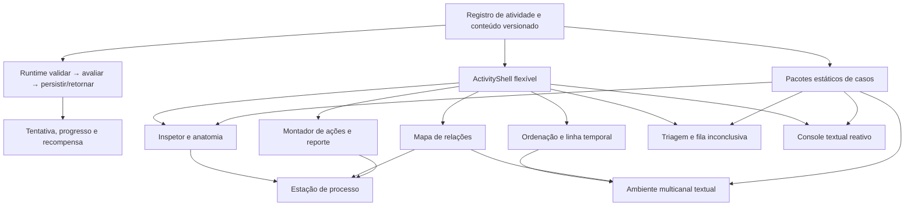

# Componentes compartilhados e fronteiras

> **Estado:** arquitetura aprovada; shell, progresso, erro, registros e runtime básico já existem, enquanto as mecânicas C1–C9 continuam incrementais.
>
> **Princípio:** reutilizar infraestrutura e gramática de interação sem transformar todas as atividades no mesmo questionário com outra cor.

## 1. Visão de dependências

## 2. Catálogo de componentes

| Código documental | Família | Primeira atividade que prova a base | Outras consumidoras principais | Camada |
|---|---|---|---|---|
| C0 | `ActivityShell` e primitivas | **Domínio sob a lupa** v2 | todas | P0 |
| C1 | Inspetor/anatomia de artefato | **Domínio sob a lupa** v2 | Documento, QR, Espelho, OAuth, busca, pagamento | P1 |
| C2 | Ordenação acessível/linha temporal | **A conversa já estava acontecendo** v2 | Cliquei, link, multicanal, pagamento | P1 |
| C3 | Mapa de relações | **Quem enviou de verdade?** v2 | OAuth, código/dispositivo, mensagens, multicanal | P1 |
| C4 | Montador de ações e reporte | **Cliquei. E agora?** v2 | Documento, central, pagamento | P1 |
| C5 | Estação de processo | **Pedido urgente de um gestor** v1 | Pagamento, pedido sem link | P1 |
| C6 | Triagem/fila inconclusiva | **Uma manhã comum** v2 | futuras simulações em lote | P1/P2 |
| C7 | Console de eventos/conversa reativa | **Você iniciou este acesso?** v2 | A central, código/dispositivo | P2 |
| C8 | Ambiente multicanal textual | **Ataque multicanal** v1 | Central de mensagens, futuras variações | P2 |
| C9 | Pacotes estáticos de casos | **Domínio sob a lupa** v2 | todas as atividades com variação | P0/P2 |

## 3. C0 — `ActivityShell`

### Responsabilidade

Controla somente a moldura operacional: metadados, etapa, foco, navegação, revisão, erros, resultado e debrief.

### Entradas conceituais

- definição publicada da atividade e do pacote;
- estado atual `notStarted | inProgress | review | completed | error`;
- modelo de progresso;
- ações de avançar, voltar, revisar, concluir e sair;
- slots de briefing, área de trabalho, transferência, resultado e debrief.

### Não pertence ao shell

- texto e opções do caso;
- layout de inbox, grafo, bancada, console ou estação;
- regra de nota;
- seleção de pacote;
- persistência direta;
- cor ou identidade da área.

### Critério de aceite

Duas mecânicas visualmente diferentes devem compartilhar o shell sem compartilhar a área central. A remoção de estilos de uma mecânica não pode afetar outra.

## 4. C1 — inspetor e anatomia

### Responsabilidade

Representar um artefato fictício por partes nomeadas, permitir inspeção e comparação e registrar o que cada parte comprova ou não comprova.

### Modelo conceitual

- `artifactId` e `artifactType`;
- segmentos com `segmentId`, rótulo, valor textual e descrição;
- referências autorizadas;
- inspeções realizadas;
- comparações e classificação final;
- limite de certeza e rota segura.

### Variações visuais permitidas

- URL segmentada;
- lente de caracteres;
- cabeçalho de mensagem;
- propriedades de arquivo;
- prévia textual de QR;
- escopos de consentimento;
- dados de recebedor.

### Acessibilidade

A representação canônica é uma lista ou tabela textual ordenada. Cor, zoom, sublinhado ou posição são redundantes. Abrir uma explicação não reduz a nota.

### Risco controlado

O componente não oferece um veredito genérico. Cada atividade define qual comparação e qual resposta segura são avaliadas.

## 5. C2 — ordenação e linha temporal

### Responsabilidade

Ordenar eventos, marcar transições e representar precedências sem exigir uma única ordem artificial quando ações puderem ocorrer em paralelo.

### Modelo conceitual

- itens por ID;
- ordem proposta;
- pontos ou eventos marcados;
- relações `before | after | parallel | dependsOn`;
- evidências anexadas;
- estado de certeza por relação.

### Interação

Arrastar pode existir como atalho, nunca como único meio. Botões **Mover para cima**, **Mover para baixo** e **Mover para a posição** são obrigatórios. A posição nova é anunciada e o foco permanece no item movido.

### Avaliação

O avaliador compara dependências críticas e grupos aceitáveis, não necessariamente uma permutação única. Velocidade não participa.

## 6. C3 — mapa de relações

### Responsabilidade

Relacionar fatos como pessoa alegada, conta, endereço, domínio, destino da resposta, dispositivo, sessão, aplicativo, publicador, canal e origem da confirmação.

### Fonte de verdade

Uma tabela ou um conjunto de seletores mantém entidade, relação e nível de certeza. Linhas e nós visuais são uma visualização redundante derivada.

### Modelo conceitual

- entidades allowlisted;
- relações allowlisted;
- certeza `observed | inferred | unproven`;
- justificativa por evidência;
- conflitos e lacunas.

### Limite

O mapa nunca afirma “quem controla” uma conta apenas pelo endereço. Ele distingue fato observado, hipótese e controle não comprovado.

## 7. C4 — montador de ações e reporte

### Responsabilidade

Classificar ações por momento e adequação, preservar dependências e compor um relato útil sem segredos.

### Modelo conceitual

- cartões de ação allowlisted;
- estágio `now | next | guidedOnly | doNotDo`;
- relações críticas entre ações;
- blocos permitidos no reporte;
- campos proibidos;
- revisão textual final.

### Acessibilidade

Botões de categorizar e reordenar, resumo por lista e foco estável. Arraste opcional. O construtor impede seleção de senha, OTP, segredo ou dado real por não oferecer esses valores no contrato.

### Limite

O componente monta uma resposta fictícia; não executa contenção, revogação, contato ou reporte.

## 8. C5 — estação de processo

### Responsabilidade

Permitir consultar fontes fictícias, reconciliar alegação com registro, escolher canal independente, organizar controles e tomar uma decisão proporcional.

### Módulos

- painel da solicitação;
- registro anterior ou referência oficial;
- diretório ou fonte autorizada;
- resposta simulada da confirmação;
- organizador de controles;
- decisão e reporte.

### Reuso

O componente de Equipes **Mudança bancária sem atalho** fornece padrões de fontes progressivas e etapas, mas não deve ser importado como um player inteiro. A estação compartilhada precisa ser individual, configurável e sem contribuição coletiva automática.

### Gate editorial

Procedimentos, alçadas, contatos e exceções são pacotes versionados. Uma política fictícia pode provar a mecânica; política corporativa real exige dono e publicação autorizada.

## 9. C6 — triagem e fila inconclusiva

### Responsabilidade

Tratar lote misto, separar resolvidos de pendências, investigar seletivamente e revisar tudo antes de concluir.

### Estado

- fila de entrada;
- item ativo;
- `pending | investigating | resolved | inconclusive`;
- evidências inspecionadas;
- ação proposta;
- resumo global.

### Feedback

Não revelar correção durante a triagem. O resultado vem depois da revisão global e diferencia falso positivo, falha de investigação e resposta insegura.

### Retomada

Rascunho persistido só será ativado se a duração e o número de itens justificarem. Até lá, o estado pode permanecer na sessão do componente.

## 10. C7 — console textual reativo

### Responsabilidade

Apresentar eventos em sequência e respostas textuais determinadas pelas decisões anteriores.

### Motor mínimo

- máquina de estados finita;
- eventos e opções allowlisted;
- transições determinísticas;
- histórico completo;
- ações oficiais fictícias separadas da conversa;
- finalizações segura, parcial e insegura.

### Limite

Não utiliza IA generativa, mensagem em tempo real, chamada real ou cronômetro. A ramificação existe para dar consequência coerente, não para simular um atacante ilimitado.

## 11. C8 — ambiente multicanal textual

### Responsabilidade

Exibir uma cadeia de e-mail, chat, transcrição, QR descrito, página e registro interno e pedir que a pessoa identifique quais canais dependem da mesma origem.

### Dependências

Requer C2 e C3 estáveis. A primeira versão é textual e inerte. Áudio, vídeo, câmera e evento em tempo real permanecem P3.

### Avaliação

Pontua a escolha de uma âncora independente, a interrupção proporcional e o registro das dependências. Não pontua “detectar voz falsa” ou defeito visual.

## 12. C9 — pacotes estáticos de casos

### Responsabilidade

Separar conteúdo de interface e permitir três percursos iniciais e bancos futuros sem um editor ou geração combinatória.

### Publicação

Cada pacote possui ID, versão da atividade, estado `draft | published | retired` no futuro autoritativo e allowlists imutáveis. Um pacote retirado permanece legível para tentativas históricas, mas não inicia nova tentativa.

### Seleção local

Na demonstração, o pacote pode ser escolhido de forma determinística ou pelo usuário para teste. No uso real, a seleção e a versão pertencem ao servidor.

## 13. Componentes que não serão criados agora

- player genérico que interpreta qualquer JSON;
- editor de atividades;
- motor generativo de casos;
- grafo espacial ou planta física;
- gravação ou análise de áudio/vídeo;
- leitor real de QR ou upload de arquivo;
- integração com diretório, identidade, banco, e-mail ou reporte;
- painel de telemetria ou colaboração em tempo real;
- adaptação específica para celular.

## 14. Gate para promover uma família a compartilhada

Uma abstração só se torna compartilhada quando:

1. a primeira atividade passa em domínio, SSR, navegador e acessibilidade;
2. uma segunda atividade consegue reutilizá-la sem condicionais pelo título da primeira;
3. contrato, conteúdo e visual permanecem separados;
4. o componente possui alternativa textual e por teclado;
5. a extração reduz duplicação mensurável sem esconder regras de avaliação;
6. a ficha e o mapa técnico são atualizados no mesmo lote.

Até esse gate, a implementação pode permanecer local à primeira prova, com API desenhada para extração posterior.
